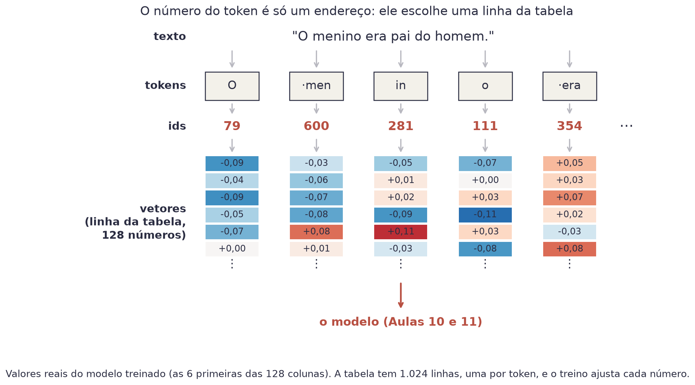

# Aula 9 — Do Texto aos Números


**O que você leva desta aula**

Você vai entender o que um modelo de linguagem faz e escrever o mais
simples de todos, que só conta letras. Vai escrever também o tokenizador
que as próximas três aulas usam.


## Onde estamos

<figure><figcaption>Quatro aulas para construir a máquina inteira. Esta é a primeira peça.</figcaption></figure>

Nestas quatro aulas você constrói um modelo de linguagem do zero, em
PyTorch, e treina no processador do Colab. Cada aula alterna explicações
curtas e exercícios, e cada exercício acrescenta uma peça ao mesmo modelo.
No fim da Aula 12, o modelo é seu: você escreveu cada parte e apertou o
botão do treino.

## O que um LLM faz

Um modelo de linguagem grande faz **uma** coisa: recebe um pedaço de texto
e devolve as probabilidades do que vem em seguida. Só isso. Conversar,
resumir, traduzir e programar são tudo consequência de repetir essa
resposta muitas vezes.

Comece pelo que é fácil de conferir. Aqui estão as continuações de
"minha mãe" nas 90 vezes em que a expressão aparece nos livros de Machado
de Assis:

<figure><figcaption>Nenhuma continuação passa de 9%. A resposta certa não é uma palavra, é uma distribuição.</figcaption></figure>

Repare que não existe resposta certa. Existem 63 continuações diferentes, e
a mais provável aparece em menos de uma vez a cada dez. É por isso que a
saída do modelo é uma **distribuição de probabilidade**, exatamente como a
softmax da Aula 8 produzia para as dez categorias de roupa. Só que aqui as
categorias são todas as continuações possíveis.

## O modelo mais simples: contar

Antes de qualquer rede neural, dá para construir um modelo de linguagem
com uma tabela de contagem. Percorra o livro inteiro e anote, para cada
letra, qual letra veio logo depois dela.

<figure><figcaption>Depois de "q", quase sempre "u". Depois de um espaço, quase qualquer coisa.</figcaption></figure>

A contagem vira probabilidade com uma divisão. A chance de uma letra vir
depois de outra é quantas vezes isso aconteceu, dividido por quantas vezes
a primeira apareceu:

$$P(\text{seguinte} \mid \text{atual}) = \frac{\text{contagem}(\text{atual}, \text{seguinte})}{\text{contagem}(\text{atual})}$$

| Símbolo | Significado |
|---|---|
| `P(seguinte ∣ atual)` | a chance da próxima letra, sabendo qual é a atual (a barra se lê "sabendo que") |
| `contagem(atual, seguinte)` | quantas vezes o par apareceu, nessa ordem, no corpus |
| `contagem(atual)` | quantas vezes a letra atual apareceu |

Exemplo: o "q" aparece 33.847 vezes nos livros de Machado. Em 33.842
delas, a letra seguinte é "u". A chance é 33.842 / 33.847 = 99,99%. O
modelo nunca leu uma regra de ortografia, e achou a regra do "qu" sozinho.

Para **gerar** texto, você sorteia a próxima letra com essas chances, cola
no fim e repete. É o Exercício 1 da aula, e o resultado é este:

```
A ou ntilemuerinãocuma ganto a me l Ansisbo erdo ostrunes m ansamenerelhasaqus
```

Parece português visto de longe: letras frequentes, espaços no lugar, um
"ão" aqui e ali. De perto, não tem uma palavra. O defeito é óbvio: o
modelo só olha **uma** letra para trás.

## Por que contar não escala

A correção parece simples: olhar mais letras para trás. O problema é o
tamanho da tabela. Cada letra a mais de contexto multiplica o número de
linhas por 118, que é a quantidade de caracteres diferentes no corpus.

| Olhando para trás | Linhas na tabela | Quantas o corpus já mostrou |
|---|---|---|
| 1 letra | 118 | todas |
| 3 letras | 1,6 milhão | uma fração pequena |
| 10 letras | 5 × 10²⁰ | quase nenhuma |

Com dez letras de contexto, quase toda combinação que o modelo encontrar é
nova, e a tabela não tem nada a dizer sobre ela. Contar não generaliza:
"o gato dorme" e "o cão dorme" são linhas diferentes, sem nada em comum.

Uma rede neural resolve isso. Ela troca a tabela por pesos que vários
contextos parecidos dividem, então o que ela aprende num contexto vale
para os vizinhos. As próximas três aulas constroem essa rede.

## O material da obra

O modelo que você vai construir é pequeno (787.584 pesos, contra centenas
de bilhões dos modelos comerciais) e treina no processador, sem placa de
vídeo.

O texto que ele vai ler é toda a prosa de Machado de Assis: onze obras,
3.676.878 caracteres, 623.120 palavras. Está em domínio público, e o
arquivo mora em `data/machado.txt`.


**O detalhe que vai voltar em todas as aulas**

Esses livros são de 1880 a 1908, com a grafia da época: "elle", "cousa",
"difficil", "pharmacia". O modelo vai aprender a escrever assim, porque é
o que ele viu. Guarde essa observação. Ela é a coisa mais importante que
este curso tem a dizer sobre modelos de linguagem.


## Limpar o texto, sem estragar o texto

Quem já viu processamento de texto antigo espera uma faxina antes de
tudo: passar para minúsculas, tirar acentos e pontuação, apagar as
palavras muito comuns ("de", "a", "que") e cortar cada palavra no radical
("casamento", "casado" e "casar" viram `cas`). Fazia sentido quando o
objetivo era classificar um texto contando palavras, como nos modelos de
saco de palavras: a maiúscula e a vírgula só atrapalhavam a contagem.

Um modelo de linguagem não faz nada disso, porque ele precisa **escrever**.
Se nunca vir uma vírgula, não sabe onde pôr uma. Se tudo estiver em
minúsculas, não sabe que frase começa com maiúscula, nem que "Capitu" é
um nome. As palavras comuns são justamente as que mais aparecem no texto
que ele vai gerar. A regra de hoje é: **tirar o que não é texto, nunca o
que é**.

O que se tira, então? Nos modelos grandes, que leem bilhões de páginas da
internet, a limpeza é pesada, mas é limpeza de lixo:

| O que sai | Por quê |
|---|---|
| menus, propaganda, código de página, rodapés | não é texto escrito por alguém para ser lido |
| páginas repetidas | o modelo decoraria o que aparece mil vezes |
| texto de baixa qualidade ou em outra língua | ensina o que não se quer |
| dados pessoais (e-mails, telefones) | o modelo poderia repetir |

Com os livros de Machado, o trabalho foi pequeno. O script
`data/scripts/baixar_machado.py` faz cinco coisas:

1. Tira o cabeçalho e o rodapé em inglês que o Project Gutenberg cola em
   todo livro (licença, créditos).
2. **Normaliza o Unicode**. Existem dois jeitos de guardar o "ã" no
   computador: uma letra só, ou um "a" seguido de um til solto. Na tela
   são iguais, mas para o tokenizador seriam peças diferentes. A
   normalização (chamada NFC) escolhe sempre o primeiro jeito.
3. Troca aspas curvas (“ ”) e travessões tipográficos pelas versões
   simples (`"` e `--`). Significam a mesma coisa, e não vale gastar
   vocabulário com variantes.
4. Tira o sublinhado (`_assim_`) que o Gutenberg usa para marcar itálico.
5. Tira os espaços no fim das linhas e as linhas em branco repetidas.

Maiúsculas, acentos, pontuação, quebras de parágrafo e a grafia de 1900
ficaram exatamente como estavam.

## A unidade errada, duas vezes

Antes de qualquer conta, uma decisão: qual é a peça mínima que o modelo
manipula?

<figure><figcaption>A mesma frase, cortada de três jeitos. O ponto médio marca um espaço dentro da peça.</figcaption></figure>

**Palavra inteira** parece o óbvio, e não funciona. O corpus tem 50.390
palavras diferentes, e essa é só a contagem de Machado. Pior: na primeira
palavra que o modelo nunca viu, ele não tem entrada nenhuma para usar.
Nomes próprios, erros de digitação e palavras novas quebram tudo.

**Letra** resolve o vocabulário: são 118 caracteres diferentes, e nada
fica de fora. Mas a frase acima vira 26 peças em vez de 7. Como o custo do
modelo cresce com o número de peças, você paga quase quatro vezes mais
para dizer a mesma coisa.

## O meio-termo: BPE

A solução usada por todos os modelos modernos se chama **codificação por
pares de bytes** (*byte pair encoding*, ou BPE). A regra cabe em uma frase:

> Encontre o par de peças vizinhas mais comum no texto, junte as duas numa
> peça nova, e repita.

Faça à mão, com o texto `banana banana banana`:

| Passo | Par mais comum | Como cada `banana` fica |
|---|---|---|
| 0 | | `b` `a` `n` `a` `n` `a` |
| 1 | `a`+`n`, 6 vezes | `b` `an` `an` `a` |
| 2 | `b`+`an`, 3 vezes | `ban` `an` `a` |
| 3 | `ban`+`an`, 3 vezes | `banan` `a` |

Em três passos, `banana` saiu de seis peças para duas. Nenhum linguista
escolheu essas peças: elas saíram da contagem.

Num texto minúsculo como esse, vários pares empatam (`na` também aparece 6
vezes no passo 1) e o programa desempata por uma regra fixa. Em texto de
verdade o empate no topo quase nunca acontece.

Veja o BPE trabalhando, devagar, em outra frase:

<figure><video src="../assets/aula-09/bpe.mp4" poster="../assets/aula-09/bpe.jpg" controls preload="none" playsinline aria-label="Animação do BPE sobre a frase casa casada casamento"></video><figcaption>"casa casada casamento": quatro rodadas de contar, escolher e fundir. As peças "ca", "cas", "casa" e "·casa" saem da contagem, e 21 peças viram 10.</figcaption></figure>

No computador, cada passo da tabela são três linhas: contar os pares
vizinhos, achar o mais comum, e trocar cada ocorrência dele por um número
novo. O treino repete as três:

```python
for novo in [256, 257, 258]:
    pares = contar_pares(ids)          # conta os pares vizinhos
    par = par_mais_comum(pares)        # acha o mais comum
    ids = fundir(ids, par, novo)       # troca o par pelo número novo
```

Rodando isso no corpus inteiro até chegar a 1.024 peças, é isto o que sai:

<figure><figcaption>As primeiras fusões são pedaços de duas letras. As últimas já são palavras inteiras.</figcaption></figure>

Leia as três colunas na ordem. No começo o algoritmo junta o que é comum
em qualquer texto em português (`ra`, `os`, `qu`). No meio já aparece a
grafia da época (`·dous`). No fim sobrou espaço para palavras inteiras que
Machado usa muito (`fazer`, `sei`, `filha`). O vocabulário é um retrato do
corpus.

## Bytes, para nada ficar de fora

Um detalhe que parece técnico e não é. O BPE não começa das letras: começa
dos **bytes**. Todo texto do mundo, em qualquer língua, é uma sequência de
bytes, e existem exatamente 256 valores possíveis.

A consequência: o vocabulário inicial tem 256 peças e cobre tudo. O
modelo nunca encontra um caractere que ele não saiba representar. Um
emoji, um ideograma chinês ou um nome próprio esquisito viram vários
bytes, e o modelo processa sem reclamar.

| Texto | Bytes em UTF-8 | Quantos |
|---|---|---|
| `a` | 97 | 1 |
| `ã` | 195, 163 | 2 |
| `🙂` | 240, 159, 153, 130 | 4 |

Um efeito colateral divertido: como o `ã` ocupa dois bytes, no começo do
treino ele é duas peças. Uma das primeiras fusões junta as duas. O
algoritmo aprendeu a letra `ã` sozinho, contando.

$$\text{vocabulário} = 256 \text{ bytes} + 768 \text{ fusões} = 1024$$

| Símbolo | Significado |
|---|---|
| 256 | os valores possíveis de um byte, a base de tudo |
| 768 | quantas vezes você mandou juntar o par mais comum |
| 1024 | o tamanho final da tabela, escolhido por você |

Exemplo: com 768 fusões, o corpus de 3.676.878 caracteres vira 1.484.827
tokens. São 2,48 caracteres por token.

## Antes de juntar, separar as palavras

Se você rodar o BPE direto sobre o texto corrido, ele aprende peças que
atravessam a pontuação. No exercício da aula, com um trecho de Machado,
as primeiras fusões saem assim: `e·`, `a·`, `o·`, `,·`, e logo depois
`o,·`, que junta o fim de uma palavra, a vírgula e o espaço.

Isso desperdiça vocabulário. "dele." e "dele," viram peças diferentes, sem
nada em comum. Por isso o tokenizador oficial corta o texto em palavras
**antes** de fundir: cada palavra com o espaço da frente, cada número,
cada sinal de pontuação, separados. As fusões só acontecem dentro de um
pedaço.

O corte é feito por uma expressão regular, guardada junto com a tabela de
fusões no arquivo `machado_bpe.json`. É por isso que, na figura das três
unidades, o espaço aparece grudado no **começo** das palavras (`·men`,
`·era`).

## Codificar e decodificar

Com a tabela pronta, converter texto em números é mecânico:

```python
tokens = codificar("O menino era pai do homem.")
# [79, 600, 281, 111, 354, 405, 105, 319, 724, 46]

decodificar(tokens)
# 'O menino era pai do homem.'
```

**Decodificar** é o caminho fácil: cada número vira os bytes dele, e os
bytes juntos viram texto.

**Codificar** tem uma regra que importa. Dentro de cada palavra, você
aplica as fusões **na ordem em que o treino aprendeu cada uma**: das
fusões possíveis, sempre a de número menor. É essa ordem que garante que a mesma
palavra seja cortada do mesmo jeito que o modelo viu no treino.

Uma regra que não tem exceção: **codificar e decodificar têm que usar a
mesma tabela de fusões**. Se você treinar o modelo com uma tabela e usar
outra na hora de conversar com ele, os números vão significar outra coisa,
e a saída vira lixo.

<figure><figcaption>O BPE fica no meio de propósito: poucas peças e vocabulário pequeno, ao mesmo tempo.</figcaption></figure>

Os dois gráficos contam a mesma escolha por dois lados. Por letra, o
vocabulário é minúsculo mas o texto fica longo. Por palavra, o texto fica
curto mas o vocabulário explode. O BPE não vence em nenhum dos dois, e é
aceitável nos dois.

## O tokenizador também tem sotaque

Como as fusões saem da contagem, o tokenizador fica bom no texto que ele
leu e ruim no resto. O de Machado corta assim:

| Palavra | Tokens | Como ficou |
|---|---|---|
| `·elle` | 1 | `·elle` |
| `·ele` | 2 | `·e` `le` |
| `·cousa` | 1 | `·cousa` |
| `·internet` | 4 | `·inter` `n` `e` `t` |
| `·smartphone` | 7 | `·s` `mar` `t` `p` `ho` `n` `e` |

A grafia de 1899 sai barata, e a de hoje sai cara. Isso acontece com os
modelos comerciais também: o tokenizador deles aprendeu com muito mais
texto em inglês que em português, então a mesma frase em português costuma
gastar mais tokens. Mais tokens querem dizer resposta mais cara e menos
texto cabendo na janela.

## Depois do número, um vetor

Os tokens viraram números, mas o modelo não usa esses números como
quantidades. Se usasse, ele acharia que `·men` (600) vale quase oito
vezes `O` (79), o que não quer dizer nada: os números são só a ordem em
que o BPE criou cada peça.

O número é um **endereço**. O modelo guarda uma tabela com uma linha por
token (1.024 linhas) e 128 colunas. Cada token é trocado pela sua linha,
uma lista de 128 números chamada **embutimento** do token (em inglês,
*embedding*). É esse vetor que entra no modelo.

<figure><figcaption>Texto, tokens, ids e vetores. Os valores são do modelo treinado: as 6 primeiras das 128 colunas de cada linha.</figcaption></figure>

No começo do treino a tabela é sorteada, e os vetores não significam
nada. O treino ajusta cada número dela, como ajusta qualquer outro peso.
No fim, tokens que aparecem em lugares parecidos acabam com vetores
parecidos. No modelo treinado da disciplina, o vetor mais parecido com o
de `·elle` é o de `·ella`; o de `·dous` é o de `·tres`; o de `·era` é o
de `·foi`. Ninguém ensinou gramática ao modelo: ele achou sozinho que
essas palavras fazem o mesmo papel. Você monta essa tabela na Aula 10,
com uma linha de PyTorch.

O caminho inteiro, então, é este:

```
texto  →  tokens  →  ids  →  vetores (embutimentos)  →  modelo
```

Esta aula cuida das três primeiras setas.


**Erro do dia**

Treinar o tokenizador de novo antes de usar o modelo. Cada treino de BPE
pode sair com uma tabela diferente (basta um corpus um pouco diferente, ou
outra regra de desempate). O tokenizador é parte do modelo: salve os dois
juntos, sempre. Nesta disciplina, o arquivo é `data/machado_bpe.json`, o
mesmo da Aula 9 à Aula 12.


## Cola da aula

| Conceito | Em uma frase |
|---|---|
| Modelo de linguagem | recebe texto e devolve as chances de cada próximo token |
| Modelo de contagem | conta o que vem depois de cada símbolo; não escala para contexto longo |
| Limpeza do texto | tira o que não é texto; maiúsculas, acentos e pontuação ficam |
| Token | a peça mínima que o modelo manipula |
| BPE | funde o par vizinho mais comum, e repete |
| Bytes | a base do vocabulário: 256 peças que cobrem qualquer texto |
| Vocabulário | 256 bytes + 768 fusões = 1.024 tokens |
| Separar antes de fundir | as fusões ficam dentro das palavras |
| Codificar | aplica as fusões na ordem em que o treino aprendeu |
| Tabela de fusões | a mesma no treino e no uso, sempre |
| Embutimento (*embedding*) | a linha da tabela que o id escolhe: o vetor que entra no modelo |

## Materiais

- **Notebook desta aula, no Google Colab:** [](https://colab.research.google.com/github/klein-natan/nanodegree-AI-Atitus/blob/main/notebooks/aula-09-do-texto-aos-numeros.ipynb)
- **Quiz de cada microaula:** [no fim desta página](#quizzes-das-microaulas), 5 perguntas depois de cada explicação, antes do exercício.
- **Travou num exercício?** [Colas dos exercícios](colas-dos-exercicios.md#aula-9-do-texto-aos-numeros), com dicas que você abre uma de cada vez.
- Slides desta aula: entregues em sala.
- Corpus: [`machado.txt`](https://github.com/klein-natan/nanodegree-AI-Atitus/blob/main/data/machado.txt)
- Tokenizador pronto: [`machado_bpe.json`](https://github.com/klein-natan/nanodegree-AI-Atitus/blob/main/data/machado_bpe.json)

Os três exercícios do notebook:

| Exercício | O que você constrói |
|---|---|
| 9.1 | o modelo de contagem, que já gera texto |
| 9.2 | o texto como ele chega ao tokenizador, o BPE no computador (a tabela do "banana") e as primeiras fusões em Machado |
| 9.3 | codificar e decodificar frases com o tokenizador oficial, e o primeiro passo de número para vetor |

## Para ir além

- [Tiktokenizer](https://tiktokenizer.vercel.app/): cole qualquer texto e veja como o tokenizador do GPT o corta, token por token. Compare uma frase em português e a mesma em inglês.
- [Let's build the GPT Tokenizer (Andrej Karpathy)](https://www.youtube.com/watch?v=zduSFxRajkE): duas horas construindo o mesmo BPE desta aula, com todos os detalhes que ficaram de fora. Em inglês.
- [Build a Large Language Model (From Scratch)](https://www.manning.com/books/build-a-large-language-model-from-scratch): o livro que inspirou a ordem destas aulas. Constrói um GPT em PyTorch, peça por peça, em inglês.

## Quizzes das microaulas

Depois de cada microaula, e antes do exercício no Colab, responda o quiz
dela. As perguntas aparecem uma de cada vez, como uma pilha de cartas:
responda, leia a explicação e passe para a próxima. No fim aparece quantas
você acertou. Nada fica gravado: dá para refazer quantas vezes quiser.

### Microaula 1: o que um LLM faz



```quiz
O que um modelo de linguagem devolve quando recebe um pedaço de texto?
- A próxima palavra certa, uma só.
- Um resumo do texto.
+ As chances de cada token que pode vir em seguida.
- A tradução do texto para números, e mais nada.
? Ele devolve uma distribuição de probabilidade sobre o próximo token. Conversar, resumir e traduzir vêm de repetir essa previsão muitas vezes.
```

```quiz
Nos livros de Machado, a continuação mais comum de "minha mãe" aparece em 9% das vezes. O que isso mostra?
+ Que não existe uma resposta certa: existe uma distribuição de chances.
- Que o modelo ainda não foi treinado.
- Que Machado escrevia de um jeito errado.
- Que 9% é a resposta certa, e o resto é erro.
? Existem 63 continuações diferentes, e nenhuma domina. Por isso a saída do modelo é uma distribuição, como a softmax da Aula 8.
```

```quiz
No modelo de contagem, como se calcula a chance de vir "u" depois de "q"?
- Contando quantas vezes o "u" aparece no livro inteiro.
- Dividindo 1 pelo número de letras do alfabeto.
- Somando as vezes que "q" e "u" aparecem.
+ Dividindo as vezes que "u" veio depois de "q" pelo total de letras que vieram depois de "q".
? É a contagem do par dividida pela contagem da letra atual: 33.842 / 33.847, ou 99,99%.
```

```quiz
O texto gerado pelo modelo de contagem de letras tem letras e espaços nos lugares certos, mas quase nenhuma palavra existe. Por quê?
- Porque o corpus de Machado é pequeno demais.
+ Porque ele só olha uma letra para trás.
- Porque o sorteio está errado.
- Porque ele não sabe o que é um espaço.
? Para formar palavras e frases, o modelo precisaria lembrar do que veio bem antes. Com uma letra só de contexto, cada escolha ignora todo o resto.
```

```quiz
Por que não dá para simplesmente contar com 10 letras de contexto em vez de uma?
- Porque o computador não aguenta contar até 10.
- Porque a contagem de 10 letras dá sempre o mesmo resultado.
- Porque a regra do "qu" deixa de valer.
+ Porque a tabela fica gigante e quase toda combinação de 10 letras nunca apareceu no corpus.
? Cada letra a mais multiplica a tabela por 118. Com 10 letras são 5 × 10²⁰ linhas, quase todas vazias. Uma rede neural resolve isso porque contextos parecidos dividem os mesmos pesos.
```



### Microaula 2: a unidade certa



```quiz
Qual é o problema de usar a palavra inteira como peça do modelo?
- O texto fica longo demais.
+ O vocabulário fica enorme, e uma palavra nova não tem entrada nenhuma.
- As palavras não cabem em bytes.
- O modelo não consegue contar palavras.
? Só Machado tem 50.390 palavras diferentes. E uma palavra que o modelo nunca viu (um nome, um erro de digitação) não tem número nenhum.
```

```quiz
E qual é o problema de usar a letra como peça?
- Existem letras demais no português.
- As letras não têm número.
- O modelo não sabe juntar letras.
+ O texto vira uma fila muito longa, e o custo cresce com o número de peças.
? Com 118 símbolos nada fica de fora, mas "O menino era pai do homem." vira 26 peças em vez de 7. O modelo paga quase quatro vezes mais para dizer a mesma coisa.
```

```quiz
Qual é a regra do BPE?
+ Encontre o par de peças vizinhas mais comum, junte as duas numa peça nova, e repita.
- Corte o texto sempre de três em três letras.
- Junte as palavras que um linguista marcou como importantes.
- Separe o texto nas sílabas de cada palavra.
? É a regra inteira, e ela cabe numa frase. Ninguém escolhe as peças: elas saem da contagem.
```

```quiz
Antes de treinar um modelo de linguagem, o que se faz com as maiúsculas, os acentos e a pontuação do texto?
- Passa tudo para minúsculas e tira os acentos, para o vocabulário ficar menor.
- Tira a pontuação, porque ela não carrega significado.
+ Deixa como está: o modelo vai ter que escrever tudo isso, então precisa ver tudo isso.
- Tira as palavras mais comuns, como "de" e "que".
? A faxina pesada é do processamento de texto antigo, feito para classificar. Um LLM escreve, então só sai o que não é texto (cabeçalhos, menus, cópias repetidas). Nos livros de Machado, maiúsculas, acentos e pontuação ficaram intactos.
```

```quiz
As últimas fusões do tokenizador de Machado são palavras inteiras, como "·fazer" e "·filha". O que isso diz?
- Que o algoritmo errou no fim.
- Que essas palavras são raras.
- Que o tokenizador foi feito à mão.
+ Que o vocabulário é um retrato do corpus: o que Machado usa muito vira peça.
? As primeiras fusões são pedaços comuns em qualquer português ("ra", "qu"). As últimas já são palavras frequentes nos livros. Treinado em outro texto, o vocabulário seria outro.
```



### Microaula 3: do texto aos números, e de volta



```quiz
Por que o BPE começa dos bytes, e não das letras?
- Porque bytes são mais rápidos de digitar.
+ Porque qualquer texto, em qualquer língua, é uma fila de bytes: nenhum caractere fica de fora.
- Porque o português não tem letras suficientes.
- Porque os bytes já vêm agrupados em palavras.
? Um byte tem 256 valores possíveis. Um emoji ou um ideograma vira vários bytes, e o modelo nunca encontra um símbolo que não saiba escrever.
```

```quiz
Dentro do modelo, o que acontece com o número de cada token, como o 600 de "·men"?
- Ele entra no modelo como está, e 600 vale mais que 79.
+ Ele é um endereço: escolhe uma linha de uma tabela, o embutimento, e é essa lista de números que entra no modelo.
- Ele é dividido por 1.024, para virar uma chance.
- Ele é trocado de volta pelas letras antes de entrar no modelo.
? O número é só a ordem em que o BPE criou a peça. Cada token vira uma linha de 128 números, que o treino ajusta. No fim, tokens que aparecem em lugares parecidos ganham linhas parecidas, como "·elle" e "·ella".
```

```quiz
Por que o tokenizador oficial separa o texto em palavras antes de fundir?
- Para o texto ficar mais longo.
- Porque o BPE só funciona com uma palavra de cada vez.
- Para tirar a pontuação do texto.
+ Para nenhuma fusão atravessar o espaço ou a pontuação, e "dele." e "dele," dividirem a mesma peça.
? Sem essa separação, o BPE aprende peças como "o,·", que juntam fim de palavra, vírgula e espaço, e desperdiçam vocabulário.
```

```quiz
Ao codificar uma palavra, em que ordem as fusões são aplicadas?
+ Na ordem em que o treino aprendeu: sempre a de número menor primeiro.
- Da maior peça para a menor.
- Em ordem alfabética.
- Na ordem em que as letras aparecem na palavra.
? É essa ordem que faz a mesma palavra ser cortada do mesmo jeito que o modelo viu no treino.
```

```quiz
O que acontece se você treinar o modelo com uma tabela de fusões e usar outra na hora de conversar com ele?
- Nada: os números são os mesmos.
- O modelo fica mais rápido.
+ Os números passam a significar outra coisa, e a saída vira lixo.
- O modelo aprende a tabela nova sozinho.
? É o erro do dia. O tokenizador é parte do modelo: os dois andam juntos, sempre. Por isso o notebook carrega a tabela oficial em vez de treinar uma nova.
```


