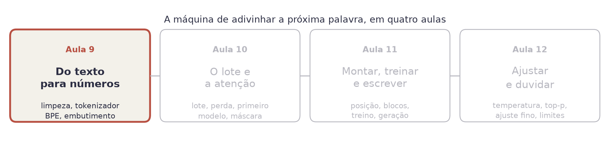
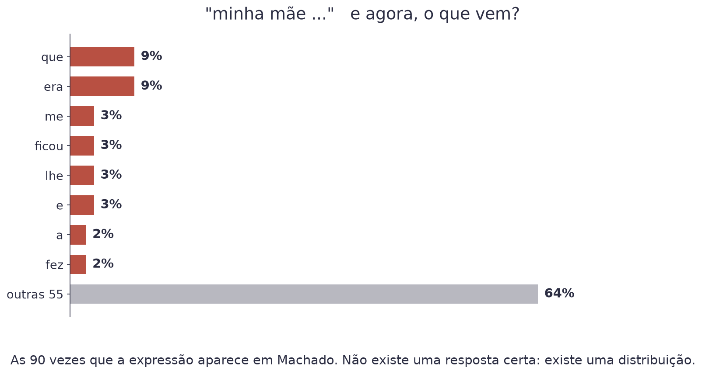
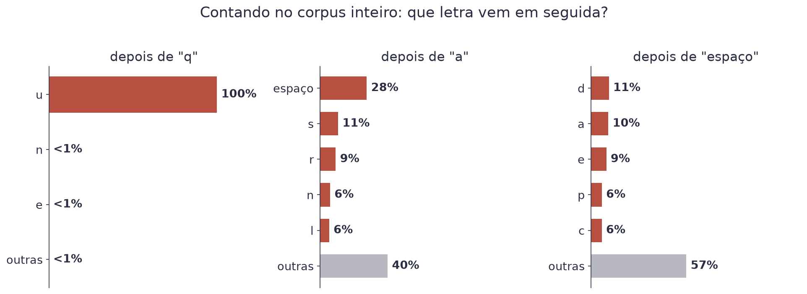
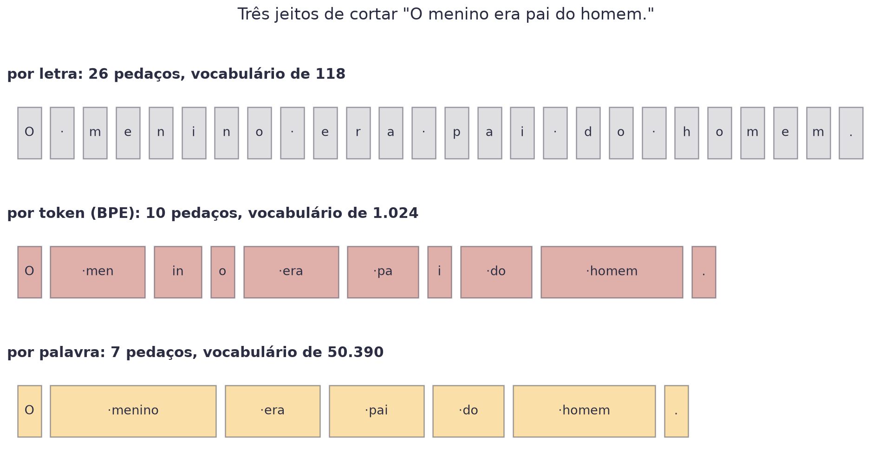
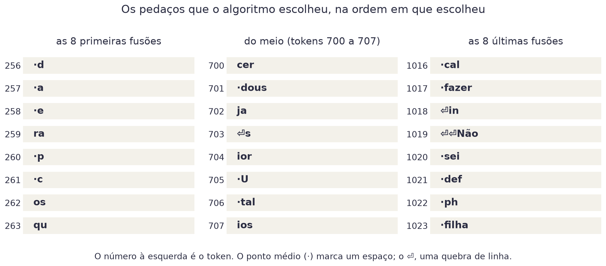
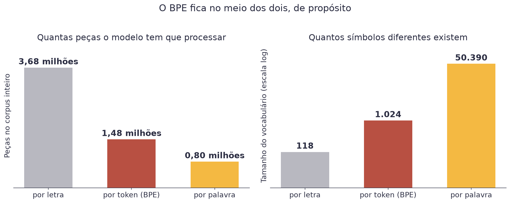
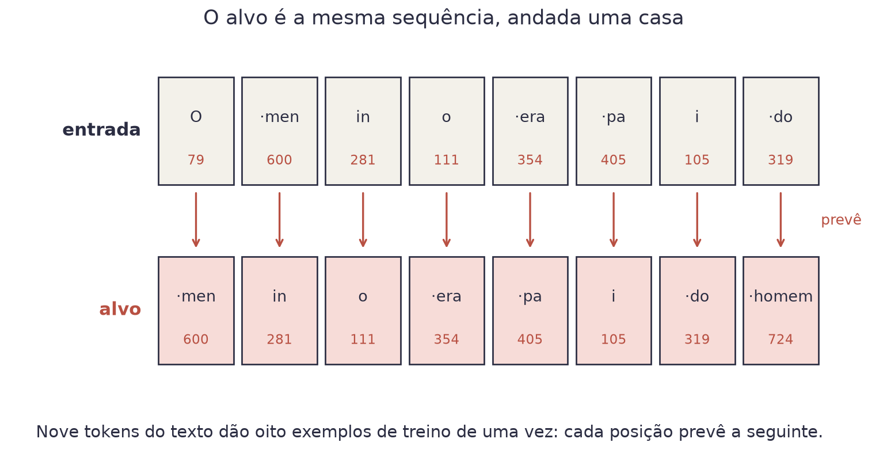

# Aula 9 — Do Texto aos Números


**O que você leva desta aula**

Você vai entender o que um modelo de linguagem faz e escrever o mais
simples de todos, que só conta letras. Vai escrever também o tokenizador
que as próximas três aulas usam. E vai sair com um número que o seu
transformer, na Aula 11, vai ter que bater.


## Onde estamos

<figure><figcaption>Quatro aulas para construir a máquina inteira. Esta é a primeira peça.</figcaption></figure>

Nestas quatro aulas você constrói um modelo de linguagem do zero, em
PyTorch, e treina no processador do Colab. Cada aula alterna explicações
curtas e exercícios, e cada exercício acrescenta uma peça ao mesmo modelo.
No fim da Aula 12, o modelo é seu: você escreveu cada parte e apertou o
botão do treino.

## O que um LLM faz

Um modelo de linguagem grande faz **uma** coisa: recebe um pedaço de texto
e devolve as probabilidades do que vem em seguida. Só isso. Conversar,
resumir, traduzir e programar são tudo consequência de repetir essa
resposta muitas vezes.

Comece pelo que é fácil de conferir. Aqui estão as continuações de
"minha mãe" nas 90 vezes em que a expressão aparece nos livros de Machado
de Assis:

<figure><figcaption>Nenhuma continuação passa de 9%. A resposta certa não é uma palavra, é uma distribuição.</figcaption></figure>

Repare que não existe resposta certa. Existem 63 continuações diferentes, e
a mais provável aparece em menos de uma vez a cada dez. É por isso que a
saída do modelo é uma **distribuição de probabilidade**, exatamente como a
softmax da Aula 8 produzia para as dez categorias de roupa. Só que aqui as
categorias são todas as continuações possíveis.

## O modelo mais simples: contar

Antes de qualquer rede neural, dá para construir um modelo de linguagem
com uma tabela de contagem. Percorra o livro inteiro e anote, para cada
letra, qual letra veio logo depois dela.

<figure><figcaption>Depois de "q", quase sempre "u". Depois de um espaço, quase qualquer coisa.</figcaption></figure>

A contagem vira probabilidade com uma divisão. A chance de uma letra vir
depois de outra é quantas vezes isso aconteceu, dividido por quantas vezes
a primeira apareceu:

$$P(\text{seguinte} \mid \text{atual}) = \frac{\text{contagem}(\text{atual}, \text{seguinte})}{\text{contagem}(\text{atual})}$$

| Símbolo | Significado |
|---|---|
| `P(seguinte ∣ atual)` | a chance da próxima letra, sabendo qual é a atual (a barra se lê "sabendo que") |
| `contagem(atual, seguinte)` | quantas vezes o par apareceu, nessa ordem, no corpus |
| `contagem(atual)` | quantas vezes a letra atual apareceu |

Exemplo: o "q" aparece 33.847 vezes nos livros de Machado. Em 33.842
delas, a letra seguinte é "u". A chance é 33.842 / 33.847 = 99,99%. O
modelo nunca leu uma regra de ortografia, e achou a regra do "qu" sozinho.

Para **gerar** texto, você sorteia a próxima letra com essas chances, cola
no fim e repete. É o Exercício 1 da aula, e o resultado é este:

```
A ou ntilemuerinãocuma ganto a me l Ansisbo erdo ostrunes m ansamenerelhasaqus
```

Parece português visto de longe: letras frequentes, espaços no lugar, um
"ão" aqui e ali. De perto, não tem uma palavra. O defeito é óbvio: o
modelo só olha **uma** letra para trás.

## Por que contar não escala

A correção parece simples: olhar mais letras para trás. O problema é o
tamanho da tabela. Cada letra a mais de contexto multiplica o número de
linhas por 118, que é a quantidade de caracteres diferentes no corpus.

| Olhando para trás | Linhas na tabela | Quantas o corpus já mostrou |
|---|---|---|
| 1 letra | 118 | todas |
| 3 letras | 1,6 milhão | uma fração pequena |
| 10 letras | 5 × 10²⁰ | quase nenhuma |

Com dez letras de contexto, quase toda combinação que o modelo encontrar é
nova, e a tabela não tem nada a dizer sobre ela. Contar não generaliza:
"o gato dorme" e "o cão dorme" são linhas diferentes, sem nada em comum.

Uma rede neural resolve isso. Ela troca a tabela por pesos que vários
contextos parecidos dividem, então o que ela aprende num contexto vale
para os vizinhos. As próximas três aulas constroem essa rede.

## O material da obra

O modelo que você vai construir é pequeno (787.584 pesos, contra centenas
de bilhões dos modelos comerciais) e treina no processador, sem placa de
vídeo.

O texto que ele vai ler é toda a prosa de Machado de Assis: onze obras,
3.676.878 caracteres, 623.120 palavras. Está em domínio público, e o
arquivo mora em `data/machado.txt`.


**O detalhe que vai voltar em todas as aulas**

Esses livros são de 1880 a 1908, com a grafia da época: "elle", "cousa",
"difficil", "pharmacia". O modelo vai aprender a escrever assim, porque é
o que ele viu. Guarde essa observação. Ela é a coisa mais importante que
este curso tem a dizer sobre modelos de linguagem.


## A unidade errada, duas vezes

Antes de qualquer conta, uma decisão: qual é a peça mínima que o modelo
manipula?

<figure><figcaption>A mesma frase, cortada de três jeitos. O ponto médio marca um espaço dentro da peça.</figcaption></figure>

**Palavra inteira** parece o óbvio, e não funciona. O corpus tem 50.390
palavras diferentes, e essa é só a contagem de Machado. Pior: na primeira
palavra que o modelo nunca viu, ele não tem entrada nenhuma para usar.
Nomes próprios, erros de digitação e palavras novas quebram tudo.

**Letra** resolve o vocabulário: são 118 caracteres diferentes, e nada
fica de fora. Mas a frase acima vira 26 peças em vez de 7. Como o custo do
modelo cresce com o número de peças, você paga quase quatro vezes mais
para dizer a mesma coisa.

## O meio-termo: BPE

A solução usada por todos os modelos modernos se chama **codificação por
pares de bytes** (*byte pair encoding*, ou BPE). A regra cabe em uma frase:

> Encontre o par de peças vizinhas mais comum no texto, junte as duas numa
> peça nova, e repita.

Faça à mão, com o texto `banana banana banana`:

| Passo | Par mais comum | Como cada `banana` fica |
|---|---|---|
| 0 | | `b` `a` `n` `a` `n` `a` |
| 1 | `a`+`n`, 6 vezes | `b` `an` `an` `a` |
| 2 | `b`+`an`, 3 vezes | `ban` `an` `a` |
| 3 | `ban`+`an`, 3 vezes | `banan` `a` |

Em três passos, `banana` saiu de seis peças para duas. Nenhum linguista
escolheu essas peças: elas saíram da contagem.

Num texto minúsculo como esse, vários pares empatam (`na` também aparece 6
vezes no passo 1) e o programa desempata por uma regra fixa. Em texto de
verdade o empate no topo quase nunca acontece.

Veja o BPE trabalhando, devagar, em outra frase:

<figure><video src="../assets/aula-09/bpe.mp4" poster="../assets/aula-09/bpe.jpg" controls preload="none" playsinline aria-label="Animação do BPE sobre a frase casa casada casamento"></video><figcaption>"casa casada casamento": quatro rodadas de contar, escolher e fundir. As peças "ca", "cas", "casa" e "·casa" saem da contagem, e 21 peças viram 10.</figcaption></figure>

No computador, cada passo da tabela são três linhas: contar os pares
vizinhos, achar o mais comum, e trocar cada ocorrência dele por um número
novo. O treino repete as três:

```python
for novo in [256, 257, 258]:
    pares = contar_pares(ids)          # conta os pares vizinhos
    par = par_mais_comum(pares)        # acha o mais comum
    ids = fundir(ids, par, novo)       # troca o par pelo número novo
```

Rodando isso no corpus inteiro até chegar a 1.024 peças, é isto o que sai:

<figure><figcaption>As primeiras fusões são pedaços de duas letras. As últimas já são palavras inteiras.</figcaption></figure>

Leia as três colunas na ordem. No começo o algoritmo junta o que é comum
em qualquer texto em português (`ra`, `os`, `qu`). No meio já aparece a
grafia da época (`·dous`). No fim sobrou espaço para palavras inteiras que
Machado usa muito (`fazer`, `sei`, `filha`). O vocabulário é um retrato do
corpus.

## Bytes, para nada ficar de fora

Um detalhe que parece técnico e não é. O BPE não começa das letras: começa
dos **bytes**. Todo texto do mundo, em qualquer língua, é uma sequência de
bytes, e existem exatamente 256 valores possíveis.

A consequência: o vocabulário inicial tem 256 peças e cobre tudo. O
modelo nunca encontra um caractere que ele não saiba representar. Um
emoji, um ideograma chinês ou um nome próprio esquisito viram vários
bytes, e o modelo processa sem reclamar.

| Texto | Bytes em UTF-8 | Quantos |
|---|---|---|
| `a` | 97 | 1 |
| `ã` | 195, 163 | 2 |
| `🙂` | 240, 159, 153, 130 | 4 |

Um efeito colateral divertido: como o `ã` ocupa dois bytes, no começo do
treino ele é duas peças. Uma das primeiras fusões junta as duas. O
algoritmo aprendeu a letra `ã` sozinho, contando.

$$\text{vocabulário} = 256 \text{ bytes} + 768 \text{ fusões} = 1024$$

| Símbolo | Significado |
|---|---|
| 256 | os valores possíveis de um byte, a base de tudo |
| 768 | quantas vezes você mandou juntar o par mais comum |
| 1024 | o tamanho final da tabela, escolhido por você |

Exemplo: com 768 fusões, o corpus de 3.676.878 caracteres vira 1.484.827
tokens. São 2,48 caracteres por token.

## Antes de juntar, separar as palavras

Se você rodar o BPE direto sobre o texto corrido, ele aprende peças que
atravessam a pontuação. No exercício da aula, com um trecho de Machado,
as primeiras fusões saem assim: `e·`, `a·`, `o·`, `,·`, e logo depois
`o,·`, que junta o fim de uma palavra, a vírgula e o espaço.

Isso desperdiça vocabulário. "dele." e "dele," viram peças diferentes, sem
nada em comum. Por isso o tokenizador oficial corta o texto em palavras
**antes** de fundir: cada palavra com o espaço da frente, cada número,
cada sinal de pontuação, separados. As fusões só acontecem dentro de um
pedaço.

O corte é feito por uma expressão regular, guardada junto com a tabela de
fusões no arquivo `machado_bpe.json`. É por isso que, na figura das três
unidades, o espaço aparece grudado no **começo** das palavras (`·men`,
`·era`).

## Codificar e decodificar

Com a tabela pronta, converter texto em números é mecânico:

```python
tokens = codificar("O menino era pai do homem.")
# [79, 600, 281, 111, 354, 405, 105, 319, 724, 46]

decodificar(tokens)
# 'O menino era pai do homem.'
```

**Decodificar** é o caminho fácil: cada número vira os bytes dele, e os
bytes juntos viram texto.

**Codificar** tem uma regra que importa. Dentro de cada palavra, você
aplica as fusões **na ordem em que o treino aprendeu cada uma**: das
fusões possíveis, sempre a de número menor. É essa ordem que garante que a mesma
palavra seja cortada do mesmo jeito que o modelo viu no treino.

Uma regra que não tem exceção: **codificar e decodificar têm que usar a
mesma tabela de fusões**. Se você treinar o modelo com uma tabela e usar
outra na hora de conversar com ele, os números vão significar outra coisa,
e a saída vira lixo.

<figure><figcaption>O BPE fica no meio de propósito: poucas peças e vocabulário pequeno, ao mesmo tempo.</figcaption></figure>

Os dois gráficos contam a mesma escolha por dois lados. Por letra, o
vocabulário é minúsculo mas o texto fica longo. Por palavra, o texto fica
curto mas o vocabulário explode. O BPE não vence em nenhum dos dois, e é
aceitável nos dois.

## O tokenizador também tem sotaque

Como as fusões saem da contagem, o tokenizador fica bom no texto que ele
leu e ruim no resto. O de Machado corta assim:

| Palavra | Tokens | Como ficou |
|---|---|---|
| `·elle` | 1 | `·elle` |
| `·ele` | 2 | `·e` `le` |
| `·cousa` | 1 | `·cousa` |
| `·internet` | 4 | `·inter` `n` `e` `t` |
| `·smartphone` | 7 | `·s` `mar` `t` `p` `ho` `n` `e` |

A grafia de 1899 sai barata, e a de hoje sai cara. Isso acontece com os
modelos comerciais também: o tokenizador deles aprendeu com muito mais
texto em inglês que em português, então a mesma frase em português costuma
gastar mais tokens. Mais tokens querem dizer resposta mais cara e menos
texto cabendo na janela.

## Do texto ao lote de treino

Falta uma peça: como esses números viram exemplos de treino.

### Tensores

Daqui até a Aula 12 os números moram em **tensores**, a lista do
PyTorch. Um tensor faz conta rápido, calcula gradientes sozinho e sabe o
próprio formato, o `shape`. O corpus inteiro é um tensor de formato
`[1484827]`. Um lote de 32 janelas de 128 tokens é um tensor de formato
`[32, 128]`. Ler o formato é metade de entender o código.

### Treino e validação

Os primeiros 90% dos tokens são para treinar. Os últimos 10% ficam
guardados, e o modelo nunca treina neles: são 1.336.344 tokens de treino e
148.483 de validação. É o conjunto de teste das aulas anteriores. A perda
na validação diz se o modelo aprendeu português ou decorou o livro.

O corte é no fim, e não sorteado, porque tokens vizinhos são quase o mesmo
texto. Sortear misturaria pedaços da mesma frase nos dois lados.

### A janela

A tarefa é prever o próximo token. Então o exemplo é simplesmente a mesma
sequência, andada uma casa:

<figure><figcaption>Entrada e alvo são o mesmo texto, com uma casa de diferença.</figcaption></figure>

Repare no detalhe que faz a coisa toda ser barata: nove tokens de texto
não dão **um** exemplo de treino. Dão oito. O modelo prevê o token 2
olhando o 1, prevê o 3 olhando o 1 e o 2, e assim por diante, tudo na
mesma passada.

Com janelas de 128 tokens e lotes de 32, cada passo de treino corrige os
pesos usando 4.096 previsões de uma vez.

<figure><video src="../assets/aula-09/janela.mp4" poster="../assets/aula-09/janela.jpg" controls preload="none" playsinline aria-label="Animação da janela de treino, da janela de contexto e do lote"></video><figcaption>Cada posição prevê a seguinte, a janela anda pelo texto, e várias janelas formam um lote.</figcaption></figure>

O tamanho da janela tem nome: **janela de contexto**. É o quanto o modelo
consegue olhar para trás. A sua vai ser de 128 tokens, uns 300 caracteres.
Os modelos comerciais estão na casa das centenas de milhares.

## O número a bater

Falta uma régua. Para saber se um modelo é bom, você mede quanto ele se
surpreende com o texto de validação. Essa medida é a **perda**, a mesma
entropia cruzada das Aulas 3 e 8:

$$\text{perda} = -\frac{1}{n}\sum_{i=1}^{n} \log P(\text{token certo}_i)$$

| Símbolo | Significado |
|---|---|
| `n` | quantas previsões o modelo fez |
| `P(token certo)` | a chance que o modelo deu ao token que de fato veio |
| `log` | o logaritmo natural, que castiga com força a chance baixa na resposta certa |

Exemplo com três previsões. O modelo deu 50%, 25% e 10% ao token certo.
Os logaritmos, com o sinal trocado, são 0,69, 1,39 e 2,30. A média é
(0,69 + 1,39 + 2,30) / 3 = 1,46.

A animação abaixo faz a mesma conta com três previsões do modelo treinado:

<figure><video src="../assets/aula-09/perda.mp4" poster="../assets/aula-09/perda.jpg" controls preload="none" playsinline aria-label="Animação das previsões do modelo e do cálculo da perda"></video><figcaption>Chance alta no token certo, surpresa pequena. Chance baixa, surpresa grande. A perda é a média.</figcaption></figure>

Quanto menor, melhor. Um modelo que chuta igual entre 1.024 tokens dá
1/1024 a cada um, e a perda dele é `ln(1024) = 6,93`. É dali que todo
treino das próximas aulas começa.

Agora o número a bater. Refaça o contador do começo da aula com tokens em
vez de letras, conte os pares no treino e meça na validação. A perda dele
é **4,48**. Sem rede neural nenhuma, só contando, o modelo já sai de 6,93.
O transformer da Aula 11 vai ter que fazer melhor que isso.


**Erro do dia**

Treinar o tokenizador de novo antes de usar o modelo. Cada treino de BPE
pode sair com uma tabela diferente (basta um corpus um pouco diferente, ou
outra regra de desempate). O tokenizador é parte do modelo: salve os dois
juntos, sempre. Nesta disciplina, o arquivo é `data/machado_bpe.json`, o
mesmo da Aula 9 à Aula 12.


## Cola da aula

| Conceito | Em uma frase |
|---|---|
| Modelo de linguagem | recebe texto e devolve as chances de cada próximo token |
| Modelo de contagem | conta o que vem depois de cada símbolo; não escala para contexto longo |
| Token | a peça mínima que o modelo manipula |
| BPE | funde o par vizinho mais comum, e repete |
| Bytes | a base do vocabulário: 256 peças que cobrem qualquer texto |
| Vocabulário | 256 bytes + 768 fusões = 1.024 tokens |
| Separar antes de fundir | as fusões ficam dentro das palavras |
| Codificar | aplica as fusões na ordem em que o treino aprendeu |
| Tabela de fusões | a mesma no treino e no uso, sempre |
| Tensor | a lista do PyTorch, com formato (`shape`) |
| Janela | o alvo é a entrada andada uma casa |
| Lote | 32 janelas de 128: 4.096 previsões por passo |
| Perda | média de `-log P(token certo)`; chute ao acaso = 6,93 |
| O número a bater | 4,48, a perda do contador de pares de tokens |

## Materiais

- **Notebook desta aula, no Google Colab:** [](https://colab.research.google.com/github/klein-natan/nanodegree-AI-Atitus/blob/main/notebooks/aula-09-do-texto-aos-numeros.ipynb)
- **Quiz de cada microaula:** [Quizzes da Aula 9](quiz-aula-09.md), 5 perguntas depois de cada explicação, antes do exercício.
- **Travou num exercício?** [Colas dos exercícios](colas-dos-exercicios.md#aula-9-do-texto-aos-numeros), com dicas que você abre uma de cada vez.
- Slides desta aula: entregues em sala.
- Corpus: [`machado.txt`](https://github.com/klein-natan/nanodegree-AI-Atitus/blob/main/data/machado.txt)
- Tokenizador pronto: [`machado_bpe.json`](https://github.com/klein-natan/nanodegree-AI-Atitus/blob/main/data/machado_bpe.json)

Os quatro exercícios do notebook:

| Exercício | O que você constrói |
|---|---|
| 9.1 | o modelo de contagem, que já gera texto |
| 9.2 | o BPE no computador: a tabela do "banana", e as primeiras fusões em Machado |
| 9.3 | codificar e decodificar frases com o tokenizador oficial |
| 9.4 | o lote de treino, e o número a bater |

## Para ir além

- [Tiktokenizer](https://tiktokenizer.vercel.app/): cole qualquer texto e veja como o tokenizador do GPT o corta, token por token. Compare uma frase em português e a mesma em inglês.
- [Let's build the GPT Tokenizer (Andrej Karpathy)](https://www.youtube.com/watch?v=zduSFxRajkE): duas horas construindo o mesmo BPE desta aula, com todos os detalhes que ficaram de fora. Em inglês.
- [Build a Large Language Model (From Scratch)](https://www.manning.com/books/build-a-large-language-model-from-scratch): o livro que inspirou a ordem destas aulas. Constrói um GPT em PyTorch, peça por peça, em inglês.
