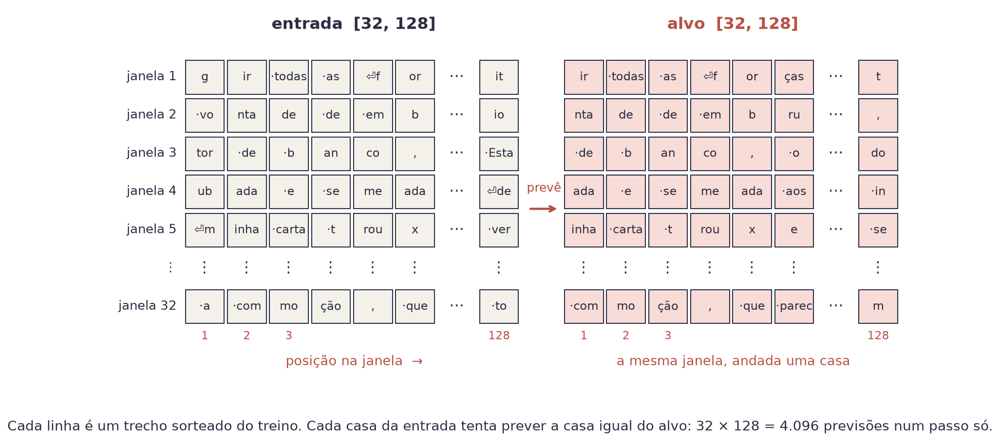
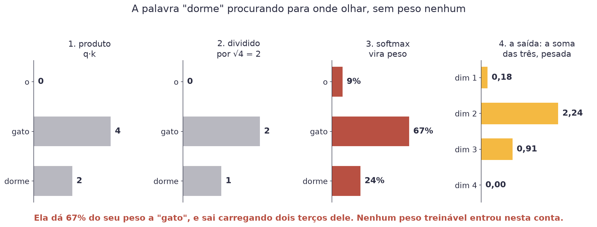
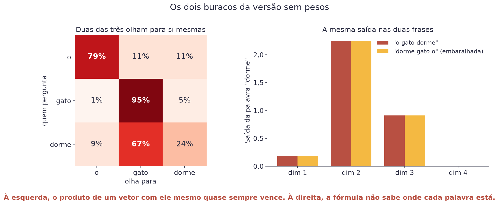

# Aula 10 — Atenção


**O que você leva desta aula**

Você vai transformar a fila de números da Aula 9 em lotes de treino e
medir o número que o seu modelo vai ter que bater. Depois vai escrever o
seu primeiro modelo em PyTorch, calcular à mão o peso de atenção de uma
palavra, e montar uma cabeça de atenção com máscara, a única peça
realmente nova de um transformer.


## Onde estamos

<figure><figcaption>A Aula 9 entregou uma fila de números. Esta aula a transforma em exemplos de treino e ensina o modelo a escolher para onde olhar.</figcaption></figure>

A Aula 9 terminou com o texto virando números. Esta aula tem três
passos. Primeiro, esses números viram exemplos de treino, e você mede o
número a bater. Depois, o modelo de contagem vira uma rede neural. Por
fim, a rede ganha a atenção, que deixa cada posição olhar para trás.

## Do texto ao lote de treino

O primeiro passo é transformar a fila de números em exemplos de treino.

### Tensores

Daqui até a Aula 12 os números moram em **tensores**, a lista do
PyTorch. Um tensor faz conta rápido, calcula gradientes sozinho e sabe o
próprio formato, o `shape`. O corpus inteiro é um tensor de formato
`[1484827]`. Um lote de 32 janelas de 128 tokens é um tensor de formato
`[32, 128]`. Ler o formato é metade de entender o código.

### Treino e validação

Os primeiros 90% dos tokens são para treinar. Os últimos 10% ficam
guardados, e o modelo nunca treina neles: são 1.336.344 tokens de treino e
148.483 de validação. É o conjunto de teste das aulas anteriores. A perda
na validação diz se o modelo aprendeu português ou decorou o livro.

O corte é no fim, e não sorteado, porque tokens vizinhos são quase o mesmo
texto. Sortear misturaria pedaços da mesma frase nos dois lados.

### A janela

A tarefa é prever o próximo token. Então o exemplo é simplesmente a mesma
sequência, andada uma casa:

<figure><figcaption>Entrada e alvo são o mesmo texto, com uma casa de diferença.</figcaption></figure>

Repare no detalhe que faz a coisa toda ser barata: nove tokens de texto
não dão **um** exemplo de treino. Dão oito. O modelo prevê o token 2
olhando o 1, prevê o 3 olhando o 1 e o 2, e assim por diante, tudo na
mesma passada.

Com janelas de 128 tokens e lotes de 32, cada passo de treino corrige os
pesos usando 4.096 previsões de uma vez. O lote é uma matriz: cada linha
é uma janela sorteada do texto de treino, cada coluna é uma posição
dentro da janela. O alvo é outra matriz do mesmo tamanho, com cada linha
andada uma casa.

<figure><figcaption>Um lote de verdade, com tokens do corpus: 32 janelas por 128 posições. Cada casa da entrada prevê a casa igual do alvo.</figcaption></figure>

Leia a figura de dois jeitos. Uma **linha** é a figura da janela de
antes, só que com 128 casas. Uma **coluna** é a mesma posição em 32
trechos diferentes dos livros. O modelo faz as 4.096 previsões ao mesmo
tempo, mede o erro de todas, e corrige os pesos uma vez: isso é um passo
de treino. No passo seguinte, outras 32 janelas são sorteadas.

<figure><video src="../assets/aula-09/janela.mp4" poster="../assets/aula-09/janela.jpg" controls preload="none" playsinline aria-label="Animação da janela de treino, da janela de contexto e do lote"></video><figcaption>Cada posição prevê a seguinte, a janela anda pelo texto, e várias janelas formam um lote.</figcaption></figure>

O tamanho da janela tem nome: **janela de contexto**. É o quanto o modelo
consegue olhar para trás. A sua vai ser de 128 tokens, uns 300 caracteres.
Os modelos comerciais estão na casa das centenas de milhares.

## O número a bater

Falta uma régua. Para saber se um modelo é bom, você mede quanto ele se
surpreende com o texto de validação. Essa medida é a **perda**, a mesma
entropia cruzada das Aulas 3 e 8:

$$\text{perda} = -\frac{1}{n}\sum_{i=1}^{n} \log P(\text{token certo}_i)$$

| Símbolo | Significado |
|---|---|
| `n` | quantas previsões o modelo fez |
| `P(token certo)` | a chance que o modelo deu ao token que de fato veio |
| `log` | o logaritmo natural, que castiga com força a chance baixa na resposta certa |

Exemplo com três previsões. O modelo deu 50%, 25% e 10% ao token certo.
Os logaritmos, com o sinal trocado, são 0,69, 1,39 e 2,30. A média é
(0,69 + 1,39 + 2,30) / 3 = 1,46.

### Por que o log

Por que não usar a chance direto? Olhe a curva de `-log(chance)`:

<figure><figcaption>Certeza no token certo custa zero. Chance quase nula custa caro.</figcaption></figure>

São três razões, e a primeira se vê na figura:

1. **Errar com confiança custa muito mais que hesitar.** Passar de 0,5
   para 0,25 aumenta a perda em 0,69. Passar de 0,01 para 0,001 aumenta
   em 2,30. O modelo é castigado com força quando aposta contra a resposta
   certa, e é isso que o obriga a nunca descartar uma continuação
   possível.
2. **Produto vira soma.** A chance de um texto inteiro é a chance do
   primeiro token, vezes a do segundo, vezes a do terceiro... Multiplicar
   milhares de números menores que 1 dá um número tão pequeno que o
   computador arredonda para zero. O log transforma esse produto numa
   soma, e a soma dividida por `n` vira a média da fórmula.
3. **Zero é o ideal.** Chance 1 no token certo dá perda 0. A perda nunca
   é negativa, então quanto mais perto de zero, melhor.

A animação abaixo faz a mesma conta com três previsões do modelo treinado:

<figure><video src="../assets/aula-09/perda.mp4" poster="../assets/aula-09/perda.jpg" controls preload="none" playsinline aria-label="Animação das previsões do modelo e do cálculo da perda"></video><figcaption>Chance alta no token certo, surpresa pequena. Chance baixa, surpresa grande. A perda é a média.</figcaption></figure>

Quanto menor, melhor. Um modelo que chuta igual entre 1.024 tokens dá
1/1024 a cada um, e a perda dele é `ln(1024) = 6,93`. É dali que todo
treino das próximas aulas começa.

Agora o número a bater. Refaça o contador do começo da Aula 9 com tokens em
vez de letras, conte os pares no treino e meça na validação. A perda dele
é **4,48**. Sem rede neural nenhuma, só contando, o modelo já sai de 6,93.
O transformer da Aula 11 vai ter que fazer melhor que isso.

## O primeiro modelo em PyTorch

### O embutimento: o token vira vetor

Cada token da Aula 9 é um número inteiro, e número inteiro não serve para
fazer conta de parecença. Como a Aula 9 terminou mostrando, o número é só
um endereço. O primeiro passo do modelo é trocar cada token pela linha
dele numa tabela:

```python
embutir = nn.Embedding(1024, 128)   # 1.024 tokens, 128 números cada
```

Essa tabela se chama **embutimento** (*embedding*). São 131.072 pesos, que
o treino ajusta como quaisquer outros. Depois dela, o token 600 deixou de
ser "o número 600" e virou um ponto num espaço de 128 dimensões. Tokens
que aparecem em contextos parecidos acabam com linhas parecidas, sem
ninguém mandar, do mesmo jeito que os filtros da Aula 8 apareceram sozinhos.

### Uma camada que dá uma pontuação para cada token

O modelo mais simples possível pega o vetor do token atual e o transforma
em 1.024 pontuações, uma para cada token que pode vir em seguida. A
softmax transforma as pontuações em probabilidades. As pontuações cruas
têm nome: **logits**.

No Keras você empilhava camadas numa lista. No PyTorch você escreve uma
classe com duas partes: o `__init__` cria as camadas, e o `forward` diz o
caminho dos números.

```python
class ModeloBigrama(nn.Module):
    def __init__(self):
        super().__init__()
        self.embutir = nn.Embedding(1024, 128)
        self.cabeca = nn.Linear(128, 1024)

    def forward(self, indices, alvos):
        logits = self.cabeca(self.embutir(indices))
        perda = F.cross_entropy(logits.view(-1, 1024), alvos.view(-1))
        return logits, perda
```

Esse modelo faz o mesmo que o contador da Aula 9: prevê o próximo token
olhando só o atual. A diferença é que ele **aprende** a tabela por
gradiente, em vez de contar.

### O laço de treino

O `model.fit` do Keras fazia cinco coisas escondido. No PyTorch você vê
todas:

```python
for passo in range(500):
    entrada, alvo = sortear_lote(dados_treino)   # 1. um lote
    logits, perda = modelo(entrada, alvo)        # 2. a perda
    otimizador.zero_grad()                       # 3. apaga o gradiente anterior
    perda.backward()                             # 4. calcula o gradiente
    otimizador.step()                            # 5. dá o passo
```

É o gradiente descendente da Aula 1. O `zero_grad` existe porque o PyTorch
soma os gradientes de uma chamada para outra. Sem ele, cada passo carrega
a soma de todos os anteriores, e o treino desanda.

Antes de treinar, confira o **passo zero**. Um modelo recém-criado não
sabe nada e chuta igual entre 1.024 tokens, então a perda dele tem que
dar perto de `ln(1024) = 6,93`. No exercício da aula, o modelo novo dá
7,1. Em 500 passos, a perda cai para 4,2, que já está abaixo dos 4,48 do
contador de pares. O texto que ele gera tem palavras de verdade e frases
sem sentido, porque o modelo escolhe cada token olhando só o anterior.

## O problema

Leia esta frase e complete a última palavra:

<figure><figcaption>Para completar a última palavra, o modelo precisa voltar mais de vinte palavras.</figcaption></figure>

Você completou sem esforço, porque leu a frase inteira e reteve as quatro
palavras que importam. O modelo precisa fazer o mesmo, e tem duas saídas
ruins pela frente.

**Saída ruim 1: olhar só as últimas palavras.** Barato, e perde tudo o que
está longe. É o modelo que você acabou de treinar, e é como os modelos
funcionavam antes de 2017.

**Saída ruim 2: somar todas as palavras anteriores por igual.** Aí "de",
"uma" e "para" pesam tanto quanto "Capitú". A informação some no meio da
média.

A resposta é uma terceira coisa: deixar cada posição **escolher** para onde
olhar, com pesos que o treino ajusta. Isso se chama **atenção**
(*attention*).

## Primeiro, a versão sem peso nenhum

Antes de qualquer coisa treinável, vale ver que a ideia central da atenção
funciona **sem nenhum peso novo**. Só com os vetores que já temos.

Tome três palavras e quatro números por palavra, para caber na página:

| Palavra | Vetor |
|---|---|
| `o` | (2, 0, 0, 0) |
| `gato` | (0, 3, 1, 0) |
| `dorme` | (0, 1, 1, 0) |

A palavra `dorme` quer saber para onde olhar. São quatro passos, e você
pode fazer os quatro à mão.

**Passo 1: medir parecença com cada palavra.** Multiplique casa com casa e
some. Isso se chama **produto escalar**, e é a mesma conta da convolução da
Aula 8:

$$q \cdot k = \sum_{i=1}^{d} q_i k_i$$

| Símbolo | Significado |
|---|---|
| `q` | o vetor da palavra que está perguntando |
| `k` | o vetor de uma das palavras da frase |
| `d` | quantos números tem cada vetor (aqui, 4) |

Exemplo: `dorme` com `o` dá `0·2 + 1·0 + 1·0 + 0·0 = 0`. Com `gato` dá
`0 + 3 + 1 + 0 = 4`. Com ela mesma dá `0 + 1 + 1 + 0 = 2`. Vetores
apontando para o mesmo lado dão número alto; perpendiculares dão zero.

**Passo 2: dividir pela raiz de `d`.** Aqui, `√4 = 2`. Os três números
viram 0, 2 e 1. O motivo vem logo abaixo.

**Passo 3: passar pela softmax**, a mesma da Aula 8, que transforma
qualquer trio de números em pesos que somam 100%: **9%, 67% e 24%**.

**Passo 4: somar os vetores, pesados por esses números.**

$$z = 0{,}09 \cdot (2,0,0,0) + 0{,}67 \cdot (0,3,1,0) + 0{,}24 \cdot (0,1,1,0)$$

| Símbolo | Significado |
|---|---|
| `z` | o vetor de saída da posição `dorme` |
| os três pesos | quanto ela decidiu olhar para cada palavra |
| os três vetores | as próprias palavras, sem transformação nenhuma |

O resultado é `(0,18, 2,24, 0,91, 0)`. Repare: `dorme` saiu carregando dois
terços de `gato`. A palavra deixou de ser só ela mesma e virou ela mesma
**mais o contexto**.

<figure><figcaption>Quatro passos, três palavras, números pequenos. É a atenção inteira, e ainda não há um peso treinável.</figcaption></figure>

Os mesmos quatro passos, em movimento:

<figure><video src="../assets/aula-10/atencao.mp4" poster="../assets/aula-10/atencao.jpg" controls preload="none" playsinline aria-label="Animação dos quatro passos da atenção sem pesos"></video><figcaption>Produto escalar, divisão por √d, softmax e mistura: "dorme" sai carregando dois terços de "gato".</figcaption></figure>

**Por que dividir pela raiz de `d`?** Quanto mais dimensões, maiores os
produtos escalares, só por haver mais parcelas na soma. Números grandes
fazem a softmax virar tudo-ou-nada: a softmax de (0, 20, 10) é
praticamente (0%, 100%, 0%), enquanto a de (0, 2, 1) é (9%, 67%, 24%).
Com os pesos colados no zero e no um, o gradiente some. A divisão mantém
a distribuição espalhada, e com isso o modelo continua aprendendo.

No PyTorch, os quatro passos cabem em quatro linhas:

```python
pontos = frase @ dorme                   # 1. produto com cada palavra
pontos = pontos / math.sqrt(4)           # 2. divide pela raiz de d
pesos = F.softmax(pontos, dim=0)         # 3. vira peso
saida = pesos @ frase                    # 4. mistura
```

## Os dois buracos da versão sem pesos

A versão de cima funciona, e tem dois defeitos. Os dois dá para medir. O resto
desta aula tapa o primeiro; a Aula 11 tapa o segundo.

<figure><figcaption>Buraco 1: a palavra olha para si mesma. Buraco 2: embaralhar a frase não muda nada.</figcaption></figure>

**Buraco 1: vira espelho.** Faça a mesma conta para as três palavras:

| Quem pergunta | olha `o` | olha `gato` | olha `dorme` |
|---|---|---|---|
| `o` | **79%** | 11% | 11% |
| `gato` | 1% | **95%** | 5% |
| `dorme` | 9% | **67%** | 24% |

Em duas das três linhas, a palavra olha principalmente para si mesma. Não é
azar: o produto escalar de um vetor com ele mesmo é o comprimento dele ao
quadrado, o maior valor que ele costuma tirar de qualquer comparação.

E tem um problema mais fundo por trás. Parecença de embutimento é **uma**
relação: palavras de sentido próximo ficam perto. Mas `dorme` não precisa
procurar sinônimos de `dorme`. Precisa procurar o **sujeito** dela, que é
`gato`, e sujeito não é sinônimo de nada. Uma relação só, fixa, não cobre
isso.

**Buraco 2: a frase virou um saco de palavras.** Embaralhe "o gato dorme"
para "dorme gato o" e refaça a conta. A saída de cada palavra é idêntica.
Nada na fórmula diz onde cada palavra está, então "o gato mordeu o
cachorro" e "o cachorro mordeu o gato" são a mesma coisa para ela.

## Os três papéis

A atenção de verdade dá três vetores a cada palavra, obtidos multiplicando
o vetor da palavra por três tabelas de pesos diferentes:

<figure><figcaption>A mesma palavra, vista de três jeitos. O treino ajusta as três tabelas de pesos.</figcaption></figure>

Pense numa biblioteca. Você chega com uma **pergunta** (o Q da posição
atual). Cada livro tem uma **etiqueta** na lombada (o K de cada palavra
anterior). Você compara a sua pergunta com todas as etiquetas, escolhe os
livros mais parecidos, e lê o **conteúdo** deles (o V).

A diferença para a biblioteca de verdade: aqui você não escolhe um livro
só. Você lê todos, em proporções diferentes.

Cada papel sai de uma multiplicação por uma tabela própria:

$$q = x\,W_Q \qquad k = x\,W_K \qquad v = x\,W_V$$

| Símbolo | Significado |
|---|---|
| `x` | o vetor da palavra, que sai do embutimento |
| `W_Q`, `W_K`, `W_V` | as três tabelas de pesos que o treino ajusta |
| `q`, `k`, `v` | a pergunta, a etiqueta e o conteúdo da palavra |

Exemplo com dois números. A palavra é `x = (1, 2)`. Suponha que `W_Q`
troque os dois números de lugar e que `W_K` não mexa em nada. Então
`q = (2, 1)` e `k = (1, 2)`, e o produto `q · k` dá `2 + 2 = 4`. Sem as
tabelas, a palavra comparada com ela mesma dava `1 + 4 = 5`. Com tabelas
diferentes, o produto de uma palavra com ela mesma deixa de ser
automaticamente o maior. **É isso que tapa o buraco 1**: o treino decide
quem olha para quem.

No código, cada tabela é um `nn.Linear` sem viés:

```python
self.pergunta = nn.Linear(128, 32, bias=False)
self.etiqueta = nn.Linear(128, 32, bias=False)
self.conteudo = nn.Linear(128, 32, bias=False)
```

## A fórmula inteira

$$\text{Atenção}(Q, K, V) = \text{softmax}\!\left(\frac{Q K^{\top}}{\sqrt{d}}\right) V$$

| Símbolo | Significado |
|---|---|
| `Q Kᵀ` | todos os produtos escalares de todas as perguntas com todas as etiquetas |
| `√d` | a raiz da dimensão, que segura o tamanho dos números |
| `softmax` | transforma os números em pesos que somam 1 |

São os mesmos quatro passos que você já fez à mão, para todas as posições
de uma vez. O `Kᵀ` (K transposta) é a tabela de etiquetas deitada, para que
cada pergunta encontre cada etiqueta. Numa frase de 6 tokens, `Q Kᵀ` é uma
tabela de 6 × 6: uma linha por posição que pergunta, uma coluna por
posição consultada.

## A máscara: não vale olhar a resposta

Existe um problema que o desenho acima esconde. Se cada posição olha todas
as outras, a posição 3 olha a posição 4, que é justamente a palavra que ela
deveria prever.

<figure><figcaption>À esquerda o modelo cola. À direita, cada linha só enxerga o que veio antes dela.</figcaption></figure>

A correção é a **máscara causal**: antes da softmax, troque por menos
infinito todos os produtos que apontam para o futuro. A softmax eleva `e`
a cada número, e `e` elevado a menos infinito é zero:

$$\text{softmax}(1,\; 2,\; -\infty) = (27\%,\; 73\%,\; 0\%)$$

| Símbolo | Significado |
|---|---|
| `1`, `2` | os produtos de duas posições do passado |
| `−∞` | o produto com uma posição do futuro, apagado pela máscara |

Exemplo: `e¹ = 2,72`, `e² = 7,39` e `e^(−∞) = 0`. A soma é 10,11. Divididos
por ela: 27%, 73% e 0%. A posição do futuro some da mistura, e as outras
duas dividem os 100% entre si.

<figure><video src="../assets/aula-10/mascara.mp4" poster="../assets/aula-10/mascara.jpg" controls preload="none" playsinline aria-label="Animação da máscara causal numa matriz de atenção"></video><figcaption>O futuro vira −∞, a softmax transforma em 0%, e cada linha só olha para trás.</figcaption></figure>

```python
futuro = torch.triu(torch.ones(n, n), diagonal=1).bool()
pontos = pontos.masked_fill(futuro, float("-inf"))
```

O nome "causal" vem daí: a informação só corre do passado para o futuro,
nunca ao contrário.

Dá para conferir que a máscara funciona com um teste simples, que o
exercício da aula usa: troque **só a última palavra** da frase e rode a
cabeça de novo. Se as saídas das posições anteriores mudarem, alguma delas
está olhando o futuro.


**Erro do dia**

Esquecer a máscara. O modelo treina lindamente, a perda cai para quase
zero, e você comemora. Na hora de gerar texto, ele não tem mais o futuro
para copiar, e a saída vira lixo. É o erro mais frustrante desta aula,
porque o sintoma aparece longe da causa. O teste da última palavra pega o
erro na hora.


## Cola da aula

| Conceito | Em uma frase |
|---|---|
| Tensor | a lista do PyTorch, com formato (`shape`) |
| Janela | o alvo é a entrada andada uma casa |
| Lote | 32 janelas de 128: 4.096 previsões por passo |
| Perda | média de `-log P(token certo)`; chute ao acaso = 6,93 |
| Por que o log | castiga o erro confiante e troca produto por soma |
| O número a bater | 4,48, a perda do contador de pares de tokens |
| Embutimento | troca cada token por uma linha de 128 números de uma tabela treinável |
| Logits | as pontuações cruas, uma por token, antes da softmax |
| `nn.Module` | `__init__` cria as camadas, `forward` diz o caminho |
| Laço de treino | lote, perda, `zero_grad`, `backward`, `step` |
| Passo zero | um modelo novo tem perda perto de `ln(1024) = 6,93` |
| Produto escalar | mede a parecença entre dois vetores |
| `√d` | segura o tamanho dos produtos para a softmax não saturar |
| Q, K, V | pergunta, etiqueta e conteúdo, de três tabelas de pesos |
| Máscara causal | o futuro vira `−∞` antes da softmax, e some |

## Materiais

- **Notebook desta aula, no Google Colab:** [](https://colab.research.google.com/github/klein-natan/nanodegree-AI-Atitus/blob/main/notebooks/aula-10-atencao.ipynb)
- **Quiz de cada microaula:** [no fim desta página](#quizzes-das-microaulas), 5 perguntas depois de cada explicação, antes do exercício.
- **Travou num exercício?** [Colas dos exercícios](colas-dos-exercicios.md#aula-10-atencao), com dicas que você abre uma de cada vez.
- Slides desta aula: entregues em sala.
- Modelo treinado, usado nas figuras: [`mini_llm.pt`](https://github.com/klein-natan/nanodegree-AI-Atitus/blob/main/data/mini_llm.pt)

Os três exercícios do notebook:

| Exercício | O que você constrói |
|---|---|
| 10.1 | treino e validação, entrada e alvo, o lote, a perda e o número a bater |
| 10.2 | o primeiro modelo em PyTorch e o laço de treino |
| 10.3 | a conta da atenção à mão, e uma cabeça de atenção com máscara |

## Para ir além

- [The Illustrated Transformer](https://jalammar.github.io/illustrated-transformer/): a explicação visual mais conhecida, com animações de cada passo.
- [Attention in transformers, step-by-step (3Blue1Brown)](https://www.youtube.com/watch?v=eMlx5fFNoYc): a conta desta aula, animada. Em inglês, com legendas.
- [Attention Is All You Need](https://arxiv.org/abs/1706.03762): o artigo de 2017 que apresentou o transformer. Difícil, mas vale ver o desenho da página 3.

## Quizzes das microaulas

Depois de cada microaula, e antes do exercício no Colab, responda o quiz
dela. As perguntas aparecem uma de cada vez, como uma pilha de cartas:
responda, leia a explicação e passe para a próxima. No fim aparece quantas
você acertou. Nada fica gravado: dá para refazer quantas vezes quiser.

### Microaula 1: do texto ao lote de treino



```quiz
Um lote de 32 janelas de 128 tokens é um tensor. Qual é o formato (shape) dele?
- [128, 32]
+ [32, 128]
- [4096]
- [1024, 128]
? Uma linha por janela (32) e uma coluna por token da janela (128). Ler o formato é metade de entender o código.
```

```quiz
Por que os últimos 10% do corpus ficam fora do treino?
- Para o treino ser mais rápido.
- Porque o fim dos livros é menos importante.
+ Para medir se o modelo aprendeu português ou decorou o texto que viu.
- Porque o tokenizador não consegue ler o fim.
? É o conjunto de validação, como o conjunto de teste das aulas anteriores. O modelo nunca treina nele.
```

```quiz
Na janela de treino, o que é o alvo?
- A última palavra da frase.
- Um token sorteado ao acaso.
- A mesma janela de trás para a frente.
+ A mesma sequência da entrada, andada uma casa.
? Cada posição tem que prever o token seguinte. Por isso nove tokens de texto dão oito exemplos de treino de uma vez.
```

```quiz
Por que a perda usa o log da chance do token certo, e não a chance direto?
- Porque o log deixa a conta mais rápida no Colab.
- Porque o log transforma toda chance num número positivo maior que 1.
+ Porque castiga com força quem dá chance quase zero à resposta certa, e troca o produto das chances por uma soma.
- Porque sem o log a perda de um chute daria zero.
? Chance 1 dá perda 0; chance 0,1 dá 2,30; chance 0,001 dá 6,93. Perto de zero a curva dispara. E a chance de um texto é o produto das chances de cada token: o log vira esse produto numa soma, que o computador consegue fazer.
```

```quiz
Um modelo que chuta igual entre os 1.024 tokens tem perda 6,93. O contador de pares de tokens tem perda 4,48. O que isso quer dizer?
+ Que contar já é bem melhor que chutar, e o transformer vai ter que fazer melhor que 4,48.
- Que o contador é pior que o chute, porque 4,48 é menor.
- Que a perda não serve para comparar modelos.
- Que o transformer nunca passa de 4,48.
? Quanto menor a perda, menos o modelo se surpreende com o token certo. O 4,48 é o número a bater na Aula 11.
```



### Microaula 2: o primeiro modelo em PyTorch



```quiz
O que faz a camada nn.Embedding(1024, 128)?
- Transforma cada palavra em uma letra.
+ Troca cada token por uma linha de 128 números de uma tabela que o treino ajusta.
- Divide o texto em 128 pedaços.
- Calcula a perda do modelo.
? É o embutimento: 1.024 linhas, uma por token, com 128 números cada. São 131.072 pesos, ajustados como quaisquer outros.
```

```quiz
Numa classe do PyTorch, para que servem o __init__ e o forward?
- O __init__ treina o modelo, e o forward mede a perda.
- Os dois fazem a mesma coisa.
- O __init__ desenha o gráfico, e o forward imprime o resultado.
+ O __init__ cria as camadas, e o forward diz o caminho que os números percorrem.
? É a troca do Keras para o PyTorch: em vez de uma lista de camadas, uma classe em que você escreve o caminho.
```

```quiz
No laço de treino, para que serve o zero_grad()?
- Para zerar os pesos do modelo.
- Para zerar a perda.
+ Para apagar o gradiente do passo anterior, que senão se soma ao novo.
- Para sortear um lote novo.
? O PyTorch acumula os gradientes de uma chamada para outra. Sem o zero_grad, cada passo carregaria a soma de todos os anteriores.
```

```quiz
Qual é a ordem certa das linhas do laço de treino?
- step, backward, perda, zero_grad
+ lote, perda, zero_grad, backward, step
- backward, lote, step, perda, zero_grad
- perda, step, lote, backward, zero_grad
? Sorteia o lote, calcula a perda, apaga o gradiente antigo, calcula o novo (backward) e dá o passo (step). É o que o model.fit do Keras fazia escondido.
```

```quiz
Um modelo recém-criado, ainda sem treino, deu perda 31. O que isso indica?
- Que ele já aprendeu muito.
- Que a perda dele é normal: todo modelo começa assim.
- Que o vocabulário tem 31 tokens.
+ Que há erro de montagem: um modelo novo devia dar perto de ln(1024) = 6,93.
? É o teste do passo zero. Um modelo que não sabe nada chuta igual entre os 1.024 tokens, e a perda de um chute é 6,93.
```



### Microaula 3: a atenção



```quiz
O produto escalar de "dorme" = (0, 1, 1, 0) com "gato" = (0, 3, 1, 0) é:
- 1
- 2
- 3
+ 4
? Multiplica casa com casa e soma: 0·0 + 1·3 + 1·1 + 0·0 = 4. Vetores que apontam para o mesmo lado dão produto alto.
```

```quiz
Por que a atenção divide os produtos pela raiz de d?
- Para os pesos somarem 100%.
+ Para os números não ficarem grandes demais e a softmax não virar tudo-ou-nada.
- Para trocar a ordem das palavras.
- Para o resultado ficar inteiro.
? Com muitas dimensões, os produtos crescem só por terem mais parcelas. Números grandes saturam a softmax, e aí o gradiente some.
```

```quiz
Na analogia da biblioteca, o que é a etiqueta (K)?
- O que a posição atual está procurando.
+ O que cada palavra anterior oferece, como a etiqueta na lombada de um livro.
- O texto que a palavra entrega quando é escolhida.
- O número da página onde a palavra aparece.
? A pergunta (Q) procura, a etiqueta (K) anuncia, e o conteúdo (V) é o que se lê do livro escolhido.
```

```quiz
Por que usar tabelas diferentes para Q e K tapa o buraco 1 (a palavra olhando para si mesma)?
+ Porque o produto da pergunta de uma palavra com a etiqueta dela mesma deixa de ser automaticamente o maior.
- Porque as tabelas apagam a palavra atual.
- Porque o modelo passa a ignorar a diagonal.
- Porque Q e K ficam sempre iguais a zero.
? Sem as tabelas, uma palavra comparada com ela mesma dá o comprimento ao quadrado, o maior valor possível. Com tabelas diferentes, o treino decide quem olha para quem.
```

```quiz
Um modelo sem máscara causal treina com perda perto de zero e depois gera lixo. Por quê?
- Porque a máscara deixa o treino mais lento.
- Porque o modelo decorou o tokenizador.
+ Porque no treino ele colava, olhando o token que devia prever, e na geração não existe futuro para copiar.
- Porque a perda perto de zero é sempre um bom sinal.
? É o erro do dia. O teste da cola pega esse erro: trocar só a última palavra não pode mudar a saída das posições anteriores.
```


