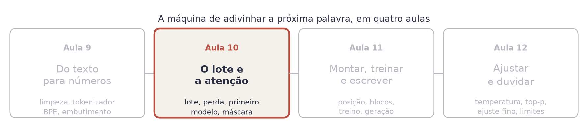
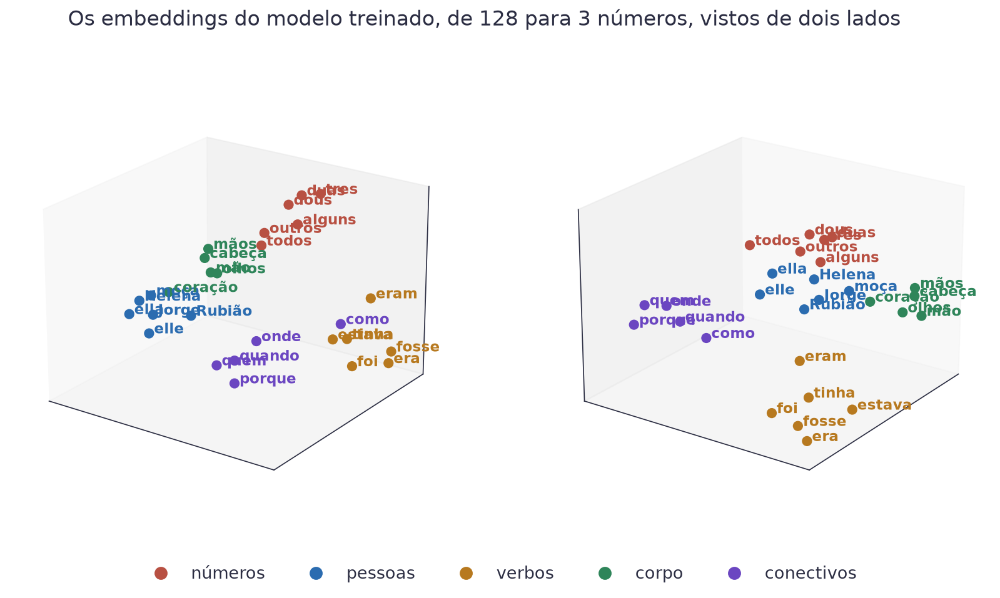
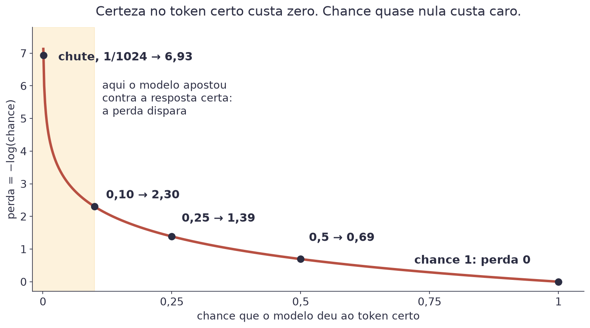
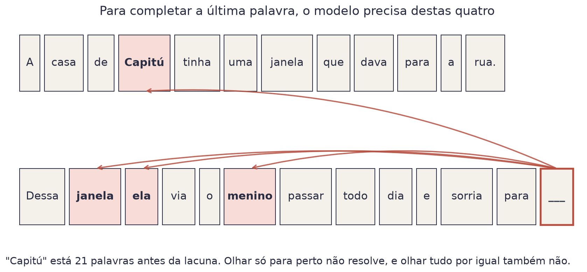
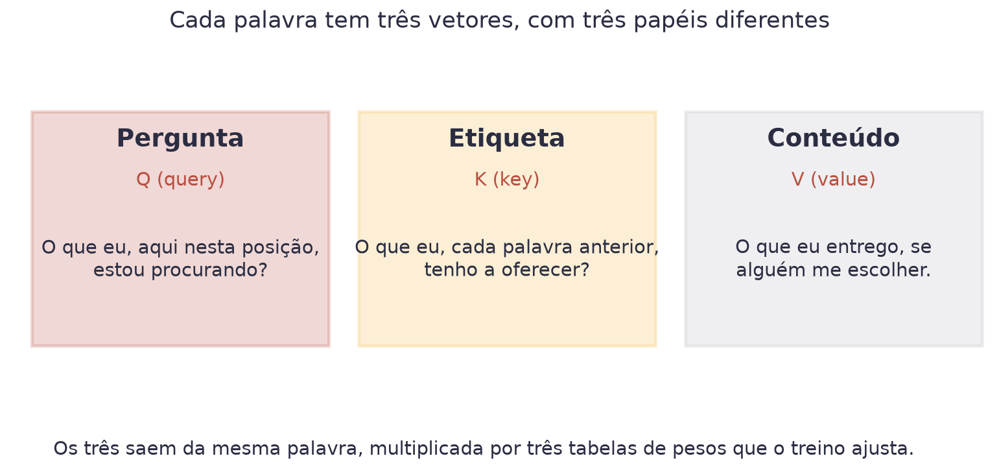
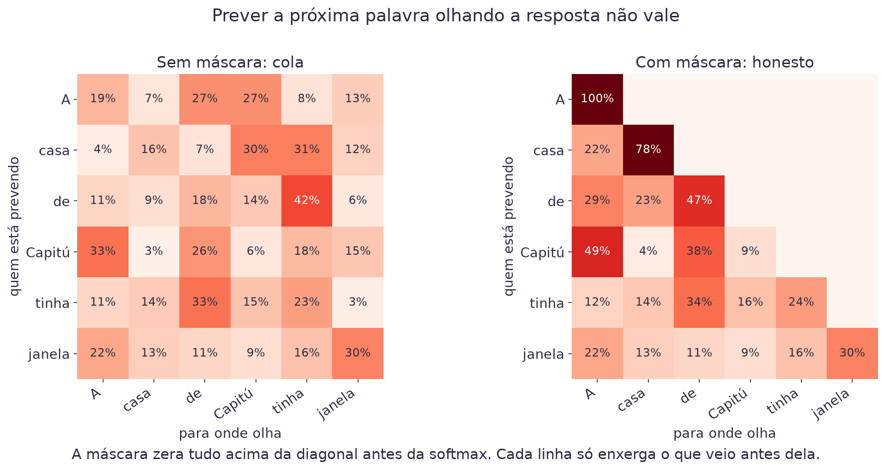
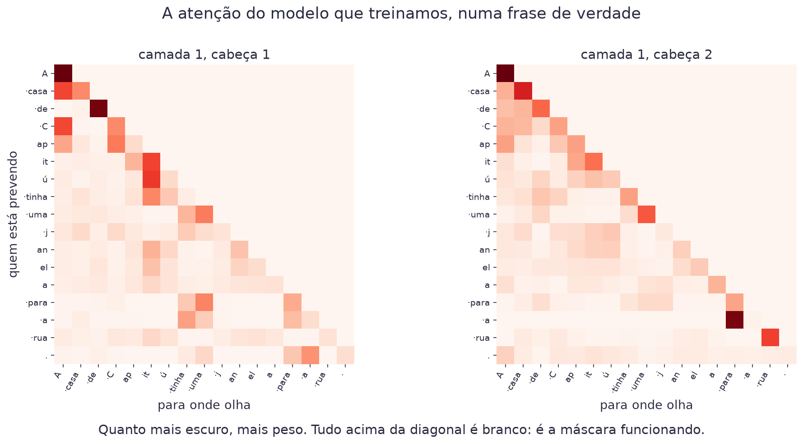
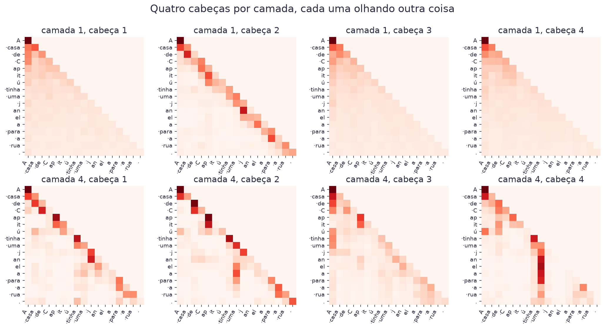
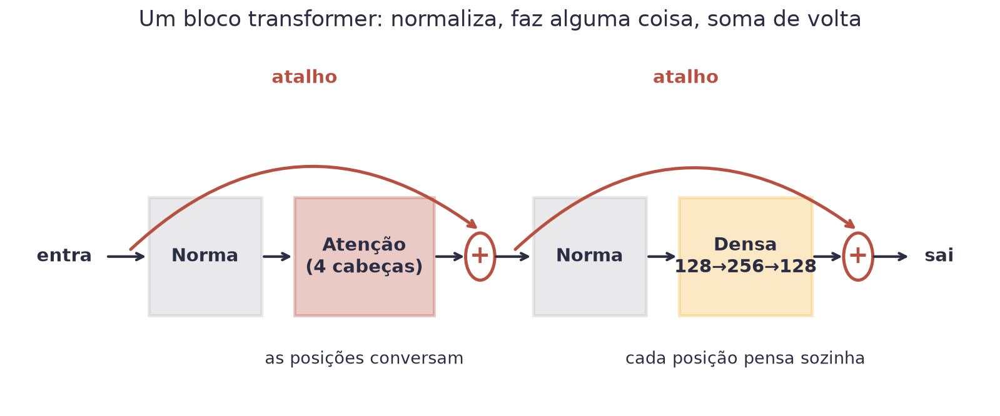
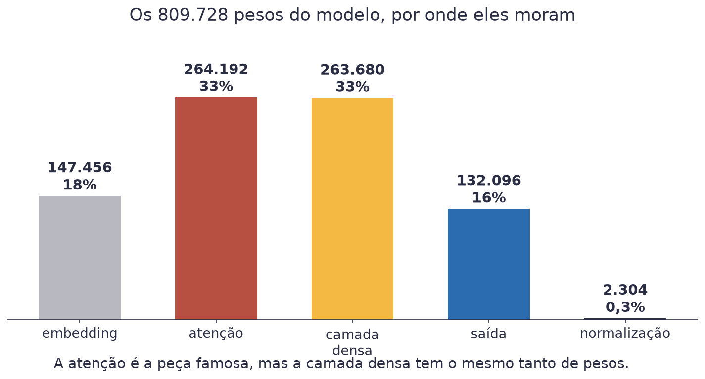

# Aula 10 — Como Funciona um LLM


**O que você leva desta aula**

Você vai entender o caminho inteiro dentro de um modelo de linguagem: o
token vira um vetor que carrega sentido, a atenção deixa cada posição olhar
para trás, e um bloco repetido quatro vezes transforma isso numa previsão.
No fim, você monta o seu próprio LLM em Keras, com 809.728 pesos, e vê ele
escrever com os pesos treinados do professor.


## Onde estamos

<figure><figcaption>A Aula 9 entregou uma fila de números. Esta aula abre a máquina que recebe esses números.</figcaption></figure>

A Aula 9 terminou com o texto virando uma fila de números. Esta aula abre
o modelo que recebe essa fila. São três partes, e cada uma vira um
exercício: o token vira um vetor, a atenção deixa cada posição consultar
as anteriores, e o bloco transformer, repetido, faz a previsão.

## O token vira vetor

O número de um token não é uma quantidade. O token 600 não vale oito vezes
o token 79: os números são só a ordem em que o BPE criou cada peça. O
número é um **endereço**.

O modelo guarda uma tabela com uma linha por token (1.024 linhas) e 128
colunas. Cada token é trocado pela sua linha, uma lista de 128 números
chamada **embedding**. No Keras, a tabela inteira é uma camada:

```python
keras.layers.Embedding(1024, 128)   # 1.024 tokens, 128 números cada
```

São 131.072 pesos, que o treino ajusta como quaisquer outros. Um lote de
32 janelas de 128 tokens entra com formato `[32, 128]` e sai com formato
`[32, 128, 128]`: cada token virou um vetor.

## O que esses números querem dizer

No começo do treino, a tabela é sorteada, e os vetores não significam
nada. O treino mexe em cada número dela para a previsão melhorar. No fim,
tokens que aparecem em lugares parecidos do texto acabam com vetores
parecidos. Ninguém ensina gramática ao modelo: ele descobre sozinho que
`·dous` e `·tres` fazem o mesmo papel, porque aparecem nos mesmos lugares.

<figure><video src="../assets/aula-10/embeddings.mp4" poster="../assets/aula-10/embeddings.jpg" controls preload="none" playsinline aria-label="Animação em 3D dos embeddings: os pontos começam misturados e, depois do treino, as palavras de cada grupo se juntam"></video><figcaption>Os embeddings do modelo treinado, espremidos de 128 para 3 números. No começo as cores se misturam; depois do treino, cada grupo se junta.</figcaption></figure>

Os 128 números não cabem num desenho, então a animação espreme os 128 em
3, com a mesma PCA da Aula 3. Alguma coisa se perde no aperto, e mesmo
assim os grupos aparecem: números com números, pessoas com pessoas,
verbos com verbos, partes do corpo com partes do corpo.

<figure><figcaption>O mesmo espaço, de dois lados. As palavras de cada cor ficam juntas.</figcaption></figure>

## Parecido quer dizer apontar para o mesmo lado

Para medir se dois vetores são parecidos, o modelo olha se eles apontam
para o mesmo lado. A medida se chama **similaridade do cosseno**:

$$\text{similaridade}(a, b) = \frac{a \cdot b}{\lVert a \rVert \, \lVert b \rVert}$$

| Símbolo | Significado |
|---|---|
| `a · b` | o produto escalar: multiplique casa com casa e some |
| `‖a‖` | o tamanho do vetor `a` |
| o resultado | 1 se apontam para o mesmo lado, 0 se são perpendiculares |

Exemplo com dois números por vetor. `a = (3, 4)` e `b = (6, 8)`: o produto
é `18 + 32 = 50`, os tamanhos são 5 e 10, e a similaridade é
`50 / 50 = 1`. Mesmo lado, só que `b` é maior. Com `c = (4, −3)`, o produto
com `a` é `12 − 12 = 0`: perpendiculares, nada em comum.

No modelo treinado do curso, os vizinhos mais próximos de alguns tokens
são estes:

| Token | Os mais parecidos (similaridade) |
|---|---|
| `·elle` | `·ella` (0,71), `·isso`, `·Helena`, `·Rubião` |
| `·dous` | `·duas` (0,55), `·tres` (0,55), `·outros`, `·alguns` |
| `·era` | `·Era` (0,77), `·fosse`, `·foi`, `·eram` |
| `·olhos` | `·mão` (0,54), `·cabeça`, `·mãos` |
| `·quando` | `·porque` (0,57), `·onde`, `·que` |

Repare que os vizinhos não são sinônimos: são palavras que **fazem o mesmo
papel** na frase. É exatamente o que um modelo que prevê a próxima palavra
precisa saber.

## O exemplo de treino

O modelo aprende prevendo o próximo token. Então o exemplo de treino é a
própria frase, andada uma casa:

<figure><figcaption>Entrada e alvo são o mesmo texto, com uma casa de diferença.</figcaption></figure>

Repare no detalhe que faz a coisa toda ser barata: nove tokens de texto
não dão **um** exemplo de treino. Dão oito. O modelo prevê o token 2
olhando o 1, prevê o 3 olhando o 1 e o 2, e assim por diante, tudo na
mesma passada.

Um **lote** junta 32 janelas de 128 tokens, sorteadas do texto de treino:
4.096 previsões de uma vez. O tamanho da janela tem nome, **janela de
contexto**: é o quanto o modelo consegue olhar para trás. A nossa tem 128
tokens, uns 300 caracteres. Os modelos comerciais estão na casa das
centenas de milhares.

<figure><video src="../assets/aula-09/janela.mp4" poster="../assets/aula-09/janela.jpg" controls preload="none" playsinline aria-label="Animação da janela de treino, da janela de contexto e do lote"></video><figcaption>Cada posição prevê a seguinte, a janela anda pelo texto, e várias janelas formam um lote.</figcaption></figure>

Os primeiros 90% dos tokens são para treinar. Os últimos 10% ficam
guardados, e o modelo nunca treina neles: é o conjunto de validação, que
diz se o modelo aprendeu português ou decorou o livro.

## A perda

Para cada previsão, a perda olha a chance que o modelo deu ao token que de
fato veio. É a mesma entropia cruzada das Aulas 3 e 8, e o Keras calcula
por você:

$$\text{perda} = -\frac{1}{n}\sum_{i=1}^{n} \log P(\text{token certo}_i)$$

| Símbolo | Significado |
|---|---|
| `n` | quantas previsões o modelo fez |
| `P(token certo)` | a chance que o modelo deu ao token que de fato veio |
| `log` | o logaritmo natural, que castiga com força a chance baixa na resposta certa |

Exemplo com três previsões. O modelo deu 50%, 25% e 10% ao token certo.
Os logaritmos, com o sinal trocado, são 0,69, 1,39 e 2,30. A média é
(0,69 + 1,39 + 2,30) / 3 = 1,46.

<figure><figcaption>Certeza no token certo custa zero. Chance quase nula custa caro.</figcaption></figure>

Um modelo que chuta igual entre 1.024 tokens dá 1/1024 a cada um, e a
perda dele é `ln(1024) = 6,93`. É dali que todo treino começa.

## A atenção: o problema

Leia esta frase e complete a última palavra:

<figure><figcaption>Para completar a última palavra, o modelo precisa voltar mais de vinte palavras.</figcaption></figure>

Você completou sem esforço, porque leu a frase inteira e reteve as quatro
palavras que importam. O modelo precisa fazer o mesmo. Olhar só as últimas
palavras perde o que está longe. Somar todas por igual afoga "Capitú" no
meio de "de", "uma" e "para".

A resposta é deixar cada posição **escolher** para onde olhar, com pesos
que o treino ajusta. Isso se chama **atenção** (*attention*), e é a única
peça de um transformer em que uma posição vê as outras.

## Os três papéis

Cada token ganha três vetores, obtidos multiplicando o embedding dele por
três tabelas de pesos:

<figure><figcaption>A mesma palavra, vista de três jeitos. O treino ajusta as três tabelas de pesos.</figcaption></figure>

Pense numa biblioteca. Você chega com uma **pergunta** (o Q da posição
atual). Cada livro tem uma **etiqueta** na lombada (o K de cada posição
anterior). Você compara a sua pergunta com todas as etiquetas e lê o
**conteúdo** (o V) dos livros que combinam mais. A diferença para a
biblioteca de verdade: você não escolhe um livro só. Você lê todos, em
proporções diferentes.

$$q = x\,W_Q \qquad k = x\,W_K \qquad v = x\,W_V$$

| Símbolo | Significado |
|---|---|
| `x` | o vetor do token, que sai do embedding |
| `W_Q`, `W_K`, `W_V` | as três tabelas de pesos que o treino ajusta |
| `q`, `k`, `v` | a pergunta, a etiqueta e o conteúdo do token |

Por que três tabelas, e não o embedding direto? Porque "parecido" no
embedding quer dizer "faz o mesmo papel". Um verbo não precisa procurar
outros verbos: precisa procurar o **sujeito** dele. As tabelas deixam o
treino decidir que tipo de relação cada pergunta procura.

## A conta

$$\text{Atenção}(Q, K, V) = \text{softmax}\!\left(\frac{Q K^{\top}}{\sqrt{d}}\right) V$$

| Símbolo | Significado |
|---|---|
| `Q Kᵀ` | todos os produtos escalares de todas as perguntas com todas as etiquetas |
| `√d` | a raiz do tamanho dos vetores, que segura o tamanho dos números |
| `softmax` | transforma cada linha de números em pesos que somam 100% |
| `V` | os conteúdos, misturados com esses pesos |

Exemplo com três tokens, "o gato dorme", e vetores de 4 números. A
pergunta de `dorme` comparada com as etiquetas dos três tokens dá 0, 4 e 2.
Dividindo pela raiz de 4: 0, 2 e 1. A softmax transforma isso em **9%, 67%
e 24%**. A saída de `dorme` é a mistura dos três conteúdos com esses
pesos: dois terços de `gato`. O token deixou de ser só ele mesmo e virou
ele mesmo **mais o contexto**.

A divisão pela raiz de `d` existe porque vetores maiores dão produtos
maiores, e números grandes fazem a softmax virar tudo ou nada: a softmax
de (0, 20, 10) é praticamente (0%, 100%, 0%). Com os pesos colados no zero
e no um, o treino para de aprender.

## A máscara: não vale olhar a resposta

Se cada posição olha todas as outras, a posição 3 olha a posição 4, que é
justamente o token que ela deveria prever.

<figure><figcaption>À esquerda o modelo cola. À direita, cada linha só enxerga o que veio antes dela.</figcaption></figure>

A correção é a **máscara causal**: antes da softmax, todos os produtos
que apontam para o futuro viram menos infinito. A softmax eleva `e` a
cada número, e `e` elevado a menos infinito é zero:

$$\text{softmax}(1,\; 2,\; -\infty) = (27\%,\; 73\%,\; 0\%)$$

| Símbolo | Significado |
|---|---|
| `1`, `2` | os produtos com duas posições do passado |
| `−∞` | o produto com uma posição do futuro, apagado pela máscara |

Exemplo: `e¹ = 2,72`, `e² = 7,39` e `e^(−∞) = 0`. A soma é 10,11.
Divididos por ela: 27%, 73% e 0%. O futuro some da mistura.

<figure><video src="../assets/aula-10/mascara.mp4" poster="../assets/aula-10/mascara.jpg" controls preload="none" playsinline aria-label="Animação da máscara causal numa matriz de atenção"></video><figcaption>O futuro vira −∞, a softmax transforma em 0%, e cada linha só olha para trás.</figcaption></figure>

## Quatro cabeças, quatro olhares

Uma atenção só tem um jeito de perguntar. O modelo roda quatro em
paralelo, cada uma com as suas três tabelas, e junta os resultados. Cada
uma se chama **cabeça** (*head*). Como o vetor tem 128 números, cada
cabeça trabalha com 32, e as quatro saídas lado a lado voltam a ser 128.

No Keras, tudo isso (as tabelas Q, K e V das quatro cabeças, a conta, a
máscara e a mistura final) é uma camada pronta:

```python
atencao = keras.layers.MultiHeadAttention(num_heads=4, key_dim=32)
saida = atencao(x, x, use_causal_mask=True)
```

O `x` aparece duas vezes porque as perguntas e as etiquetas saem do mesmo
texto. O `use_causal_mask=True` liga a máscara.

<figure><figcaption>Cada linha é uma posição prevendo. Cada coluna é para onde ela olhou.</figcaption></figure>

Duas coisas para reparar no modelo treinado. O canto de cima à direita é
todo branco: é a máscara funcionando. E cada cabeça olha para lugares
diferentes. Na camada 1, a cabeça 2 olha quase só para o token anterior.
Na camada 4, os pedaços de "janela" (`·j`, `an`, `el`, `a`) olham para o
`·uma` que veio antes deles: é o modelo juntando a palavra cortada pelo
BPE com o artigo dela.

<figure><figcaption>As oito cabeças, na mesma frase. Nenhuma faz o que a outra faz.</figcaption></figure>

Ninguém programou essa divisão de trabalho: ela sai do treino.

## A posição

Falta uma coisa. Nada na conta da atenção diz **onde** cada token está:
embaralhe a frase e cada token recebe a mesma mistura. "O gato mordeu o
cachorro" e "o cachorro mordeu o gato" seriam a mesma coisa.

A solução é uma segunda tabela, com uma linha por **posição** da janela
(128 linhas de 128 números). Cada token entra no modelo como a soma de
dois vetores: o do token e o da posição em que ele está.

```python
x = embedding_do_token(ids) + embedding_da_posicao(posicoes)
```

A tabela das posições também é aprendida no treino. Depois dela, `gato`
na posição 2 e `gato` na posição 5 são vetores diferentes, e a atenção
consegue saber quem veio antes de quem.

## O preço da janela

Para uma janela de `n` tokens, cada cabeça calcula `n × n` produtos.
Dobrar a janela quadruplica a conta: são 16.384 produtos para os nossos
128 tokens, 1 milhão para 1.000 tokens e 10 bilhões para 100.000. É por
isso que janela grande é caro, e por que cada modelo novo anuncia a dele.


**Erro do dia**

Esquecer a máscara. O modelo treina lindamente, a perda cai para quase
zero, e você comemora. Na hora de gerar texto, ele não tem mais o futuro
para copiar, e a saída vira lixo. Um teste pega o erro na hora: troque
**só a última palavra** da frase. Se a saída de alguma posição anterior
mudar, ela estava olhando o futuro.


## O bloco transformer

Um **transformer** é um bloco repetido várias vezes. Cada bloco tem duas
metades, e as duas seguem o mesmo desenho: normaliza, faz alguma coisa,
soma de volta.

<figure><figcaption>Um bloco. A primeira metade mistura as posições, a segunda pensa sobre cada posição sozinha.</figcaption></figure>

```python
def bloco(x, i):
    # 1ª metade: as posições conversam
    h = keras.layers.LayerNormalization()(x)
    h = keras.layers.MultiHeadAttention(num_heads=4, key_dim=32)(h, h, use_causal_mask=True)
    x = x + h                                        # atalho
    # 2ª metade: cada posição pensa sozinha
    h = keras.layers.LayerNormalization()(x)
    h = keras.layers.Dense(256, activation="gelu")(h)
    h = keras.layers.Dense(128)(h)
    return x + h                                     # atalho
```

## As duas metades

A **primeira metade é a atenção**: é onde as posições conversam entre si.

A **segunda metade é uma camada densa**, como as da Aula 7, aplicada a cada
posição **separadamente**. Ela abre o vetor de 128 para 256 números, passa
por uma ativação e volta para 128. Não olha para os vizinhos: pega o
vetor que a atenção montou e pensa sobre ele sozinha.

> A atenção **junta** informação de outras posições. A camada densa
> **pensa** sobre essa mistura, uma posição de cada vez.

A ativação é a **GELU**, uma ReLU com a dobra arredondada: perto de zero,
em vez de cortar seco, ela deixa passar um pouco. É a de quase todo
modelo de linguagem desde o GPT-2.

## O atalho

Repare no `x +` das duas metades: é o **atalho** (conexão residual). A
entrada atravessa o bloco por fora, e o bloco soma a ela o que calculou.
Cada bloco não reescreve o vetor do token: ele **acrescenta** alguma coisa
ao que já estava lá.

O atalho também é um caminho direto para o gradiente da Aula 1. Sem ele,
o gradiente precisa atravessar todos os blocos para chegar ao primeiro, e
vai encolhendo no caminho. Foi esse problema que travou as redes
profundas por anos, até a ideia do atalho, em 2015.

## A normalização

A `LayerNormalization` faz o de sempre desde a Aula 7: mantém os números
de cada vetor num tamanho parecido, para o treino não desandar. Ela
subtrai a média dos números do vetor e divide pelo desvio padrão:

$$\hat{x}_i = \frac{x_i - \mu}{\sigma}$$

| Símbolo | Significado |
|---|---|
| `xᵢ` | um dos números do vetor que entra |
| `μ` | a média dos números do vetor |
| `σ` | o desvio padrão dos números do vetor |

Exemplo com `x = (3, 5)`. A média é 4 e o desvio padrão é 1. O vetor
normalizado é `((3 − 4) / 1, (5 − 4) / 1) = (−1, 1)`. Depois disso, cada
número ainda é multiplicado e somado por pesos que o treino ajusta.

## O modelo inteiro

Com o bloco pronto, o modelo é o embedding, quatro blocos, uma última
normalização e a camada de saída:

```python
entrada = keras.Input(shape=(None,), dtype="int32")
x = TokenEPosicao()(entrada)              # embedding do token + da posição
for i in range(4):
    x = bloco(x, i)
x = keras.layers.LayerNormalization()(x)
saida = keras.layers.Dense(1024)(x)       # uma pontuação para cada token
modelo = keras.Model(entrada, saida)
```

A saída tem 1.024 números para **cada** posição, um por token do
vocabulário. São pontuações cruas, os **logits**; a softmax transforma
em chances. O formato de entrada `(None,)` quer dizer que o texto pode
ter qualquer tamanho até 128 tokens.

## Onde moram os pesos

<figure><figcaption>A atenção é a peça famosa, mas a camada densa tem o mesmo tanto de pesos.</figcaption></figure>

| Peça | Conta | Pesos |
|---|---|---|
| Embedding do token | 1.024 × 128 | 131.072 |
| Embedding da posição | 128 × 128 | 16.384 |
| Atenção, por bloco | Q, K, V e a mistura final: 4 × (128 × 128 + 128) | 66.048 |
| Camada densa, por bloco | 128 × 256 + 256, e 256 × 128 + 128 | 65.920 |
| Normalizações | 2 × 128 em cada uma, 9 no total | 2.304 |
| Saída | 128 × 1.024 + 1.024 | 132.096 |
| **Total**, com 4 blocos | | **809.728** |

## O passo zero e a perplexidade

Antes de qualquer treino, o modelo recém-montado chuta igual entre os
1.024 tokens, e a perda dele tem que dar perto de `ln(1024) = 6,93`. Se
der muito diferente, tem erro de montagem. É o primeiro teste de qualquer
modelo de linguagem.

A perda tem uma tradução mais fácil de ler. Tire a exponencial e ela vira
a **perplexidade**:

$$\text{perplexidade} = e^{\text{perda}}$$

| Símbolo | Significado |
|---|---|
| `perda` | a entropia cruzada média na validação |
| `e` | o número de Euler, 2,718 |

A perplexidade é "entre quantos tokens o modelo está efetivamente na
dúvida". Exemplo: perda 6,93 dá `e^6,93 = 1.024`, o chute ao acaso. O
modelo do professor tem perda 3,39 na validação, e perplexidade 29,5: ele
eliminou quase todos os candidatos antes de escolher.

Os pesos treinados do professor carregam em qualquer modelo montado
exatamente assim, peça por peça. É o que o Exercício 3 faz: você monta o
modelo, ele chuta (6,93), você carrega os pesos do professor e ele passa a
escrever. Na Aula 11, você treina os seus.

## Cola da aula

| Conceito | Em uma frase |
|---|---|
| Embedding | troca cada token por uma linha de 128 números de uma tabela treinável |
| Similaridade do cosseno | mede se dois vetores apontam para o mesmo lado |
| Vizinhos no embedding | tokens que fazem o mesmo papel ficam perto |
| Entrada e alvo | o alvo é a entrada andada uma casa |
| Lote | 32 janelas de 128: 4.096 previsões por passo |
| Perda | média de `-log P(token certo)`; chute ao acaso = 6,93 |
| Q, K, V | pergunta, etiqueta e conteúdo, de três tabelas de pesos |
| Atenção | `softmax(Q Kᵀ / √d) V`: cada posição mistura as anteriores |
| Máscara causal | o futuro vira `−∞` antes da softmax, e some |
| Cabeças | quatro atenções em paralelo, cada uma com o seu olhar |
| Posição | uma segunda tabela, somada ao embedding do token |
| Bloco | normaliza, atenção, soma; normaliza, camada densa, soma |
| Atalho | o bloco acrescenta ao vetor em vez de reescrever |
| Logits | as 1.024 pontuações cruas de cada posição |
| Perplexidade | `e^perda`: entre quantos tokens o modelo está na dúvida |

## Materiais

- **Notebook desta aula, no Google Colab:** [](https://colab.research.google.com/github/klein-natan/nanodegree-AI-Atitus/blob/main/notebooks/aula-10-como-funciona-um-llm.ipynb)
- **Quiz de cada microaula:** [no fim desta página](#quizzes-das-microaulas), 5 perguntas depois de cada explicação, antes do exercício.
- **Travou num exercício?** [Colas dos exercícios](colas-dos-exercicios.md#aula-10-como-funciona-um-llm), com dicas que você abre uma de cada vez.
- Slides desta aula: entregues em sala.
- Modelo treinado do professor: [`mini_llm.weights.h5`](https://github.com/klein-natan/nanodegree-AI-Atitus/blob/main/data/mini_llm.weights.h5)

Os três exercícios do notebook:

| Exercício | O que você constrói |
|---|---|
| 10.1 | entrada e alvo, o lote passando pelo embedding, e os vizinhos de cada token no modelo treinado, em 3D |
| 10.2 | a atenção do Keras com quatro cabeças e a máscara, e para onde o modelo treinado olha |
| 10.3 | o bloco, o modelo inteiro com 809.728 pesos, o passo zero e os pesos do professor no seu modelo |

## Para ir além

- [The Illustrated Transformer](https://jalammar.github.io/illustrated-transformer/): a explicação visual mais conhecida, com animações de cada passo.
- [Attention in transformers, step-by-step (3Blue1Brown)](https://www.youtube.com/watch?v=eMlx5fFNoYc): a conta da atenção, animada. Em inglês, com legendas.
- [Transformer Explainer](https://poloclub.github.io/transformer-explainer/): um GPT-2 de verdade rodando no navegador, com cada peça desta aula clicável.
- [Attention Is All You Need](https://arxiv.org/abs/1706.03762): o artigo de 2017 que apresentou o transformer. Difícil, mas vale ver o desenho da página 3.

## Quizzes das microaulas

Depois de cada microaula, e antes do exercício no Colab, responda o quiz
dela. As perguntas aparecem uma de cada vez, como uma pilha de cartas:
responda, leia a explicação e passe para a próxima. No fim aparece quantas
você acertou. Nada fica gravado: dá para refazer quantas vezes quiser.

### Microaula 1: o token vira vetor



```quiz
Por que o modelo não usa o número do token (por exemplo, 600) diretamente como uma quantidade?
- Porque números grandes não cabem na memória.
+ Porque o número é só um endereço: 600 não "vale" mais que 79.
- Porque o Keras só aceita números entre 0 e 1.
- Porque os números mudam a cada treino.
? Os números são só a ordem em que o BPE criou cada peça. O modelo usa o número para buscar a linha do token numa tabela, o embedding.
```

```quiz
Um lote de 32 janelas de 128 tokens passa por `Embedding(1024, 128)`. Qual é o formato da saída?
- [32, 128]
- [1024, 128]
+ [32, 128, 128]
- [32, 1024]
? Cada um dos 32 × 128 tokens vira um vetor de 128 números.
```

```quiz
Depois do treino, os vetores de "dous" e "tres" ficam parecidos. Por quê?
- Porque alguém programou uma lista de números no modelo.
- Porque as duas palavras têm o mesmo tamanho.
+ Porque aparecem nos mesmos lugares do texto, e o treino aproxima tokens que fazem o mesmo papel.
- Porque o BPE juntou as duas no mesmo token.
? Ninguém ensina gramática ao modelo. Tokens que aparecem em contextos parecidos acabam com vetores parecidos, porque isso ajuda a prever a próxima palavra.
```

```quiz
A similaridade do cosseno entre dois vetores deu 1. O que isso quer dizer?
+ Que eles apontam exatamente para o mesmo lado.
- Que eles são perpendiculares.
- Que eles são opostos.
- Que eles têm o mesmo tamanho, apontando para qualquer lado.
? O cosseno mede a direção, não o tamanho: (3, 4) e (6, 8) dão 1. Perpendiculares dão 0.
```

```quiz
A frase "O menino era pai do homem." tem 10 tokens. Quantos exemplos de treino ela dá?
- 1
+ 9
- 10
- 100
? Cada token prevê o seguinte: o primeiro prevê o segundo, e assim por diante até o penúltimo prever o último. São 9 previsões na mesma passada.
```



### Microaula 2: a atenção



```quiz
Para que serve a atenção dentro do modelo?
- Para escolher a próxima palavra no fim.
+ Para cada posição escolher, com pesos aprendidos, de quais posições anteriores ela vai juntar informação.
- Para normalizar os vetores.
- Para transformar o texto em tokens.
? É a única peça do transformer em que uma posição vê as outras. Os pesos de quem olha para quem saem do treino.
```

```quiz
Na analogia da biblioteca, o que é o K (a etiqueta)?
- A pergunta que a posição atual está fazendo.
+ O que cada posição anterior tem a oferecer, para ser comparado com a pergunta.
- O texto que é entregue depois da escolha.
- A resposta final do modelo.
? Q pergunta, K é a etiqueta na lombada de cada livro, V é o conteúdo que você lê. A pergunta é comparada com as etiquetas.
```

```quiz
Os produtos de uma pergunta com três etiquetas, já divididos por √d, são (1, 2, −∞). Qual é o peso da terceira posição depois da softmax?
- 33%
- 73%
+ 0%
- 100%
? e elevado a −∞ é zero. É assim que a máscara causal apaga o futuro: a posição some da mistura, e as outras duas dividem os 100% (27% e 73%).
```

```quiz
O que `keras.layers.MultiHeadAttention(num_heads=4, key_dim=32)` faz com vetores de 128 números?
- Usa só 32 dos 128 números e joga o resto fora.
+ Roda quatro atenções em paralelo, de 32 números cada, e junta as quatro saídas de volta em 128.
- Repete a mesma atenção quatro vezes seguidas.
- Divide a frase em quatro pedaços.
? Cada cabeça tem as suas tabelas Q, K e V e aprende a olhar para outra coisa. As quatro saídas, lado a lado, voltam a ter 128 números.
```

```quiz
Sem o embedding de posição, o que acontece com "o gato mordeu o cachorro" e "o cachorro mordeu o gato"?
- O modelo fica mais rápido.
- O modelo dá erro.
+ Para a atenção, as duas frases viram a mesma coisa: nada diz onde cada token está.
- O modelo entende melhor as duas.
? A conta da atenção só compara vetores. A tabela de posições, somada ao embedding do token, é o que dá a cada token o seu lugar na frase.
```



### Microaula 3: o bloco e o modelo inteiro



```quiz
Num bloco transformer, qual é a divisão de trabalho entre a atenção e a camada densa?
+ A atenção junta informação de outras posições; a camada densa pensa sobre essa mistura, uma posição de cada vez.
- A atenção pensa sobre cada posição; a camada densa mistura as posições.
- As duas fazem a mesma coisa, duas vezes.
- A camada densa escolhe a próxima palavra; a atenção normaliza.
? A atenção é a única peça em que as posições conversam. A camada densa é aplicada a cada posição separadamente.
```

```quiz
O que o atalho (`x + h`) faz?
- Pula o bloco inteiro quando ele não é necessário.
+ Soma o que o bloco calculou à entrada, que atravessa o bloco por fora.
- Multiplica a entrada pela saída.
- Deixa o modelo mais rápido, sem mudar o resultado.
? Cada bloco acrescenta alguma coisa ao vetor em vez de reescrever. E o atalho dá ao gradiente um caminho direto até os primeiros blocos.
```

```quiz
A LayerNormalization recebe o vetor (3, 5). O que sai, antes dos pesos ajustáveis?
- (3, 5)
- (0, 1)
+ (−1, 1)
- (0,375, 0,625)
? Média 4, desvio padrão 1: (3 − 4) / 1 = −1 e (5 − 4) / 1 = 1.
```

```quiz
O modelo recém-montado, antes de qualquer treino, tem perda de 6,93 no lote. O que isso indica?
- Que a montagem está errada.
- Que o modelo já aprendeu bastante.
+ Que ele chuta igual entre os 1.024 tokens, como devia: ln(1024) = 6,93.
- Que o lote estava vazio.
? É o teste do passo zero. Um modelo que não sabe nada dá 1/1024 a cada token, e a perda é ln(1024). Muito diferente disso, tem erro de montagem.
```

```quiz
Um modelo tem perplexidade 30 na validação. O que isso quer dizer?
- Que ele erra 30% das vezes.
- Que ele precisa de 30 passos para gerar uma palavra.
+ Que ele está, em média, na dúvida entre uns 30 tokens.
- Que o vocabulário tem 30 tokens.
? Perplexidade é e elevado à perda. Sair de 1.024 (o chute) para 30 quer dizer que o modelo eliminou quase todos os candidatos.
```


