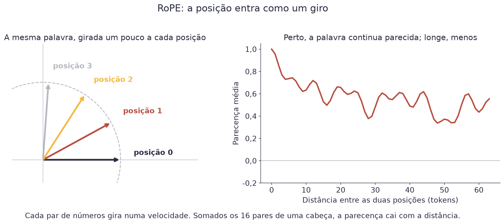

# Aula 11 — O Transformer e o Treino


**O que você leva desta aula**

Você vai dar à atenção a noção de posição e quatro cabeças, montar o
modelo inteiro (787.584 pesos), escrever o laço de treino e treinar por
35 minutos no processador do Colab. No fim, escreve a função que
transforma a saída do modelo em texto, e sai com um arquivo com o seu
modelo de linguagem, que escreve português com sotaque de 1899.


## Onde estamos

<figure><figcaption>Falta a posição. Depois, montar, ligar o treino, e ouvir o modelo escrever.</figcaption></figure>

## Todas as peças já existem

Tirando a posição e as várias cabeças, que fecham a atenção, esta aula
não tem quase nada de novo:

| Peça | De onde veio |
|---|---|
| Tokenizador | Aula 9 |
| Lote de treino e perda | Aula 10 |
| Atenção com máscara | Aula 10 |
| Laço de treino em PyTorch | Aula 10 |
| Camada densa com ativação | Aula 7 |
| Normalização | Aula 7 |
| Gradiente descendente | Aula 1 |
| Entropia cruzada e softmax | Aulas 3 e 8 |

O que falta é a montagem: em que ordem colocar as peças, e como treinar
sem que nada exploda.

## Quatro cabeças, quatro olhares

Uma atenção só tem que decidir tudo com um conjunto de pesos. Na prática,
o modelo roda várias em paralelo, cada uma com sua própria tabela de Q, K e
V, e junta os resultados no fim. Cada uma se chama **cabeça** (*head*).

O nosso modelo tem 4 cabeças por camada. Como o vetor tem 128 números,
cada cabeça trabalha com 32. As quatro saídas de 32, lado a lado, voltam a
ser 128, e uma última tabela (`saida`) mistura o que as quatro acharam:

```python
resultados = []
for cabeca in self.cabecas:
    resultados.append(cabeca(x))
juntos = torch.cat(resultados, dim=-1)    # 4 × 32 = 128
return self.saida(juntos)
```

A conta dos pesos: cada cabeça tem três tabelas de 128 × 32 (12.288
pesos), e as quatro somam 49.152. A tabela de saída tem 128 × 128 =
16.384. Uma camada de atenção inteira tem **65.536 pesos**, o mesmo custo
de uma cabeça grande de 128. O que se ganha é a variedade:

<figure><figcaption>As oito cabeças, na mesma frase. Nenhuma faz o que a outra faz.</figcaption></figure>

Agora olhe de perto duas delas, na frase "A casa de Capitú tinha uma janela
para a rua.":

<figure><figcaption>Cada linha é uma posição prevendo. Cada coluna é para onde ela olhou.</figcaption></figure>

Duas coisas para reparar. Primeira: o canto de cima à direita é todo
branco. É a máscara funcionando, no modelo de verdade. Segunda: "Capitú"
aparece cortado em quatro tokens (`·C`, `ap`, `it`, `ú`), porque um
vocabulário de 1.024 não tem espaço para nomes próprios. Os pedaços de uma
palavra costumam se olhar entre si, e é isso que remonta a palavra.

Dá para medir o que cada camada faz. Numa frase de 34 tokens, a média de
quão longe cada cabeça olha:

| Camada | Distância média | Peso na palavra anterior |
|---|---|---|
| 1 | 7,4 tokens | 9% |
| 2 | 3,2 tokens | 36% |
| 3 | 4,3 tokens | 25% |
| 4 | 4,7 tokens | 26% |

A primeira camada espalha o peso pela frase e quase não olha a palavra
imediatamente anterior. A segunda é a mais local, com mais de um terço do
peso na anterior. As de cima ficam no meio do caminho.

Ninguém programou essa divisão de trabalho: ela sai do treino.

## O buraco 2, enfim: a posição

Ficou uma dívida da Aula 10. Nem Q, nem K, nem V, nem a máscara, nem as
quatro cabeças resolveram o saco de palavras: embaralhe a frase e a conta
dá o mesmo. Todas essas peças mexem em *quem olha para quem*, e nenhuma
delas sabe *onde* cada palavra está.

A correção precisa entrar antes dos produtos escalares, mexendo nos
vetores. A solução moderna se chama **RoPE** (*rotary position embedding*,
embutimento rotativo de posição): gire a pergunta e a etiqueta de cada
palavra por um ângulo proporcional à posição dela.

<figure><figcaption>Duas palavras próximas giram ângulos parecidos, e continuam parecidas. Longe, a parecença cai.</figcaption></figure>

O giro trabalha em pares de números. Cada par `(a, b)` do vetor gira por
um ângulo `θ`, que é a posição vezes uma velocidade:

$$(a',\; b') = (a\cos\theta - b\sin\theta,\;\; a\sin\theta + b\cos\theta), \qquad \theta = p \cdot \omega$$

| Símbolo | Significado |
|---|---|
| `a`, `b` | um par de números do vetor |
| `p` | a posição da palavra na janela (0, 1, 2...) |
| `ω` | a velocidade de giro daquele par; cada par tem a sua |
| `θ` | o ângulo, em radianos |

Exemplo: o par `(1, 0)`, com velocidade `ω = 0,5`, na posição 2. O ângulo
é `θ = 2 × 0,5 = 1`. O par girado é `(cos 1, sen 1) = (0,54, 0,84)`. Na
posição 0, não gira nada.

Girar tem uma propriedade que serve à perfeição aqui: quando você gira
dois vetores e calcula o produto entre eles, o que sobra é a **diferença**
entre os dois ângulos. Uma palavra na posição 3 comparada com outra na
posição 1 dá o mesmo produto que as mesmas palavras nas posições 13 e 11.
O produto passa a depender da distância entre as palavras, e não da
posição de cada uma. O modelo trata igual uma frase que aparece no começo
e no fim do texto.

Cada par gira numa velocidade diferente: os primeiros rápido, os últimos
devagar. Na média de todos os pares, palavras próximas continuam parecidas
e palavras distantes ficam menos parecidas, que é a curva da direita na
figura.

O RoPE entra em duas linhas da cabeça de atenção. O conteúdo (`v`) não
gira, porque ele é o que a palavra entrega, e não o que entra na comparação:

```python
q = girar(self.pergunta(x))
k = girar(self.etiqueta(x))
```

## A prova

Hora de medir se tudo isso vale a pena. Pegue o modelo bigrama da Aula 10,
que só olha o token atual, e acrescente **uma** camada de atenção:

```python
x = self.embutir(indices)
x = x + self.atencao(x)        # a palavra, mais o que ela viu para trás
logits = self.cabeca(x)
```

Treine os dois do zero, do mesmo jeito, por 600 passos cada, e meça a
perda na validação:

| Modelo | Perda na validação |
|---|---|
| Só o token atual (bigrama) | 4,38 |
| Com uma camada de atenção | **4,17** |

Mesmo treino, mesmos dados. A única diferença é olhar para trás, e ela
baixou a perda em 0,2. Ainda nesta aula o modelo ganha mais três camadas e
um treino de meia hora, e essa diferença cresce muito.

## O preço da janela

Uma conta que explica muita notícia. Para uma janela de `n` tokens, a
atenção calcula `n × n` produtos escalares. Dobrar a janela quadruplica o
custo.

| Janela | Produtos por cabeça |
|---|---|
| 128 (o nosso) | 16.384 |
| 1.000 | 1 milhão |
| 100.000 | 10 bilhões |

É por isso que janela grande é caro, e por que cada modelo novo anuncia a
janela dele como se fosse uma conquista. É.

## O bloco transformer

Um **transformer** é um bloco repetido várias vezes. Cada bloco tem duas
metades, e as duas seguem o mesmo desenho: normaliza, faz alguma coisa,
soma de volta.

<figure><figcaption>Um bloco. A primeira metade mistura posições, a segunda pensa sobre cada posição isolada.</figcaption></figure>

```python
def forward(self, x):
    x = x + self.atencao(self.norma1(x))    # junta informação dos vizinhos
    x = x + self.mlp(self.norma2(x))        # pensa sobre a mistura
    return x
```

Duas linhas. Repare no `x +` das duas: é o **atalho** (conexão residual).
A entrada inteira atravessa o bloco por fora, e o modelo soma a ela o que
saiu.

### As duas metades

A **primeira metade é a atenção** da Aula 10: é onde as posições conversam
entre si. É a única parte do modelo em que uma palavra vê outra.

A **segunda metade é uma camada densa** da Aula 7 (o MLP), aplicada a cada
posição **separadamente**. Ela não olha para os vizinhos: pega o vetor que
a atenção montou e pensa sobre ele sozinho.

Essa divisão de trabalho é o transformer inteiro, e vale decorar assim:

> A atenção **junta** informação de outras posições. A camada densa
> **pensa** sobre essa mistura, uma posição de cada vez.

### Para que serve o atalho

Sem o atalho, o gradiente da Aula 1 precisa atravessar todos os blocos
para chegar ao primeiro, e vai encolhendo pelo caminho. Com ele, existe um
caminho direto da saída até qualquer bloco.

Isso não é para acreditar: é para medir. Empilhe cinco blocos com os pesos
pequenos do modelo de verdade, faça um passo para trás e meça quanto
gradiente chega na entrada de cada bloco:

<figure><figcaption>Escala logarítmica. Com atalho, todo bloco recebe o mesmo gradiente. Sem ele, o primeiro recebe quase nada.</figcaption></figure>

| Bloco | Sem atalho | Com atalho | O atalho entrega |
|---|---|---|---|
| 1 (o primeiro) | 0,00000005 | 0,000049 | **922 vezes mais** |
| 2 | 0,0000031 | 0,000049 | 16 vezes mais |
| 3 | 0,0000022 | 0,000049 | 23 vezes mais |
| 4 | 0,0000014 | 0,000049 | 34 vezes mais |
| 5 (o último) | 0,0000009 | 0,000049 | 52 vezes mais |

Leia a coluna do meio: sem atalho, até o último bloco já recebe 52 vezes
menos gradiente, e o primeiro recebe quase mil vezes menos. Com o atalho,
os cinco recebem exatamente o mesmo.

Esse é o **gradiente que desaparece**, e foi ele que travou as redes
profundas por anos. A ideia do atalho, de 2015, é o que permitiu empilhar
dezenas de camadas. O primeiro bloco e o embutimento, que ficam embaixo de
tudo, são justamente os que mais precisam do gradiente para aprender.

Uma segunda leitura, mais intuitiva: cada bloco não reescreve o vetor da
palavra. Ele **acrescenta** alguma coisa ao que já estava lá.

### RMSNorm: a normalização enxuta

A normalização antes de cada metade faz o de sempre, desde a Aula 7:
mantém os números num tamanho parecido, para o treino não desandar. A
versão que os modelos de hoje usam divide cada número pelo tamanho típico
do vetor:

$$\hat{x}_i = \frac{x_i}{\sqrt{\frac{1}{d}\sum_{j=1}^{d} x_j^2}}$$

| Símbolo | Significado |
|---|---|
| `xᵢ` | um dos números do vetor que entra |
| `d` | quantos números o vetor tem (128 no nosso modelo) |
| `x̂ᵢ` | o mesmo número, depois de normalizado |

Exemplo com um vetor de dois números, `x = (3, 4)`. A média dos quadrados
é (9 + 16) / 2 = 12,5. A raiz é 3,54. O vetor normalizado é
(3 / 3,54, 4 / 3,54) = (0,85, 1,13). Depois disso, cada número ainda é
multiplicado por um peso que o treino ajusta: são os 128 pesos de cada
RMSNorm.

O nome vem de *root mean square*, raiz da média dos quadrados. É a
normalização da Aula 7 sem a subtração da média: faz quase o mesmo e custa
menos conta.

### SwiGLU: a camada densa com porta

A camada densa do bloco tem dois caminhos. Um leva o conteúdo (`subida`).
O outro passa por uma ativação suave e vira uma **porta** (`porta`), que
decide, número a número, quanto do conteúdo passa adiante. No fim, uma
terceira tabela (`descida`) volta para 128 números:

```python
def forward(self, x):
    porta = F.silu(self.porta(x))       # quanto deixar passar
    conteudo = self.subida(x)           # o que vai passar
    return self.descida(porta * conteudo)
```

<figure><figcaption>A dobra da ReLU ficou lisa, e um segundo caminho decide o que passa.</figcaption></figure>

RMSNorm e SwiGLU são otimizações, não conceitos. Llama, Qwen e quase todo
modelo aberto de hoje usam as duas. Se você trocasse pelas versões de 2017
(LayerNorm e ReLU), o modelo desta aula ainda treinaria e ainda escreveria
português, só que um pouco pior.

## O modelo inteiro

Com o bloco pronto, o modelo é uma lista de quatro blocos entre o
embutimento e a cabeça de saída:

```python
class MiniLLM(nn.Module):
    def __init__(self):
        super().__init__()
        self.embutir = nn.Embedding(1024, 128)
        lista = []
        for _ in range(4):
            lista.append(Bloco())
        self.blocos = nn.ModuleList(lista)
        self.norma = nn.RMSNorm(128)
        self.cabeca = nn.Linear(128, 1024, bias=False)
        self.cabeca.weight = self.embutir.weight   # pesos amarrados

    def forward(self, indices, alvos):
        x = self.embutir(indices)
        for bloco in self.blocos:
            x = bloco(x)
        logits = self.cabeca(self.norma(x))
        ...
```

A linha dos pesos amarrados merece explicação. A tabela de entrada troca
token por vetor; a cabeça de saída faz o contrário, troca vetor por uma
pontuação para cada token. Usar a **mesma** tabela nos dois sentidos
economiza 131.072 pesos e costuma melhorar o resultado, porque a tabela
recebe gradiente das duas pontas.

### Onde moram os pesos

<figure><figcaption>Metade dos pesos está no MLP. A atenção é a peça famosa, mas não é a maior.</figcaption></figure>

A conta inteira cabe numa tabela:

| Peça | Conta | Pesos |
|---|---|---|
| Embutimento (e cabeça, amarrada) | 1.024 × 128 | 131.072 |
| Atenção, por bloco | 4 cabeças × 3 × 128 × 32 + 128 × 128 | 65.536 |
| MLP, por bloco | 3 × 128 × 256 | 98.304 |
| Normalizações | 2 × 128 por bloco, mais 128 no fim | 1.152 |
| **Total**, com 4 blocos | 131.072 + 4 × (65.536 + 98.304) + 1.152 | **787.584** |

Isso costuma surpreender. A atenção é o que dá nome ao artigo e o que
todo mundo explica, mas o modelo gasta mais pesos nas camadas densas que
vêm depois dela.

### Pesos pequenos no começo

Antes do treino, o modelo sorteia todos os pesos perto de zero, com desvio de
0,02. As duas tabelas que somam no atalho (`saida`, da atenção, e
`descida`, do MLP) começam ainda menores. Sem isso, cada bloco soma um
vetor grande ao atalho, os números crescem bloco a bloco, e a primeira
perda explode.

## A perda e o teste do passo zero

É a mesma perda da Aula 10: a entropia cruzada, com 1.024 categorias,
calculada em cada uma das 128 posições de cada uma das 32 janelas do lote.

Antes de qualquer treino, o modelo chuta igual entre os 1.024 tokens.
Então a probabilidade do token certo é `1/1024`, e a perda tem que dar
`ln(1024) = 6,93`. O modelo recém-montado dá 6,95, o que confirma que a
montagem está certa.


**Um teste que vale ouro**

Sempre confira a perda no passo 0 contra `ln(vocabulário)`. Se der muito
diferente, tem erro de montagem ou de inicialização, e é muito mais fácil
achar agora do que depois de meia hora de treino.


## Perplexidade: a perda em português

Perda de 3,4 não diz nada a ninguém. Tire a exponencial e ela vira um
número com significado:

$$\text{perplexidade} = e^{\text{perda}}$$

| Símbolo | Significado |
|---|---|
| `perda` | a entropia cruzada média na validação |
| `e` | o número de Euler, 2,718 |

Exemplo:

| Perda | Perplexidade | Significa |
|---|---|---|
| 6,93 | 1.024 | o modelo não sabe nada |
| 4,48 | 88 | o contador de pares da Aula 10 |
| 3,40 | 30 | ele está escolhendo entre uns 30 candidatos |
| 0 | 1 | ele acerta sempre, o que só acontece se decorou |

Perplexidade é "entre quantos tokens o modelo está efetivamente na
dúvida". Sair de 1.024 para 30 quer dizer que o modelo eliminou 97% dos
candidatos antes de escolher.

## O laço de treino

É o laço da Aula 10, com quatro proteções a mais:

```python
while tempo_que_passou < tempo_de_treino:
    ajustar_taxa(fracao_do_tempo)                    # 1. o passo muda com o relógio
    if passo % 200 == 0:
        conferir_e_salvar_o_melhor()                 # 2. validação e arquivo
    entrada, alvo = sortear_lote(dados_treino)
    logits, perda = modelo(entrada, alvo)
    otimizador.zero_grad()
    perda.backward()
    torch.nn.utils.clip_grad_norm_(modelo.parameters(), 1.0)   # 3. corte
    otimizador.step()                                # 4. AdamW
```

### AdamW

O **AdamW** é o otimizador. Ele é o gradiente descendente da Aula 1 com
duas melhorias: guarda uma média dos gradientes recentes, o que suaviza o
caminho, e dá passos maiores nas direções em que o gradiente é pequeno mas
constante. O "W" é um empurrão leve de todos os pesos em direção ao zero
(*weight decay*), que ajuda o modelo a não decorar.

### O corte do gradiente

De vez em quando um lote sai muito fora do normal, e o gradiente fica
enorme. Um passo desses joga os pesos para longe e estraga o que já foi
aprendido. O **corte de gradiente** (`clip_grad_norm_`) limita o tamanho
total do gradiente. Se ele passar de 1, o corte divide todos os números
pelo mesmo fator até o tamanho dar 1. A direção do passo não muda; só o
tamanho.

Exemplo: o gradiente tem tamanho 5. O corte divide cada número dele por 5,
e o passo sai cinco vezes menor, na mesma direção.

### O tamanho do passo segue o relógio

<figure><figcaption>Aquecimento e resfriamento. É o padrão em qualquer treino de modelo de linguagem.</figcaption></figure>

No começo os pesos são aleatórios, e passo grande em direção errada só faz
estrago: por isso o **aquecimento**, com a taxa subindo do zero no
primeiro minuto. No fim, o modelo está perto de um bom lugar e passo
grande faz ele passar do ponto: por isso o **resfriamento**, com a taxa
descendo até um décimo do máximo.

O treino desta aula tem uma diferença em relação aos treinos de
referência: ele dura um **tempo fixo**, 35 minutos, e não um número fixo
de passos. A taxa depende da fração do tempo que já passou. Assim o treino
termina na hora certa em qualquer Colab, rápido ou lento, e quem tem uma
máquina mais rápida simplesmente dá mais passos.

### Conferir e salvar o melhor

A cada 200 passos, o laço mede a perda em lotes de treino e de validação,
anota as duas no histórico, e salva o modelo no arquivo `meu_llm.pt` **se
a validação for a melhor até ali**. Duas consequências práticas: se o
Colab cair no meio, o melhor modelo já está salvo; e o arquivo guarda o
modelo que melhor generaliza, e não o último.

O laço inteiro, e o que ele faz com a perda e com o texto:

<figure><video src="../assets/aula-11/treino.mp4" poster="../assets/aula-11/treino.jpg" controls preload="none" playsinline aria-label="Animação do laço de treino com a curva da perda caindo"></video><figcaption>Cinco passos por volta, milhares de voltas. A curva e as amostras são do treino de referência.</figcaption></figure>

## O treino de verdade

Quantos passos cabem em 35 minutos depende da máquina. No teste deste
curso, com duas linhas de execução (as mesmas do Colab gratuito), foram
5.600 passos e perda de validação 3,28 com o processador livre, e 2.100
passos e perda 3,39 com o processador dividido com outro programa. O seu
Colab deve cair nessa faixa: perplexidade perto de 30, bem abaixo dos 88
do contador de pares da Aula 10. O modelo de referência, treinado por mais
tempo num processador maior, mostra a curva inteira:

<figure><figcaption>A queda grande acontece nos primeiros mil passos. Depois, cada ponto a menos custa mais.</figcaption></figure>

Repare no formato: a perda despenca no começo e depois vai ficando cada
vez mais difícil melhorar. Essa curva explica por que treinar modelos
grandes é caro. Cada ponto a menos custa mais que o anterior, e não existe
atalho.

E veja o que sai do modelo em cada momento:

<figure><figcaption>O mesmo início, gerado em quatro momentos. Nada mudou além do valor dos 787.584 pesos.</figcaption></figure>

No passo 0 é ruído. Em 200 passos já existem palavras curtas e vírgulas em
lugares plausíveis. Em 1.000 aparecem frases inteiras, erradas mas
gramaticais. No fim, ele escreve com a grafia de 1899, porque foi isso que
leu. A ordem é sempre a mesma: primeiro a forma, depois as palavras, e o
sentido por último.


**Erro do dia**

Julgar o modelo pela perda de treino. No modelo de referência, ela
estava em 2,66 no melhor ponto, enquanto a de validação parou em 3,33.
Essa diferença é o modelo decorando trechos do corpus. Enquanto as duas
caem juntas, tudo bem. Quando a de validação para ou sobe, o que vem
depois é decoreba. É por isso que o treino salva pela validação.


## O modelo não devolve uma palavra

Este é o mal-entendido mais comum sobre modelos de linguagem, e vale
desfazer com um gráfico. Dê ao modelo treinado o começo "Não sei se a
senhora" e olhe o que ele produz:

<figure><figcaption>Uma passada do modelo devolve 1.024 números, um por token do vocabulário.</figcaption></figure>

O favorito, `·é`, tem só 7,6%. As dez melhores continuações juntas dão
37%, e são precisos 116 tokens para somar 90% da probabilidade.

Escolher **qual** desses 1.024 vai para a tela é um problema separado,
que nada tem a ver com o treino. Ele tem nome: **amostragem**
(*sampling*), e é o assunto do fim desta aula e do começo da Aula 12.

## Gerar é repetir um passo

O modelo devolve uma previsão para cada posição do texto. Para gerar,
só interessa a da **última** posição: é ela que viu o texto inteiro. O
resto do mecanismo é um laço:

```python
indices = codificar("A casa de")
for _ in range(100):
    logits, _ = modelo(torch.tensor([indices[-128:]]))  # 1. passa o texto
    pontuacoes = logits[0, -1]                          # 2. só a última posição
    probabilidades = F.softmax(pontuacoes, dim=-1)      # 3. vira chance
    proximo = torch.multinomial(probabilidades, 1)      # 4. sorteia um token
    indices.append(proximo.item())                      # 5. cola no fim
```

O `[-128:]` corta o texto nos últimos 128 tokens, o tamanho da janela de
contexto. Isso se chama **geração autorregressiva**, e tem uma consequência
que explica muito: o token sorteado no passo 4 vira entrada do passo 1
seguinte. Se ele foi ruim, o modelo não tem como voltar atrás. Ele agora
precisa continuar coerentemente a partir do erro.

<figure><video src="../assets/aula-12/geracao.mp4" poster="../assets/aula-12/geracao.jpg" controls preload="none" playsinline aria-label="Animação da geração de texto, um token sorteado de cada vez"></video><figcaption>Oito passos reais do modelo, sorteando com temperatura 0,8: "A casa de" vira "A casa de Natividade continuou a". Repare no primeiro sorteio: saiu um token com 2,2% de chance.</figcaption></figure>

## Duas escolhas ruins

**Sempre o mais provável.** Troque o sorteio por `argmax`. Chama-se
decodificação gulosa (*greedy*). É determinística e parece segura, e o
resultado é ruim: o texto entra em laço, repetindo a mesma frase. Um texto
que só escolhe o topo acaba num lugar de onde o topo aponta de volta para
si.

**Sortear direto da distribuição.** O oposto: cada token tem exatamente a
chance que o modelo deu. O problema está na cauda. No exemplo do começo,
os tokens fora dos 40 melhores somam 32% da probabilidade, espalhados por
984 candidatos. Um a um eles são improváveis, mas juntos dão quase uma
chance em três de o modelo escolher algo que ele mesmo considera ruim.

A saída é ficar no meio, com três controles, que são o assunto da Aula 12.

## Cola da aula

| Conceito | Em uma frase |
|---|---|
| Cabeças | várias atenções em paralelo, juntadas e misturadas no fim |
| RoPE | gira Q e K pela posição; no produto sobra a distância |
| Custo da janela | `n × n` produtos: dobrar a janela quadruplica a conta |
| Bloco transformer | normaliza, atenção, soma; normaliza, MLP, soma |
| Atenção e MLP | a atenção junta informação das posições; o MLP pensa sobre cada uma |
| Atalho | soma a entrada à saída; deixa o gradiente chegar ao primeiro bloco |
| RMSNorm | divide o vetor pela raiz da média dos quadrados |
| SwiGLU | camada densa com porta, que decide quanto de cada número passa |
| Pesos amarrados | a mesma tabela no embutimento e na cabeça de saída |
| 787.584 pesos | metade no MLP, um terço na atenção, um sexto no embutimento |
| Passo zero | a perda do modelo novo tem que dar perto de `ln(1024) = 6,93` |
| Perplexidade | `e` elevado à perda: entre quantos tokens o modelo tem dúvida |
| AdamW | gradiente descendente com memória e um empurrão para o zero |
| Corte de gradiente | limita o tamanho do passo, sem mudar a direção |
| Aquecimento e resfriamento | passo pequeno no começo e no fim |
| Validação | o número que vale; o treino salva o melhor por ela |
| Amostragem | escolher um dos 1.024 tokens a partir das chances do modelo |
| Autorregressão | cada token escolhido vira entrada do passo seguinte |
| Guloso | sempre o mais provável; entra em laço |

## Materiais

- **Notebook desta aula, no Google Colab:** [](https://colab.research.google.com/github/klein-natan/nanodegree-AI-Atitus/blob/main/notebooks/aula-11-transformer-e-treino.ipynb)
- **Quiz de cada microaula:** [no fim desta página](#quizzes-das-microaulas), 5 perguntas depois de cada explicação, antes do exercício.
- **Travou num exercício?** [Colas dos exercícios](colas-dos-exercicios.md#aula-11-o-transformer-e-o-treino), com dicas que você abre uma de cada vez.
- Slides desta aula: entregues em sala.
- Modelo de referência, treinado: [`mini_llm.pt`](https://github.com/klein-natan/nanodegree-AI-Atitus/blob/main/data/mini_llm.pt)

Os três exercícios do notebook:

| Exercício | O que você constrói |
|---|---|
| 11.1 | o giro, quatro cabeças, o MLP, o bloco, e a medida do atalho |
| 11.2 | o MiniLLM inteiro, a perplexidade, a função de treino e o treino de 35 minutos |
| 11.3 | a curva do treino, a geração gulosa e por sorteio, e o arquivo `meu_llm.pt` |


**Leve o seu modelo para casa**

No fim do Exercício 3, baixe o arquivo `meu_llm.pt`. O Colab apaga tudo
quando a aba fecha, e a Aula 12 começa carregando esse arquivo. Se você
perder, a Aula 12 oferece o modelo do professor, que tem o mesmo formato.


## Para ir além

- [Let's build GPT, from scratch (Andrej Karpathy)](https://www.youtube.com/watch?v=kCc8FmEb1nY): duas horas de vídeo montando a mesma coisa, linha por linha. Em inglês.
- [Transformers, the tech behind LLMs (3Blue1Brown)](https://www.youtube.com/watch?v=wjZofJX0v4M): o modelo inteiro, do token à previsão, em animação. Em inglês, com legendas.
- [nanoGPT, de Andrej Karpathy](https://github.com/karpathy/nanoGPT): o repositório que inspirou o modelo desta aula, com 300 linhas de PyTorch.

## Quizzes das microaulas

Depois de cada microaula, e antes do exercício no Colab, responda o quiz
dela. As perguntas aparecem uma de cada vez, como uma pilha de cartas:
responda, leia a explicação e passe para a próxima. No fim aparece quantas
você acertou. Nada fica gravado: dá para refazer quantas vezes quiser.

### Microaula 1: posição, cabeças e o bloco



```quiz
O nosso modelo usa 4 cabeças de 32 números em vez de uma cabeça de 128. O que se ganha?
- Velocidade: quatro cabeças custam quatro vezes menos.
+ Variedade: cada cabeça aprende a olhar para uma coisa diferente.
- Mais pesos: quatro cabeças têm quatro vezes mais.
- Nada: é só um jeito diferente de escrever.
? O custo é o mesmo de uma cabeça de 128. Uma cabeça pode olhar a palavra anterior, outra o sujeito, outra os pedaços da mesma palavra.
```

```quiz
O que o RoPE faz?
- Apaga as palavras distantes.
- Soma a posição ao número do token.
+ Gira a pergunta e a etiqueta por um ângulo que cresce com a posição.
- Ordena as palavras em ordem alfabética.
? No produto de dois vetores girados sobra só a diferença dos ângulos. A atenção passa a saber a distância entre as palavras, e a ordem volta a importar.
```

```quiz
Qual é o desenho das duas metades de um bloco transformer?
- Atenção, depois soma, depois normaliza.
- Só atenção, repetida duas vezes.
+ Normaliza, faz alguma coisa (atenção ou MLP), soma de volta à entrada.
- Embutimento, atenção, cabeça de saída.
? Em código: x = x + atencao(norma1(x)) e x = x + mlp(norma2(x)). O "x +" das duas linhas é o atalho.
```

```quiz
Sem o atalho, o que acontece com o gradiente que chega ao primeiro bloco?
- Ele fica maior que o do último bloco.
- Ele fica exatamente igual.
- Ele vira negativo.
+ Ele chega quase mil vezes menor, e o primeiro bloco quase não aprende.
? É o gradiente que desaparece. Com o atalho, existe um caminho direto da saída até qualquer bloco, e todos recebem o mesmo tanto.
```

```quiz
No SwiGLU, o que a "porta" faz?
- Fecha o modelo quando a perda sobe.
- Escolhe qual palavra vem depois.
+ Decide, número a número, quanto do conteúdo passa adiante.
- Separa o texto de treino do de validação.
? Um caminho carrega o conteúdo (subida); o outro, depois da SiLU, vira a porta. Os dois se multiplicam, e a descida volta para 128 números.
```



### Microaula 2: o modelo inteiro e o treino



```quiz
Onde está a maior parte dos 787.584 pesos do modelo?
- No embutimento.
- Na atenção.
+ No MLP, a camada densa de cada bloco.
- Na normalização.
? O MLP tem 393.216 pesos (50%), a atenção 262.144 (33%), o embutimento 131.072 (17%) e a normalização só 1.152.
```

```quiz
Se a perda na validação é 3,40, qual é a perplexidade?
- 3,40
- 340
+ Cerca de 30
- 1.024
? Perplexidade é e elevado à perda: e^3,40 ≈ 30. O modelo está na dúvida entre uns 30 tokens, e não mais entre 1.024.
```

```quiz
O que o AdamW tem a mais que o gradiente descendente da Aula 1?
+ Uma média dos gradientes recentes, passos ajustados por direção, e um empurrão leve dos pesos para o zero.
- Ele não usa gradiente nenhum.
- Ele treina sem precisar de perda.
- Ele só funciona em placa de vídeo.
? É o gradiente descendente com memória. O "W" (weight decay) segura o modelo contra decorar.
```

```quiz
Um lote estranho gerou um gradiente de tamanho 5. Com o corte em 1, o que acontece?
- O passo é cancelado.
- O gradiente vira 1 em todas as direções.
+ Cada número do gradiente é dividido por 5: o passo fica menor, na mesma direção.
- O lote é sorteado de novo.
? O corte limita o tamanho do passo sem mudar a direção. É um seguro barato contra um lote fora do normal.
```

```quiz
A cada 200 passos, o treino salva o modelo em meu_llm.pt. Quando?
- Sempre, sobrescrevendo o anterior.
+ Só quando a perda na validação é a melhor até ali.
- Só quando a perda de treino sobe.
- Só no último passo.
? Assim o arquivo guarda o modelo que melhor generaliza. E se o Colab cair no meio, o melhor modelo já está salvo.
```



### Microaula 3: do número à palavra



```quiz
Ao longo do treino, o que o modelo aprende primeiro?
- O sentido das frases.
- Os nomes das personagens.
+ As letras e a pontuação, depois as palavras curtas, depois frases gramaticais.
- A grafia moderna.
? A ordem é sempre a mesma: primeiro a forma, depois as palavras, e o sentido por último. É o que ele menos tem no fim.
```

```quiz
A perda de treino está bem abaixo da perda de validação. O que isso indica?
- Que o modelo está ótimo e pode treinar para sempre.
- Que a validação está com erro.
+ Que o modelo está decorando trechos do texto que viu.
- Que o tokenizador está errado.
? O número que vale é o da validação. Enquanto as duas caem juntas, tudo bem; quando a de validação para ou sobe, o resto é decoreba.
```

```quiz
Para gerar texto, de qual posição o modelo usa as pontuações?
- Da primeira.
- Da do meio.
+ Da última, a que viu o texto inteiro.
- De todas, somadas.
? As outras posições servem ao treino. Para gerar, só interessa a previsão depois do último token: logits[0, -1].
```

```quiz
O que acontece quando o modelo escolhe sempre o token mais provável (decodificação gulosa)?
- O texto fica criativo e variado.
- O texto fica cheio de palavras inventadas.
- O modelo para de gerar.
+ Sai sempre o mesmo texto, e ele costuma entrar em laço, repetindo um pedaço.
? Um texto que só escolhe o topo acaba num lugar de onde o topo aponta de volta para si. No exemplo da aula: "--Não, senhor. --Não, senhor."
```

```quiz
Qual é o problema de sortear direto da distribuição do modelo, sem corte nenhum?
+ A cauda: centenas de tokens improváveis, somados, ganham com frequência.
- O texto sai sempre igual.
- O sorteio é lento demais.
- O modelo deixa de usar a janela de contexto.
? No exemplo da aula, os tokens fora dos 40 melhores somam 32% da chance. Quase uma vez em três sai algo que o próprio modelo considera ruim.
```


