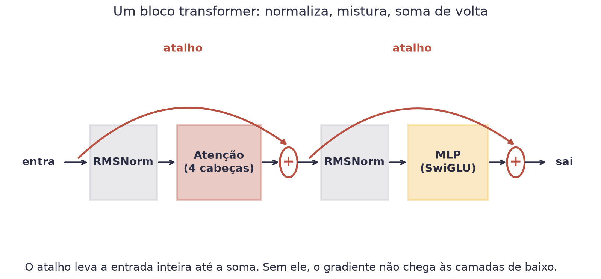
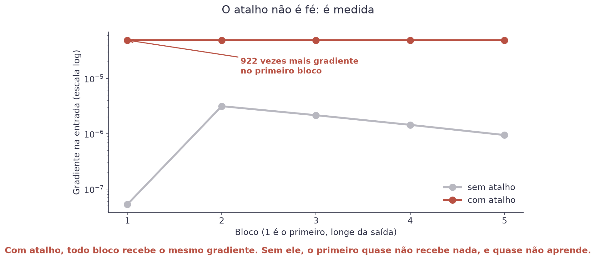
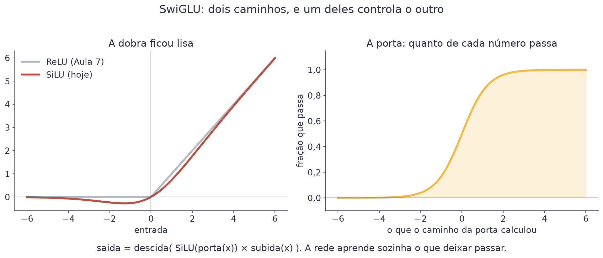
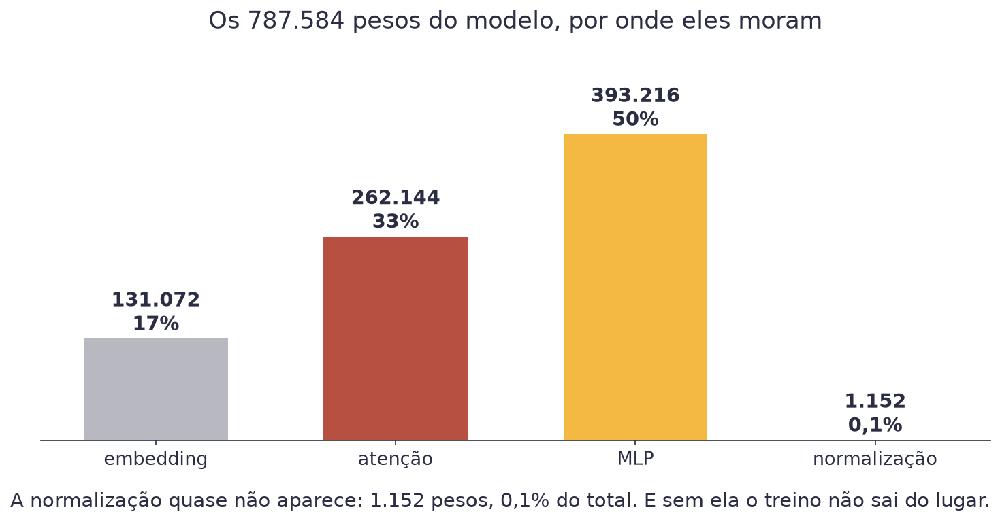

# Aula 11 — O Transformer e o Treino


**O que você leva desta aula**

Você vai montar o modelo inteiro (787.584 pesos), escrever o laço de
treino, e treinar por 35 minutos no processador do Colab. No fim, você tem
um arquivo com o seu modelo de linguagem, que escreve português com
sotaque de 1899.


## Onde estamos

<figure><figcaption>As peças estão todas prontas. Falta montar e ligar.</figcaption></figure>

## Todas as peças já existem

Esta aula não tem quase nada de novo, e vale começar por aí:

| Peça | De onde veio |
|---|---|
| Tokenizador e lote de treino | Aula 9 |
| Atenção com máscara, várias cabeças, RoPE | Aula 10 |
| Laço de treino em PyTorch | Aula 10 |
| Camada densa com ativação | Aula 7 |
| Normalização | Aula 7 |
| Gradiente descendente | Aula 1 |
| Entropia cruzada e softmax | Aulas 3 e 8 |

O que falta é a montagem: em que ordem colocar as peças, e como treinar
sem que nada exploda.

## O bloco transformer

Um **transformer** é um bloco repetido várias vezes. Cada bloco tem duas
metades, e as duas seguem o mesmo desenho: normaliza, faz alguma coisa,
soma de volta.

<figure><figcaption>Um bloco. A primeira metade mistura posições, a segunda pensa sobre cada posição isolada.</figcaption></figure>

```python
def forward(self, x):
    x = x + self.atencao(self.norma1(x))    # junta informação dos vizinhos
    x = x + self.mlp(self.norma2(x))        # pensa sobre a mistura
    return x
```

Duas linhas. Repare no `x +` das duas: é o **atalho** (conexão residual).
A entrada inteira atravessa o bloco por fora, e o modelo soma a ela o que
saiu.

### As duas metades

A **primeira metade é a atenção** da Aula 10: é onde as posições conversam
entre si. É a única parte do modelo em que uma palavra vê outra.

A **segunda metade é uma camada densa** da Aula 7 (o MLP), aplicada a cada
posição **separadamente**. Ela não olha para os vizinhos: pega o vetor que
a atenção montou e pensa sobre ele sozinho.

Essa divisão de trabalho é o transformer inteiro, e vale decorar assim:

> A atenção **junta** informação de outras posições. A camada densa
> **pensa** sobre essa mistura, uma posição de cada vez.

### Para que serve o atalho

Sem o atalho, o gradiente da Aula 1 precisa atravessar todos os blocos
para chegar ao primeiro, e vai encolhendo pelo caminho. Com ele, existe um
caminho direto da saída até qualquer bloco.

Isso não é para acreditar: é para medir. Empilhe cinco blocos com os pesos
pequenos do modelo de verdade, faça um passo para trás e meça quanto
gradiente chega na entrada de cada bloco:

<figure><figcaption>Escala logarítmica. Com atalho, todo bloco recebe o mesmo gradiente. Sem ele, o primeiro recebe quase nada.</figcaption></figure>

| Bloco | Sem atalho | Com atalho | O atalho entrega |
|---|---|---|---|
| 1 (o primeiro) | 0,00000005 | 0,000049 | **922 vezes mais** |
| 2 | 0,0000031 | 0,000049 | 16 vezes mais |
| 3 | 0,0000022 | 0,000049 | 23 vezes mais |
| 4 | 0,0000014 | 0,000049 | 34 vezes mais |
| 5 (o último) | 0,0000009 | 0,000049 | 52 vezes mais |

Leia a coluna do meio: sem atalho, até o último bloco já recebe 52 vezes
menos gradiente, e o primeiro recebe quase mil vezes menos. Com o atalho,
os cinco recebem exatamente o mesmo.

Esse é o **gradiente que desaparece**, e foi ele que travou as redes
profundas por anos. A ideia do atalho, de 2015, é o que permitiu empilhar
dezenas de camadas. O primeiro bloco e o embutimento, que ficam embaixo de
tudo, são justamente os que mais precisam do gradiente para aprender.

Uma segunda leitura, mais intuitiva: cada bloco não reescreve o vetor da
palavra. Ele **acrescenta** alguma coisa ao que já estava lá.

### RMSNorm: a normalização enxuta

A normalização antes de cada metade faz o de sempre, desde a Aula 7:
mantém os números num tamanho parecido, para o treino não desandar. A
versão que os modelos de hoje usam divide cada número pelo tamanho típico
do vetor:

$$\hat{x}_i = \frac{x_i}{\sqrt{\frac{1}{d}\sum_{j=1}^{d} x_j^2}}$$

| Símbolo | Significado |
|---|---|
| `xᵢ` | um dos números do vetor que entra |
| `d` | quantos números o vetor tem (128 no nosso modelo) |
| `x̂ᵢ` | o mesmo número, depois de normalizado |

Exemplo com um vetor de dois números, `x = (3, 4)`. A média dos quadrados
é (9 + 16) / 2 = 12,5. A raiz é 3,54. O vetor normalizado é
(3 / 3,54, 4 / 3,54) = (0,85, 1,13). Depois disso, cada número ainda é
multiplicado por um peso que o treino ajusta: são os 128 pesos de cada
RMSNorm.

O nome vem de *root mean square*, raiz da média dos quadrados. É a
normalização da Aula 7 sem a subtração da média: faz quase o mesmo e custa
menos conta.

### SwiGLU: a camada densa com porta

A camada densa do bloco tem dois caminhos. Um leva o conteúdo (`subida`).
O outro passa por uma ativação suave e vira uma **porta** (`porta`), que
decide, número a número, quanto do conteúdo passa adiante. No fim, uma
terceira tabela (`descida`) volta para 128 números:

```python
def forward(self, x):
    porta = F.silu(self.porta(x))       # quanto deixar passar
    conteudo = self.subida(x)           # o que vai passar
    return self.descida(porta * conteudo)
```

<figure><figcaption>A dobra da ReLU ficou lisa, e um segundo caminho decide o que passa.</figcaption></figure>

RMSNorm e SwiGLU são otimizações, não conceitos. Llama, Qwen e quase todo
modelo aberto de hoje usam as duas. Se você trocasse pelas versões de 2017
(LayerNorm e ReLU), o modelo desta aula ainda treinaria e ainda escreveria
português, só que um pouco pior.

## O modelo inteiro

Com o bloco pronto, o modelo é uma lista de quatro blocos entre o
embutimento e a cabeça de saída:

```python
class MiniLLM(nn.Module):
    def __init__(self):
        super().__init__()
        self.embutir = nn.Embedding(1024, 128)
        lista = []
        for _ in range(4):
            lista.append(Bloco())
        self.blocos = nn.ModuleList(lista)
        self.norma = nn.RMSNorm(128)
        self.cabeca = nn.Linear(128, 1024, bias=False)
        self.cabeca.weight = self.embutir.weight   # pesos amarrados

    def forward(self, indices, alvos):
        x = self.embutir(indices)
        for bloco in self.blocos:
            x = bloco(x)
        logits = self.cabeca(self.norma(x))
        ...
```

A linha dos pesos amarrados merece explicação. A tabela de entrada troca
token por vetor; a cabeça de saída faz o contrário, troca vetor por uma
pontuação para cada token. Usar a **mesma** tabela nos dois sentidos
economiza 131.072 pesos e costuma melhorar o resultado, porque a tabela
recebe gradiente das duas pontas.

### Onde moram os pesos

<figure><figcaption>Metade dos pesos está no MLP. A atenção é a peça famosa, mas não é a maior.</figcaption></figure>

A conta inteira cabe numa tabela:

| Peça | Conta | Pesos |
|---|---|---|
| Embutimento (e cabeça, amarrada) | 1.024 × 128 | 131.072 |
| Atenção, por bloco | 4 cabeças × 3 × 128 × 32 + 128 × 128 | 65.536 |
| MLP, por bloco | 3 × 128 × 256 | 98.304 |
| Normalizações | 2 × 128 por bloco, mais 128 no fim | 1.152 |
| **Total**, com 4 blocos | 131.072 + 4 × (65.536 + 98.304) + 1.152 | **787.584** |

Isso costuma surpreender. A atenção é o que dá nome ao artigo e o que
todo mundo explica, mas o modelo gasta mais pesos nas camadas densas que
vêm depois dela.

### Pesos pequenos no começo

Antes do treino, o modelo sorteia todos os pesos perto de zero, com desvio de
0,02. As duas tabelas que somam no atalho (`saida`, da atenção, e
`descida`, do MLP) começam ainda menores. Sem isso, cada bloco soma um
vetor grande ao atalho, os números crescem bloco a bloco, e a primeira
perda explode.

## A perda e o teste do passo zero

É a mesma perda da Aula 9: a entropia cruzada, com 1.024 categorias,
calculada em cada uma das 128 posições de cada uma das 32 janelas do lote.

Antes de qualquer treino, o modelo chuta igual entre os 1.024 tokens.
Então a probabilidade do token certo é `1/1024`, e a perda tem que dar
`ln(1024) = 6,93`. O modelo recém-montado dá 6,95, o que confirma que a
montagem está certa.


**Um teste que vale ouro**

Sempre confira a perda no passo 0 contra `ln(vocabulário)`. Se der muito
diferente, tem erro de montagem ou de inicialização, e é muito mais fácil
achar agora do que depois de meia hora de treino.


## Perplexidade: a perda em português

Perda de 3,4 não diz nada a ninguém. Tire a exponencial e ela vira um
número com significado:

$$\text{perplexidade} = e^{\text{perda}}$$

| Símbolo | Significado |
|---|---|
| `perda` | a entropia cruzada média na validação |
| `e` | o número de Euler, 2,718 |

Exemplo:

| Perda | Perplexidade | Significa |
|---|---|---|
| 6,93 | 1.024 | o modelo não sabe nada |
| 4,48 | 88 | o contador de pares da Aula 9 |
| 3,40 | 30 | ele está escolhendo entre uns 30 candidatos |
| 0 | 1 | ele acerta sempre, o que só acontece se decorou |

Perplexidade é "entre quantos tokens o modelo está efetivamente na
dúvida". Sair de 1.024 para 30 quer dizer que o modelo eliminou 97% dos
candidatos antes de escolher.

## O laço de treino

É o laço da Aula 10, com quatro proteções a mais:

```python
while tempo_que_passou < tempo_de_treino:
    ajustar_taxa(fracao_do_tempo)                    # 1. o passo muda com o relógio
    if passo % 200 == 0:
        conferir_e_salvar_o_melhor()                 # 2. validação e arquivo
    entrada, alvo = sortear_lote(dados_treino)
    logits, perda = modelo(entrada, alvo)
    otimizador.zero_grad()
    perda.backward()
    torch.nn.utils.clip_grad_norm_(modelo.parameters(), 1.0)   # 3. corte
    otimizador.step()                                # 4. AdamW
```

### AdamW

O **AdamW** é o otimizador. Ele é o gradiente descendente da Aula 1 com
duas melhorias: guarda uma média dos gradientes recentes, o que suaviza o
caminho, e dá passos maiores nas direções em que o gradiente é pequeno mas
constante. O "W" é um empurrão leve de todos os pesos em direção ao zero
(*weight decay*), que ajuda o modelo a não decorar.

### O corte do gradiente

De vez em quando um lote sai muito fora do normal, e o gradiente fica
enorme. Um passo desses joga os pesos para longe e estraga o que já foi
aprendido. O **corte de gradiente** (`clip_grad_norm_`) limita o tamanho
total do gradiente. Se ele passar de 1, o corte divide todos os números
pelo mesmo fator até o tamanho dar 1. A direção do passo não muda; só o
tamanho.

Exemplo: o gradiente tem tamanho 5. O corte divide cada número dele por 5,
e o passo sai cinco vezes menor, na mesma direção.

### O tamanho do passo segue o relógio

<figure><figcaption>Aquecimento e resfriamento. É o padrão em qualquer treino de modelo de linguagem.</figcaption></figure>

No começo os pesos são aleatórios, e passo grande em direção errada só faz
estrago: por isso o **aquecimento**, com a taxa subindo do zero no
primeiro minuto. No fim, o modelo está perto de um bom lugar e passo
grande faz ele passar do ponto: por isso o **resfriamento**, com a taxa
descendo até um décimo do máximo.

O treino desta aula tem uma diferença em relação aos treinos de
referência: ele dura um **tempo fixo**, 35 minutos, e não um número fixo
de passos. A taxa depende da fração do tempo que já passou. Assim o treino
termina na hora certa em qualquer Colab, rápido ou lento, e quem tem uma
máquina mais rápida simplesmente dá mais passos.

### Conferir e salvar o melhor

A cada 200 passos, o laço mede a perda em lotes de treino e de validação,
anota as duas no histórico, e salva o modelo no arquivo `meu_llm.pt` **se
a validação for a melhor até ali**. Duas consequências práticas: se o
Colab cair no meio, o melhor modelo já está salvo; e o arquivo guarda o
modelo que melhor generaliza, e não o último.

O laço inteiro, e o que ele faz com a perda e com o texto:

<figure><video src="../assets/aula-11/treino.mp4" poster="../assets/aula-11/treino.jpg" controls preload="none" playsinline aria-label="Animação do laço de treino com a curva da perda caindo"></video><figcaption>Cinco passos por volta, milhares de voltas. A curva e as amostras são do treino de referência.</figcaption></figure>

## O treino de verdade

Quantos passos cabem em 35 minutos depende da máquina. No teste deste
curso, com duas linhas de execução (as mesmas do Colab gratuito), foram
5.600 passos e perda de validação 3,28 com o processador livre, e 2.100
passos e perda 3,39 com o processador dividido com outro programa. O seu
Colab deve cair nessa faixa: perplexidade perto de 30, bem abaixo dos 88
do contador de pares da Aula 9. O modelo de referência, treinado por mais
tempo num processador maior, mostra a curva inteira:

<figure><figcaption>A queda grande acontece nos primeiros mil passos. Depois, cada ponto a menos custa mais.</figcaption></figure>

Repare no formato: a perda despenca no começo e depois vai ficando cada
vez mais difícil melhorar. Essa curva explica por que treinar modelos
grandes é caro. Cada ponto a menos custa mais que o anterior, e não existe
atalho.

E veja o que sai do modelo em cada momento:

<figure><figcaption>O mesmo início, gerado em quatro momentos. Nada mudou além do valor dos 787.584 pesos.</figcaption></figure>

No passo 0 é ruído. Em 200 passos já existem palavras curtas e vírgulas em
lugares plausíveis. Em 1.000 aparecem frases inteiras, erradas mas
gramaticais. No fim, ele escreve com a grafia de 1899, porque foi isso que
leu. A ordem é sempre a mesma: primeiro a forma, depois as palavras, e o
sentido por último.


**Erro do dia**

Julgar o modelo pela perda de treino. No modelo de referência, ela
estava em 2,66 no melhor ponto, enquanto a de validação parou em 3,33.
Essa diferença é o modelo decorando trechos do corpus. Enquanto as duas
caem juntas, tudo bem. Quando a de validação para ou sobe, o que vem
depois é decoreba. É por isso que o treino salva pela validação.


## Quanto custa treinar

Existe uma regra de bolso que bate bem com a realidade. Cada token que o
modelo lê no treino custa umas seis contas por peso: duas para ir (o
`forward`) e quatro para voltar com o gradiente (o `backward`).

$$\text{operações} \approx 6 \cdot N \cdot T$$

| Símbolo | Significado |
|---|---|
| `N` | quantos pesos o modelo tem |
| `T` | quantos tokens ele leu no treino |

Exemplo com o seu modelo. São 787.584 pesos e uns 2.100 passos de
4.096 tokens, ou 8,6 milhões de tokens. A conta dá
6 × 787.584 × 8,6 milhões ≈ 4 × 10¹³ operações. O GPT-3, de 2020, tem 175 bilhões de pesos e leu
300 bilhões de tokens: 6 × 175 bilhões × 300 bilhões ≈ 3 × 10²³. Bilhões
de vezes mais.

O custo cresce com o tamanho do modelo **e** com o texto, ao mesmo tempo.
É por isso que um modelo grande custa milhões de reais para treinar, e
por que dobrar o modelo sem dobrar o texto rende pouco.

## O que muda quando o modelo é grande

O nosso tem 787.584 pesos e leu 3,7 milhões de caracteres. Um modelo
comercial tem centenas de bilhões de pesos e leu trilhões de tokens. A
arquitetura, essa, é a mesma que você acabou de montar.

| Peça | O nosso | Um comercial |
|---|---|---|
| Camadas | 4 | 60 a 120 |
| Dimensão | 128 | 4.000 a 16.000 |
| Cabeças | 4 | 32 a 128 |
| Janela | 128 tokens | centenas de milhares |
| Treino | 35 minutos, um processador | meses, milhares de placas |

Nada nessa tabela é uma ideia nova. É a mesma ideia, com mais dinheiro.

## Cola da aula

| Conceito | Em uma frase |
|---|---|
| Bloco transformer | normaliza, atenção, soma; normaliza, MLP, soma |
| Atenção e MLP | a atenção junta informação das posições; o MLP pensa sobre cada uma |
| Atalho | soma a entrada à saída; deixa o gradiente chegar ao primeiro bloco |
| RMSNorm | divide o vetor pela raiz da média dos quadrados |
| SwiGLU | camada densa com porta, que decide quanto de cada número passa |
| Pesos amarrados | a mesma tabela no embutimento e na cabeça de saída |
| 787.584 pesos | metade no MLP, um terço na atenção, um sexto no embutimento |
| Passo zero | a perda do modelo novo tem que dar perto de `ln(1024) = 6,93` |
| Perplexidade | `e` elevado à perda: entre quantos tokens o modelo tem dúvida |
| AdamW | gradiente descendente com memória e um empurrão para o zero |
| Corte de gradiente | limita o tamanho do passo, sem mudar a direção |
| Aquecimento e resfriamento | passo pequeno no começo e no fim |
| Validação | o número que vale; o treino salva o melhor por ela |
| Custo | umas `6 × N × T` contas para treinar |

## Materiais

- **Notebook desta aula, no Google Colab:** [](https://colab.research.google.com/github/klein-natan/nanodegree-AI-Atitus/blob/main/notebooks/aula-11-transformer-e-treino.ipynb)
- **Quiz de cada microaula:** [Quizzes da Aula 11](quiz-aula-11.md), 5 perguntas depois de cada explicação, antes do exercício.
- **Travou num exercício?** [Colas dos exercícios](colas-dos-exercicios.md#aula-11-o-transformer-e-o-treino), com dicas que você abre uma de cada vez.
- Slides desta aula: entregues em sala.
- Modelo de referência, treinado: [`mini_llm.pt`](https://github.com/klein-natan/nanodegree-AI-Atitus/blob/main/data/mini_llm.pt)

Os quatro exercícios do notebook:

| Exercício | O que você constrói |
|---|---|
| 11.1 | o MLP, o bloco com os dois atalhos, e a medida do gradiente |
| 11.2 | o MiniLLM inteiro, a conta dos pesos e a perplexidade do passo zero |
| 11.3 | a função de treino, o teste de 1 minuto e o treino de 35 minutos |
| 11.4 | a curva do seu treino, o seu modelo escrevendo, e o arquivo `meu_llm.pt` |


**Leve o seu modelo para casa**

No fim do Exercício 4, baixe o arquivo `meu_llm.pt`. O Colab apaga tudo
quando a aba fecha, e a Aula 12 começa carregando esse arquivo. Se você
perder, a Aula 12 oferece o modelo do professor, que tem o mesmo formato.


## Para ir além

- [Let's build GPT, from scratch (Andrej Karpathy)](https://www.youtube.com/watch?v=kCc8FmEb1nY): duas horas de vídeo montando a mesma coisa, linha por linha. Em inglês.
- [Transformers, the tech behind LLMs (3Blue1Brown)](https://www.youtube.com/watch?v=wjZofJX0v4M): o modelo inteiro, do token à previsão, em animação. Em inglês, com legendas.
- [nanoGPT, de Andrej Karpathy](https://github.com/karpathy/nanoGPT): o repositório que inspirou o modelo desta aula, com 300 linhas de PyTorch.
