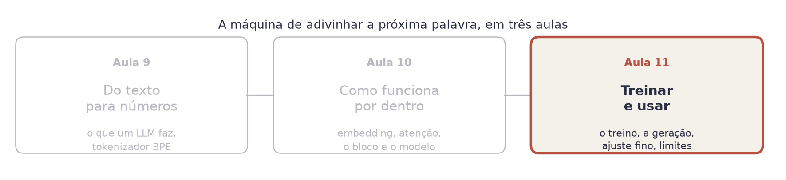
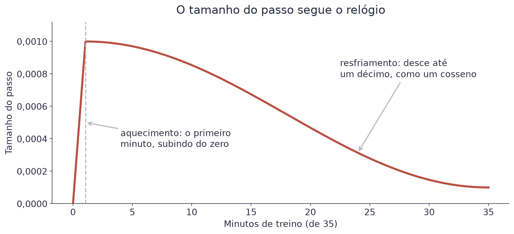
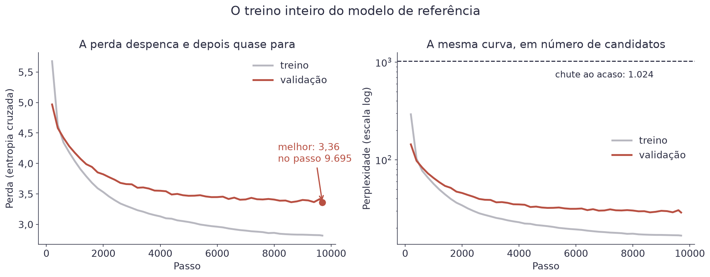
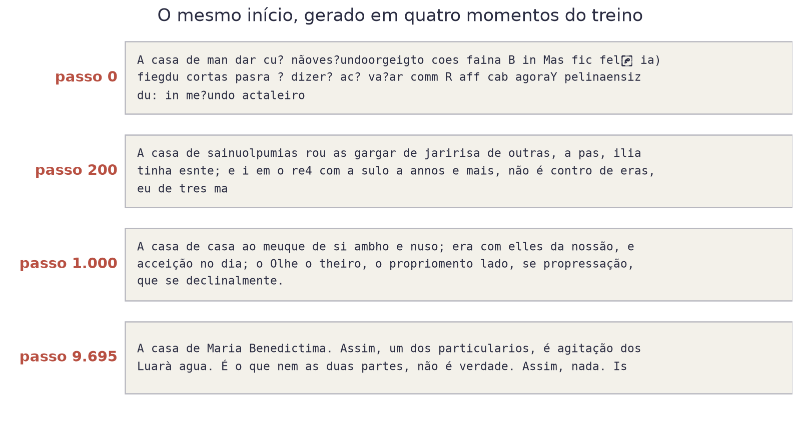
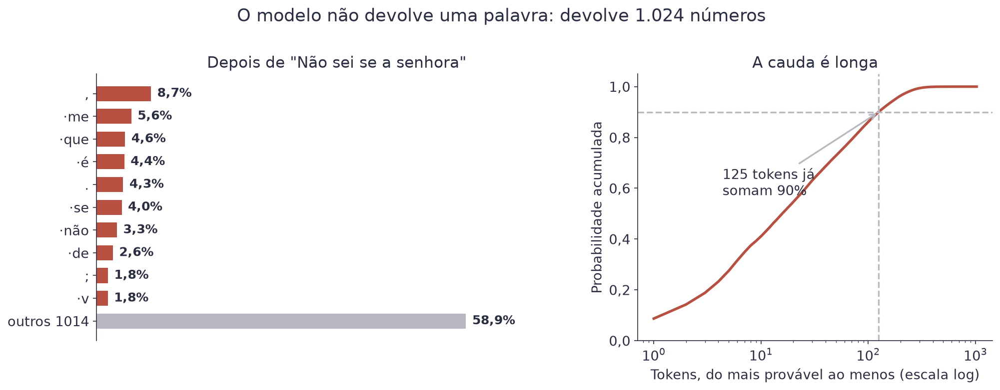
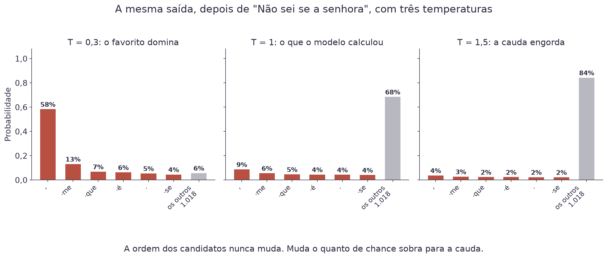
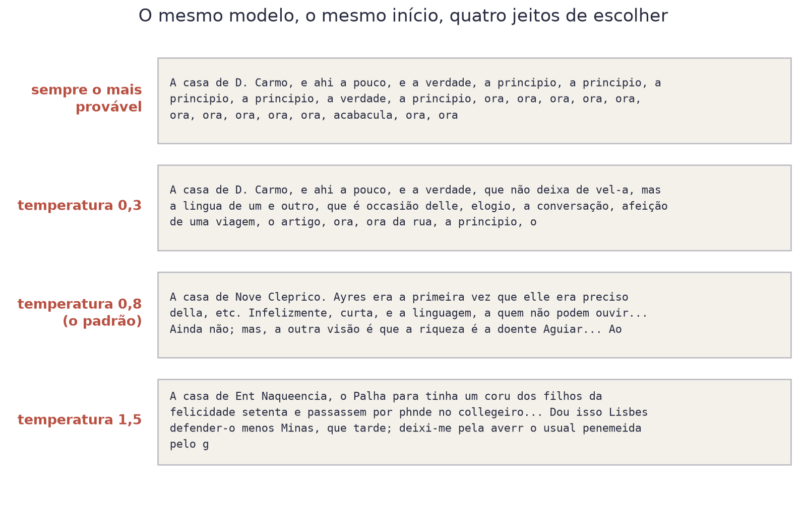
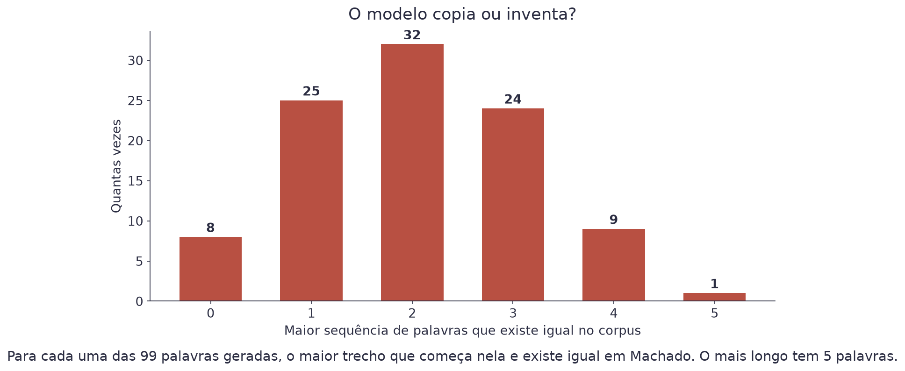
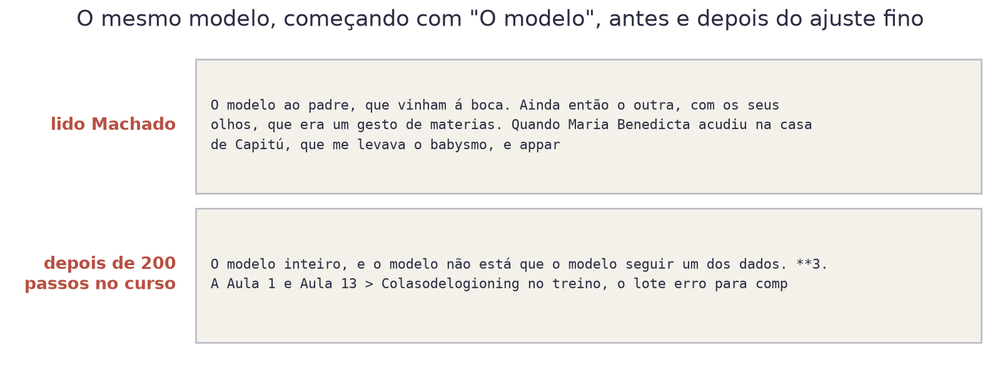
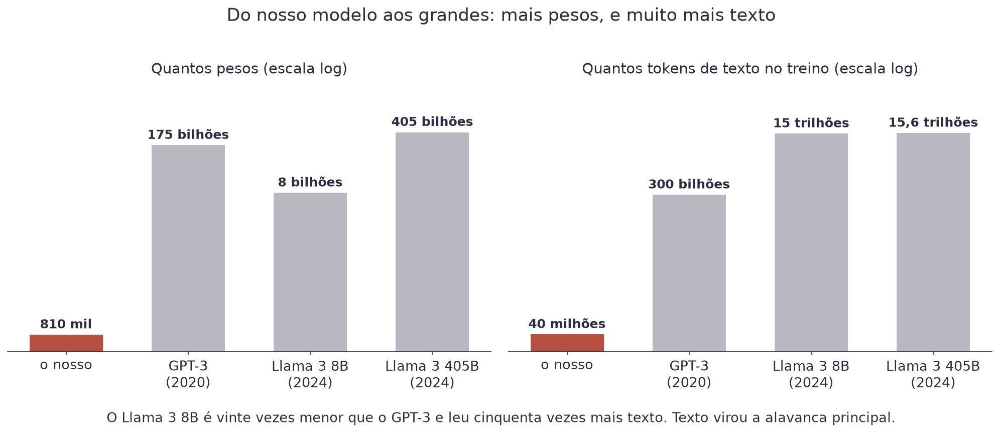

# Aula 11 — Treinar e Usar um LLM


**O que você leva desta aula**

Você vai treinar o seu modelo de linguagem por 35 minutos no processador
do Colab, escrever a função que transforma a saída dele em texto, com os
dois botões de toda ferramenta de IA (temperatura e top-k), e ajustar o
modelo para escrever sobre outro assunto. E vai conseguir explicar por que
um modelo de linguagem inventa fatos.


## Onde estamos

<figure><figcaption>O modelo está montado. Falta treinar, ouvir ele escrever, e saber do que ele não é capaz.</figcaption></figure>

Na Aula 10 você montou o modelo inteiro e viu que ele chuta: perda 6,93,
perplexidade 1.024. Com os pesos do professor, o mesmo modelo escrevia
português. Esta aula faz a ponte entre os dois: o treino. Depois, usa o
modelo treinado para gerar texto e mostra o que ele não sabe fazer.

## O treino

### O ciclo

Treinar é repetir um ciclo de cinco passos: sortear um lote, passar pelo
modelo, medir a perda, calcular o gradiente (para que lado mexer cada peso
para a perda cair) e dar um passo pequeno nessa direção. É o gradiente
descendente da Aula 1, com 809.728 pesos em vez de dois.

<figure><video src="../assets/aula-11/treino.mp4" poster="../assets/aula-11/treino.jpg" controls preload="none" playsinline aria-label="Animação do loop de treino com a curva da perda caindo"></video><figcaption>Cinco passos por volta, milhares de voltas. A curva e as amostras são do treino de referência.</figcaption></figure>

No Keras, como nas Aulas 7 e 8, o `compile` escolhe o otimizador e a
perda, e o `fit` repete o ciclo:

```python
modelo.compile(
    optimizer=keras.optimizers.AdamW(learning_rate=1e-3, weight_decay=0.1,
                                     beta_2=0.95, global_clipnorm=1.0),
    loss=keras.losses.SparseCategoricalCrossentropy(from_logits=True))
salvar_o_melhor = keras.callbacks.ModelCheckpoint(
    "meu_llm.weights.h5", monitor="val_loss", save_best_only=True,
    save_weights_only=True)
modelo.fit(lotes(dados_treino), steps_per_epoch=200, epochs=100_000,
           validation_data=lotes(dados_validacao), validation_steps=10,
           callbacks=[Relogio(minutos=35), salvar_o_melhor])
```

O `from_logits=True` avisa que o modelo devolve pontuações cruas; a
softmax fica por conta da perda. O resto são quatro escolhas que todo
treino de modelo de linguagem faz.

### 1. O otimizador: AdamW

O **AdamW** é o gradiente descendente com duas melhorias. Ele guarda uma
média dos gradientes recentes, o que suaviza o caminho, e dá passos
maiores nas direções em que o gradiente é pequeno mas constante. O "W" é
um empurrão leve de todos os pesos em direção ao zero (*weight decay*),
que ajuda o modelo a não decorar.

### 2. O corte do gradiente

De vez em quando um lote sai muito fora do normal, e o gradiente fica
enorme. Um passo desses joga os pesos para longe e estraga o que já foi
aprendido. O `global_clipnorm=1.0` limita o tamanho do gradiente inteiro:
se ele passar de 1, todos os números são divididos pelo mesmo fator. A
direção do passo não muda, só o tamanho. Exemplo: um gradiente de tamanho
5 é dividido por 5, e o passo sai cinco vezes menor, na mesma direção.

### 3. O tamanho do passo segue o relógio

<figure><figcaption>Aquecimento e resfriamento. É o padrão em qualquer treino de modelo de linguagem.</figcaption></figure>

No começo os pesos são aleatórios, e passo grande na direção errada só faz
estrago: por isso o **aquecimento**, com a taxa subindo do zero no
primeiro minuto. No fim, o modelo está perto de um bom lugar e passo
grande faz ele passar do ponto: por isso o **resfriamento**, com a taxa
descendo até um décimo do máximo.

O nosso treino dura um **tempo fixo**, 35 minutos, e não um número fixo
de passos. Quem cuida disso é o `Relogio`, um *callback*: uma função que
o `fit` chama a cada passo. Ele ajusta a taxa pela fração do tempo que já
passou e para o treino quando o tempo acaba. Assim o treino termina na
hora certa em qualquer Colab, rápido ou lento.

### 4. Conferir e salvar o melhor

A cada 200 passos, o `fit` mede a perda em lotes de validação (o
`val_loss`), e o `ModelCheckpoint` salva o modelo em
`meu_llm.weights.h5` **se a validação for a melhor até ali**. Se o Colab
cair no meio, o melhor modelo já está salvo; e o arquivo guarda o modelo
que melhor generaliza, e não o último.

### O treino de verdade

Quantos passos cabem em 35 minutos depende da máquina: um Colab rápido dá
mais passos, um lento dá menos, e os dois terminam na hora. O modelo de
referência, treinado por 60 minutos num processador maior (9.695 passos),
mostra a curva inteira:

<figure><figcaption>A queda grande acontece nos primeiros mil passos. Depois, cada ponto a menos custa mais.</figcaption></figure>

A perda despenca no começo e depois vai ficando cada vez mais difícil
melhorar. Essa curva explica por que treinar modelos grandes é caro: cada
ponto a menos custa mais que o anterior, e não existe atalho.

E veja o que sai do modelo em cada momento:

<figure><figcaption>O mesmo início, gerado em quatro momentos. Nada mudou além do valor dos 809.728 pesos.</figcaption></figure>

No passo 0 é ruído. Em 200 passos já existem palavras curtas e vírgulas
em lugares plausíveis. Em 1.000 aparecem frases inteiras, erradas mas
gramaticais. No fim, ele escreve com a grafia de 1899, porque foi isso que
leu. A ordem é sempre a mesma: primeiro a forma, depois as palavras, e o
sentido por último.

### Quanto custa treinar

Existe uma regra de bolso que bate bem com a realidade. Cada token que o
modelo lê no treino custa umas seis contas por peso: duas para ir e
quatro para voltar com o gradiente.

$$\text{operações} \approx 6 \cdot N \cdot T$$

| Símbolo | Significado |
|---|---|
| `N` | quantos pesos o modelo tem |
| `T` | quantos tokens ele leu no treino |

Exemplo com o modelo de referência: 809.728 pesos e 9.695 passos de
4.096 tokens, ou uns 40 milhões de tokens. A conta dá
6 × 809.728 × 40 milhões ≈ 2 × 10¹⁴ operações. O GPT-3, de 2020,
tem 175 bilhões de pesos e leu 300 bilhões de tokens:
6 × 175 bilhões × 300 bilhões ≈ 3 × 10²³. Bilhões de vezes mais.


**Erro do dia**

Julgar o modelo pela perda de treino. No modelo de referência, ela estava
em 2,82 no melhor ponto, enquanto a de validação parou em 3,36. Essa
diferença é o modelo decorando trechos do corpus. Enquanto as duas caem
juntas, tudo bem. Quando a de validação para ou sobe, o que vem depois é
decoreba. É por isso que o treino salva pela validação.


## Do número à palavra

### O modelo não devolve uma palavra

Dê ao modelo treinado o começo "Não sei se a senhora" e olhe o que ele
produz para a última posição:

<figure><figcaption>Uma passada do modelo devolve 1.024 números para a última posição, um por token do vocabulário.</figcaption></figure>

O favorito é a vírgula, com só 8,7%. As dez melhores continuações juntas
dão 41%, e são precisos 125 tokens para somar 90% da probabilidade.

Escolher **qual** desses 1.024 vai para a tela é um problema separado,
que nada tem a ver com o treino. Ele tem nome: **amostragem**
(*sampling*).

### Gerar é repetir um passo

O modelo devolve uma previsão para cada posição do texto. Para gerar, só
interessa a da **última** posição: é ela que viu o texto inteiro. O resto
é um loop:

```python
indices = codificar("A casa de")
for _ in range(100):
    logits = modelo(np.array([indices[-128:]]))                    # 1. passa o texto
    ultimos = logits[:, -1]                                        # 2. só a última posição
    sorteado = keras.random.categorical(ultimos / temperatura, 1)  # 3. sorteia um token
    indices.append(int(sorteado[0, 0]))                            # 4. cola no fim
```

O `[-128:]` corta o texto no tamanho da janela de contexto. Isso se chama
**geração autorregressiva**: o token sorteado vira entrada do passo
seguinte. Se ele foi ruim, o modelo não tem como voltar atrás, e passa a
continuar, com coerência, a partir do erro.

<figure><video src="../assets/aula-11/geracao.mp4" poster="../assets/aula-11/geracao.jpg" controls preload="none" playsinline aria-label="Animação da geração de texto, um token sorteado de cada vez"></video><figcaption>Oito passos reais do modelo, sorteando com temperatura 0,8 e top-k 40.</figcaption></figure>

### Duas escolhas ruins

**Sempre o mais provável.** Chama-se decodificação gulosa (*greedy*). É
determinística e parece segura, e o texto entra em loop, repetindo a
mesma frase: um texto que só escolhe o topo acaba num lugar de onde o
topo aponta de volta para si.

**Sortear direto da distribuição.** O oposto: cada token com exatamente a
chance que o modelo deu. O problema está na cauda. No exemplo de cima, os
tokens fora dos 40 melhores somam 31% da probabilidade. Um a um eles são
improváveis; juntos, viram uma chance real de o modelo escolher algo que
ele mesmo considera ruim.

A saída é ficar no meio, com dois botões.

### Botão 1: a temperatura

Antes do sorteio, divida todas as pontuações por `T`:

$$P_j = \frac{e^{z_j / T}}{\sum_{k} e^{z_k / T}}$$

| Símbolo | Significado |
|---|---|
| `zⱼ` | a pontuação crua (o *logit*) que o modelo deu ao token `j` |
| `T` | a temperatura, um número positivo que você escolhe |
| `Pⱼ` | a chance final desse token |

Exemplo com três logits: 4, 2 e 0.

| Temperatura | Os logits viram | As chances ficam |
|---|---|---|
| `T = 0,5` | 8, 4, 0 | 98%, 2%, 0% |
| `T = 1` | 4, 2, 0 | 87%, 12%, 2% |
| `T = 2` | 2, 1, 0 | 67%, 24%, 9% |

A temperatura não muda a ordem dos candidatos, só a distância entre eles.

<figure><figcaption>A mesma saída do modelo, com três temperaturas. Nada no modelo mudou.</figcaption></figure>

<figure><video src="../assets/aula-11/temperatura.mp4" poster="../assets/aula-11/temperatura.jpg" controls preload="none" playsinline aria-label="Animação das chances mudando com a temperatura"></video><figcaption>A temperatura vai de 1 para 0,3, depois para 1,5 e 0,8. A ordem das barras nunca muda.</figcaption></figure>

| Temperatura | O que acontece |
|---|---|
| perto de 0 | vira a escolha gulosa: sempre o mesmo texto |
| 0,7 a 0,9 | o padrão da maioria das ferramentas |
| acima de 1,2 | o modelo passa a considerar tokens que ele mesmo acha improváveis |

### Botão 2: cortar a cauda

A temperatura reescala tudo, inclusive o lixo. O **top-k** elimina
candidatos antes do sorteio: fique com os `k` mais prováveis e esqueça o
resto. No Keras, `ops.top_k` devolve as `k` maiores pontuações e de quais
tokens elas são:

```python
melhores, candidatos = ops.top_k(ultimos, 40)          # as 40 maiores
sorteado = keras.random.categorical(melhores[None] / temperatura, 1)
proximo = candidatos[int(sorteado[0, 0])]
```

O top-k corta sempre o mesmo tanto, mesmo quando o modelo está seguro. A
versão que se adapta à dúvida é o **top-p** (ou núcleo): fique com os
mais prováveis até a soma das chances passar de `p`. Com `p = 0,9`:

| Começo | O favorito | Candidatos que sobram |
|---|---|---|
| "Não sei se a senhora" | `,`, com 8,7% | 125 |
| "Quincas Bor" | `ba`, com 98,0% | 1 |

No primeiro caso o modelo está em dúvida, e o top-p deixa muita opção. No
segundo, só existe uma continuação razoável ("Quincas Borba"), e o top-p
deixa só ela.

### Os quatro textos

Mesmo modelo, mesmo início, quatro jeitos de escolher:

<figure><figcaption>Nenhum peso mudou entre as quatro caixas. Só a regra de escolha.</figcaption></figure>

Leia com atenção. A escolha gulosa entra em loop logo: "a principio, a
principio, a principio", e depois "ora, ora, ora". A temperatura 0,3
começa igual e vai pelo mesmo caminho. Na 1,5 aparecem palavras que não
existem ("Naqueencia", "collegeiro"). A 0,8 é a que lê melhor, e é por
isso que ela é o padrão em quase toda ferramenta.


**Erro do dia**

Subir a temperatura achando que isso deixa o modelo mais criativo. O que
sobe é a chance de ele escolher um token que ele mesmo considera
improvável, e a partir dali o texto tem que se justificar sozinho. Se você
quer outra resposta, mude o começo, não a temperatura.


## Ajuste fino e limites

### Ele copia ou inventa?

É a pergunta que a turma sempre faz, e dá para medir. Gere um texto com o
modelo e procure, para cada palavra, o maior trecho a partir dela que
aparece **literalmente** no corpus de Machado:

<figure><figcaption>O trecho copiado mais longo tem 5 palavras. Tudo o mais o modelo montou.</figcaption></figure>

A média é de duas palavras. O modelo não guarda o texto: ele guarda uma estatística sobre o texto,
em 809.728 números. Reconstruir uma frase inteira de Machado a partir
disso é impossível, e produzir uma frase nova que soa como Machado é
exatamente o que ele faz.

### Por que o modelo alucina

O nosso modelo escreve frases confiantes sobre coisas que nunca
existiram, e não há nada de errado com ele. Ele está fazendo exatamente o
que o treino pediu.

| O que ele tem | O que ele não tem |
|---|---|
| Uma estimativa de qual token é provável | Qualquer noção de verdadeiro e falso |
| 809.728 pesos ajustados por gradiente | Um lugar para consultar um fato |
| Uma janela de 128 tokens | Memória do que disse antes disso |
| A estatística do corpus | Uma marcação do que veio de onde |

"Alucinação" é um nome ruim, porque sugere defeito. Uma frase falsa e
fluente e uma frase verdadeira e fluente têm exatamente a mesma natureza
para o modelo: as duas são sequências prováveis. A Aula 13 mostra o
remédio mais usado: dar ao modelo um lugar para consultar, colando trechos
de um documento no começo do texto.

### O modelo é o corpus

O nosso escreve "elle", "cousa", "mettia", "pharmacia". Ele escreve a
grafia de 1899 porque leu 3,7 milhões de caracteres de 1899, e nada mais.
Um modelo treinado em fóruns escreve como fórum. Um modelo treinado em
textos que carregam um preconceito reproduz esse preconceito, com a mesma
fluência com que reproduz a gramática. Não existe modelo neutro. Existe
corpus.

### Ajuste fino: o mesmo treino, outro texto

Dá para provar isso em dois minutos. Pegue uma cópia do modelo pronto e
continue o treino por 200 passos, com outro texto: as páginas deste
curso, em português de hoje. Isso se chama **ajuste fino**
(*fine-tuning*). O passo é menor (`3e-4`), para mexer pouco no que o
modelo já sabe:

```python
ajustado = montar_modelo()
ajustado.set_weights(modelo.get_weights())              # uma cópia
ajustado.compile(optimizer=keras.optimizers.AdamW(learning_rate=3e-4),
                 loss=keras.losses.SparseCategoricalCrossentropy(from_logits=True))
ajustado.fit(lotes(curso_treino), steps_per_epoch=50, epochs=4)
```

<figure><figcaption>200 passos de treino, nenhuma peça da arquitetura mudou.</figcaption></figure>

Dá para medir a mudança com a perda de uma frase só: perda baixa quer
dizer que o modelo acha a frase provável.

| Frase | Modelo de Machado | Modelo ajustado |
|---|---|---|
| "Não sei se a senhora sabe que elle não veio hontem." | **3,40** | 3,16 |
| "O modelo de linguagem prevê o próximo token do texto." | 4,56 | **1,72** |

Cada modelo acha mais provável a frase do seu próprio corpus, e a frase de
hoje caiu de 4,56 para 1,72 com 200 passos. O modelo ajustado aprendeu o
assunto e até o formato das páginas do curso: no texto dele aparecem
"modelo", "dados", "Aula" e os asteriscos do negrito. É assim que
um modelo de uso geral vira um modelo de uma área: jurídico, médico, de
atendimento. E é assim, também, que um modelo que continua texto vira um
assistente.

### O que muda quando o modelo é grande

<figure><figcaption>Os números são os publicados pelos autores de cada modelo.</figcaption></figure>

| Peça | O nosso | Um comercial |
|---|---|---|
| Camadas | 4 | 60 a 120 |
| Dimensão | 128 | 4.000 a 16.000 |
| Cabeças | 4 | 32 a 128 |
| Janela | 128 tokens | centenas de milhares |
| Treino | 35 minutos, um processador | meses, milhares de placas |

Nada nessa tabela é uma ideia nova: é a mesma arquitetura, com mais
dinheiro. Repare também no Llama 3 8B, de 2024: vinte vezes menor que o
GPT-3 e com cinquenta vezes mais texto. Nos últimos anos, a alavanca
principal passou a ser o texto, e não o tamanho.

### Do modelo ao assistente

O nosso modelo continua texto. Ele não responde perguntas, e isso não é
questão de tamanho: é questão de treino. Entre ele e um assistente existem
duas etapas a mais, e as duas são ajuste fino:

| Etapa | O que faz |
|---|---|
| Pré-treino | o que fizemos: prever o próximo token, em muito texto |
| Ajuste por instrução | ajuste fino em milhares de conversas com boas respostas |
| Ajuste por preferência | treinar com pessoas escolhendo a melhor de duas respostas |

O texto da segunda etapa tem uma forma fixa, com marcadores de quem fala:

```
<|usuario|>Quem escreveu Dom Casmurro?
<|assistente|>Machado de Assis, em 1899.
```

Depois de ler milhares de textos nesse formato, o modelo aprende que,
depois de `<|assistente|>`, vem uma resposta à pergunta de cima. É o mesmo
ajuste fino do Exercício 3, com outro texto.

E existe uma quarta alavanca, que não mexe em nenhum peso: **deixar o
modelo escrever mais antes de responder**. Pedir o raciocínio passo a
passo, gerar várias respostas e escolher a melhor, revisar a própria
resposta. Cada token escrito entra de volta como contexto do próximo, então
pensar em voz alta é dar a si mesmo mais material. É por isso que os
modelos de raciocínio de hoje mostram um "pensando" antes de falar: é o
mesmo transformer, gerando muito mais antes de mostrar o resultado.

## Cola da aula

| Conceito | Em uma frase |
|---|---|
| Loop de treino | lote, previsão, perda, gradiente, passo; o `fit` repete o ciclo |
| AdamW | o gradiente descendente com média dos gradientes e um empurrão para o zero |
| Corte do gradiente | limita o tamanho do passo, sem mudar a direção |
| Aquecimento e resfriamento | a taxa sobe no começo e desce até o fim, pelo relógio |
| `ModelCheckpoint` | salva o modelo sempre que a validação bate o recorde |
| Custo do treino | umas `6 · N · T` operações |
| Geração autorregressiva | o token sorteado vira entrada do passo seguinte |
| Gulosa | sempre o mais provável; entra em loop |
| Temperatura | divide os logits por `T`: baixa concentra, alta espalha |
| Top-k e top-p | só os mais prováveis entram no sorteio |
| Alucinação | frase provável não é frase verdadeira |
| Ajuste fino | o mesmo treino, em outro texto |
| Assistente | pré-treino, mais ajuste por instrução, mais ajuste por preferência |

## Materiais

- **Notebook desta aula, no Google Colab:** [](https://colab.research.google.com/github/klein-natan/nanodegree-AI-Atitus/blob/main/notebooks/aula-11-treinar-e-usar.ipynb)
- **Quiz de cada microaula:** [no fim desta página](#quizzes-das-microaulas), 5 perguntas depois de cada explicação, antes do exercício.
- **Travou num exercício?** [Colas dos exercícios](colas-dos-exercicios.md#aula-11-treinar-e-usar-um-llm), com dicas que você abre uma de cada vez.
- Slides desta aula: entregues em sala.
- Modelo treinado do professor: [`mini_llm.weights.h5`](https://github.com/klein-natan/nanodegree-AI-Atitus/blob/main/data/mini_llm.weights.h5)
- O texto do curso, usado no ajuste fino: [`curso.txt`](https://github.com/klein-natan/nanodegree-AI-Atitus/blob/main/data/curso.txt)

Os três exercícios do notebook:

| Exercício | O que você constrói |
|---|---|
| 11.1 | a função de treino pelo relógio, que salva o melhor modelo, e um teste de um minuto |
| 11.2 | a função `gerar`, com temperatura e top-k, e o treino de 35 minutos do seu modelo |
| 11.3 | a curva do seu treino, o seu modelo escrevendo, e o ajuste fino no texto do curso |

## Para ir além

- [Let's build GPT: from scratch, in code, spelled out (Andrej Karpathy)](https://www.youtube.com/watch?v=kCc8FmEb1nY): duas horas construindo e treinando um modelo como o nosso. Em inglês.
- [Deep Dive into LLMs like ChatGPT (Andrej Karpathy)](https://www.youtube.com/watch?v=7xTGNNLPyMI): do modelo que continua texto ao assistente, com o pré-treino, o ajuste por instrução e o por preferência. Em inglês.
- [The Curious Case of Neural Text Degeneration](https://arxiv.org/abs/1904.09751): o artigo que propôs o top-p, com exemplos de texto gerado por cada estratégia.

## Quizzes das microaulas

Depois de cada microaula, e antes do exercício no Colab, responda o quiz
dela. As perguntas aparecem uma de cada vez, como uma pilha de cartas:
responda, leia a explicação e passe para a próxima. No fim aparece quantas
você acertou. Nada fica gravado: dá para refazer quantas vezes quiser.

### Microaula 1: o treino



```quiz
Qual é a ordem dos cinco passos de um passo de treino?
- Medir a perda, sortear o lote, corrigir os pesos, prever, calcular o gradiente.
+ Sortear o lote, prever, medir a perda, calcular o gradiente, corrigir os pesos.
- Prever, sortear o lote, calcular o gradiente, medir a perda, corrigir os pesos.
- Calcular o gradiente, prever, sortear o lote, corrigir os pesos, medir a perda.
? Primeiro os dados, depois a previsão e o erro dela, depois a direção da correção (o gradiente) e o passo. O fit repete isso milhares de vezes.
```

```quiz
Para que serve o aquecimento no começo do treino?
+ Os pesos ainda são aleatórios, e um passo grande na direção errada só faz estrago.
- Para o processador esquentar antes de trabalhar.
- Para o modelo decorar as primeiras frases.
- Para medir a perda do chute ao acaso.
? No primeiro minuto a taxa sobe do zero. Depois ela desce devagar até o fim (o resfriamento), para o modelo não passar do ponto.
```

```quiz
O gradiente de um lote saiu com tamanho 5, e o corte está em 1. O que o corte faz?
- Joga o lote fora.
- Zera o gradiente.
+ Divide todos os números do gradiente por 5: o passo sai menor, na mesma direção.
- Troca a direção do passo.
? O corte muda só o tamanho, nunca a direção. Assim um lote estranho não joga os pesos para longe.
```

```quiz
Por que o treino salva o modelo pela perda de validação, e não pela de treino?
- Porque a perda de treino não é calculada.
+ Porque a de treino continua caindo mesmo quando o modelo começa a decorar; a de validação mostra se ele generaliza.
- Porque a de validação é sempre menor.
- Porque o Keras não deixa salvar pela de treino.
? A validação é texto que o modelo nunca viu. Quando ela para de cair e a de treino continua, o que vem depois é decoreba.
```

```quiz
Pela regra das 6 contas, o que acontece com o custo do treino se você dobra os pesos e dobra o texto?
- Dobra.
- Fica igual.
+ Quadruplica.
- Cai pela metade.
? O custo é cerca de 6 · N · T. Dobrar N e dobrar T multiplica o produto por 4.
```



### Microaula 2: do número à palavra



```quiz
O modelo devolve logits para todas as posições do texto. Qual delas interessa para continuar o texto?
- A primeira, que começou tudo.
- A do meio.
+ A última, que viu o texto inteiro.
- Todas, somadas.
? É a última posição que prevê o próximo token. Por isso o código de gerar pega logits[:, -1].
```

```quiz
Por que a escolha gulosa (sempre o mais provável) costuma entrar em loop?
- Porque o modelo está mal treinado.
+ Porque, depois de algumas repetições, a continuação mais provável de um padrão repetido é repeti-lo de novo.
- Porque o top-k está ligado.
- Porque a temperatura está alta demais.
? Um texto que só escolhe o topo acaba num lugar de onde o topo aponta de volta para si. "Não, senhor. Não, senhor."
```

```quiz
Com logits (4, 2, 0), o que acontece com as chances quando a temperatura vai de 1 para 2?
- A ordem dos tokens se inverte.
- O favorito fica com ainda mais chance.
+ A ordem não muda, mas as chances se aproximam: de 87%, 12%, 2% para 67%, 24%, 9%.
- Todos ficam com 33%.
? Dividir por um número maior encolhe a distância entre os logits. A ordem dos candidatos nunca muda.
```

```quiz
Qual é a diferença entre top-k e top-p?
+ Top-k fica sempre com k candidatos; top-p fica com quantos forem precisos para somar p, e se adapta à dúvida do modelo.
- Top-k sorteia; top-p escolhe sempre o melhor.
- Top-p é para texto curto; top-k para texto longo.
- Não há diferença, são dois nomes para a mesma coisa.
? Quando o modelo está seguro (depois de "Quincas Bor"), o top-p deixa quase um candidato só; quando está em dúvida, deixa muitos.
```

```quiz
Subir a temperatura de 0,8 para 1,5 deixa o modelo mais criativo?
- Sim: ele passa a ter ideias novas.
+ Não: ele passa a escolher mais tokens que ele mesmo acha improváveis, e o texto vira ruído.
- Sim, desde que o top-k esteja desligado.
- Não muda nada no texto.
? A temperatura não acrescenta conhecimento. Para outra resposta, mude o começo, não a temperatura.
```



### Microaula 3: ajuste fino e limites



```quiz
O nosso modelo escreve "elle" e "cousa". Por quê?
- Porque o tokenizador está errado.
+ Porque ele leu só Machado de Assis, e escreve como o texto que leu.
- Porque a temperatura está alta.
- Porque a janela de contexto é pequena.
? O modelo é o corpus. Um modelo treinado em fórum escreve como fórum.
```

```quiz
Por que um modelo de linguagem inventa fatos com confiança?
- Porque foi programado para mentir.
- Porque o modelo é pequeno demais; os grandes nunca inventam.
+ Porque ele estima o que é provável, e nada no treino distingue uma frase provável de uma verdadeira.
- Porque a máscara causal esconde os fatos.
? Uma frase falsa e fluente e uma verdadeira e fluente têm a mesma natureza para ele: as duas são sequências prováveis.
```

```quiz
No ajuste fino do Exercício 3, o que muda em relação ao treino original?
- A arquitetura do modelo.
- O tokenizador.
+ O texto de onde vêm os lotes (e um passo menor).
- A função de perda.
? O mesmo modelo, o mesmo loop, outro texto. Em 200 passos ele passa a falar do assunto do curso.
```

```quiz
O modelo dá perda 1,9 a uma frase e 4,4 a outra. Qual ele acha mais provável?
+ A de perda 1,9.
- A de perda 4,4.
- As duas igualmente.
- Não dá para saber pela perda.
? Perda baixa quer dizer chance alta nos tokens que vieram. É a mesma conta do treino, aplicada a uma frase só.
```

```quiz
O que transforma um modelo que continua texto, como o nosso, num assistente que responde perguntas?
- Só deixar o modelo maior.
- Trocar a arquitetura por outra.
+ Mais duas etapas de ajuste fino: em conversas com boas respostas, e com pessoas escolhendo a melhor de duas.
- Desligar a máscara causal.
? Depois de ler milhares de conversas com marcadores de quem fala, o modelo aprende que depois do marcador do assistente vem uma resposta.
```


