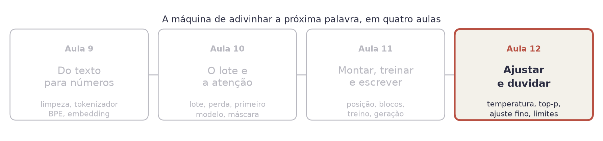
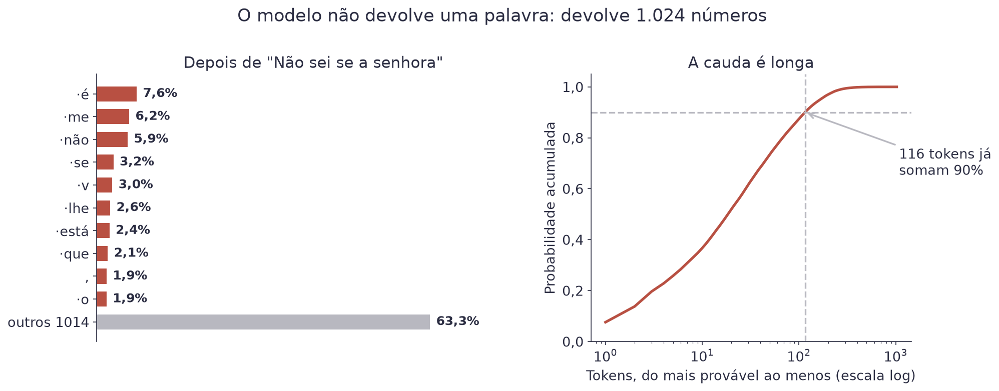
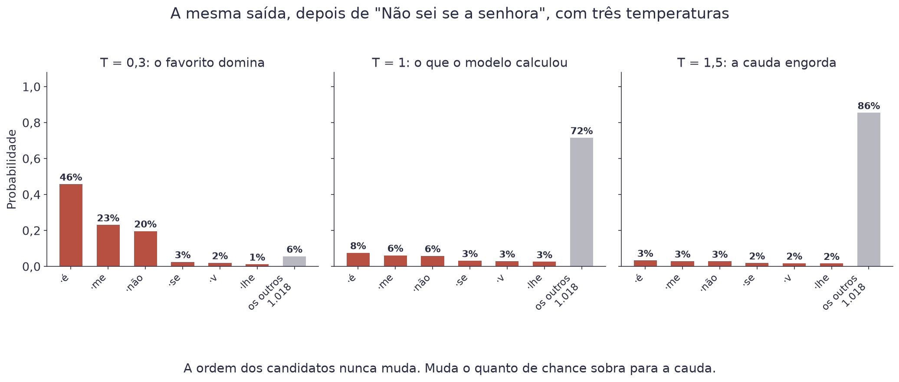
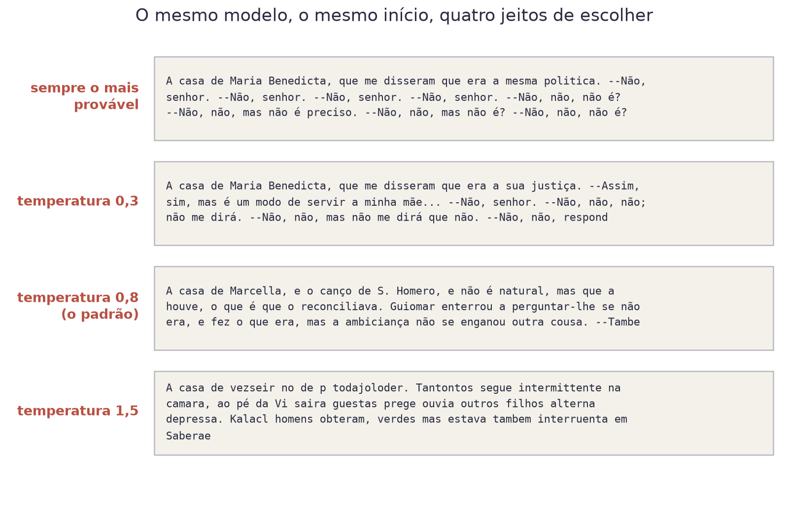
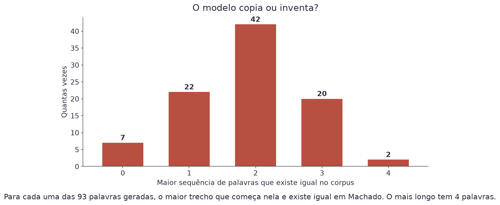
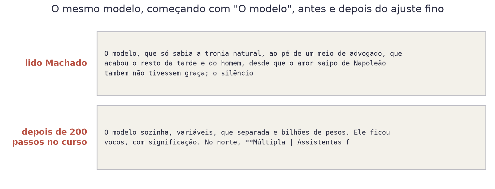
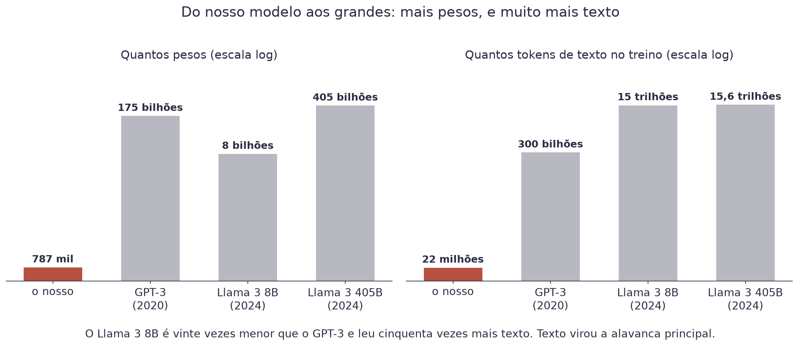

# Aula 12 — Geração e Limites


**O que você leva desta aula**

Você vai escrever a função que transforma a saída do seu modelo em texto,
com os dois botões que toda ferramenta de IA tem: temperatura e corte.
Vai ajustar o seu modelo para escrever sobre outra coisa, e vai conseguir
explicar por que um modelo de linguagem inventa fatos.


## Onde estamos

<figure><figcaption>O modelo está treinado. Falta transformar as probabilidades dele em texto, e saber do que ele não é capaz.</figcaption></figure>

A aula começa carregando o arquivo `meu_llm.pt`, o modelo que você treinou
na Aula 11. Se você perdeu o arquivo, o notebook carrega o modelo do
professor, que tem exatamente as mesmas classes e os mesmos nomes de
pesos. Tudo o que vem a seguir funciona com qualquer um dos dois.

## O modelo não devolve uma palavra

Este é o mal-entendido mais comum sobre modelos de linguagem, e vale
desfazer com um gráfico. Dê ao modelo treinado o começo "Não sei se a
senhora" e olhe o que ele produz:

<figure><figcaption>Uma passada do modelo devolve 1.024 números, um por token do vocabulário.</figcaption></figure>

O favorito, `·é`, tem só 7,6%. As dez melhores continuações juntas dão
37%, e são precisos 116 tokens para somar 90% da probabilidade.

Escolher **qual** desses 1.024 vai para a tela é um problema separado,
que nada tem a ver com o treino. Ele tem nome: **amostragem**
(*sampling*), e é o assunto da primeira metade desta aula.

## Gerar é repetir um passo

O modelo devolve uma previsão para cada posição do texto. Para gerar,
só interessa a da **última** posição: é ela que viu o texto inteiro. O
resto do mecanismo é um laço:

```python
indices = codificar("A casa de")
for _ in range(100):
    logits, _ = modelo(torch.tensor([indices[-128:]]))  # 1. passa o texto
    pontuacoes = logits[0, -1]                          # 2. só a última posição
    probabilidades = F.softmax(pontuacoes, dim=-1)      # 3. vira chance
    proximo = torch.multinomial(probabilidades, 1)      # 4. sorteia um token
    indices.append(proximo.item())                      # 5. cola no fim
```

O `[-128:]` corta o texto nos últimos 128 tokens, o tamanho da janela de
contexto. Isso se chama **geração autorregressiva**, e tem uma consequência
que explica muito: o token sorteado no passo 4 vira entrada do passo 1
seguinte. Se ele foi ruim, o modelo não tem como voltar atrás. Ele agora
precisa continuar coerentemente a partir do erro.

<figure><video src="../assets/aula-12/geracao.mp4" poster="../assets/aula-12/geracao.jpg" controls preload="none" playsinline aria-label="Animação da geração de texto, um token sorteado de cada vez"></video><figcaption>Oito passos reais do modelo, sorteando com temperatura 0,8: "A casa de" vira "A casa de Natividade continuou a". Repare no primeiro sorteio: saiu um token com 2,2% de chance.</figcaption></figure>

## Duas escolhas ruins

**Sempre o mais provável.** Troque o sorteio por `argmax`. Chama-se
decodificação gulosa (*greedy*). É determinística e parece segura, e o
resultado é ruim: o texto entra em laço, repetindo a mesma frase. Um texto
que só escolhe o topo acaba num lugar de onde o topo aponta de volta para
si.

**Sortear direto da distribuição.** O oposto: cada token tem exatamente a
chance que o modelo deu. O problema está na cauda. No exemplo do começo,
os tokens fora dos 40 melhores somam 32% da probabilidade, espalhados por
984 candidatos. Um a um eles são improváveis, mas juntos dão quase uma
chance em três de o modelo escolher algo que ele mesmo considera ruim.

A saída é ficar no meio, e existem três controles para isso.

## Controle 1: a temperatura

Antes da softmax, divida todas as pontuações por `T`.

$$P_j = \frac{e^{z_j / T}}{\sum_{k} e^{z_k / T}}$$

| Símbolo | Significado |
|---|---|
| `zⱼ` | o número cru (o *logit*) que o modelo deu ao token `j` |
| `T` | a temperatura, um número positivo que você escolhe |
| `Pⱼ` | a probabilidade final desse token |

Exemplo com três logits: 4, 2 e 0.

| Temperatura | Os logits viram | As probabilidades ficam |
|---|---|---|
| `T = 0,5` | 8, 4, 0 | 98%, 2%, 0% |
| `T = 1` | 4, 2, 0 | 87%, 12%, 2% |
| `T = 2` | 2, 1, 0 | 67%, 24%, 9% |

A última linha é a mesma conta das Aulas 8 e 10, com os mesmos três
números. Repare no que a temperatura fez: ela não mudou a ordem dos
candidatos, só a distância entre eles.

<figure><figcaption>A mesma saída do modelo, com três temperaturas. Nada no modelo mudou.</figcaption></figure>

Olhe a barra cinza, a dos 1.018 tokens restantes. Com temperatura 0,3 ela
quase some; com 1,5 ela engorda até 86%. É dali que vêm as palavras que
não existem.

<figure><video src="../assets/aula-12/temperatura.mp4" poster="../assets/aula-12/temperatura.jpg" controls preload="none" playsinline aria-label="Animação das chances mudando com a temperatura"></video><figcaption>A temperatura vai de 1 para 0,3, depois para 1,5 e 0,8. A ordem das barras nunca muda.</figcaption></figure>

| Temperatura | O que acontece |
|---|---|
| perto de 0 | vira a escolha gulosa: sempre o mesmo texto |
| 0,7 a 0,9 | o padrão da maioria das ferramentas |
| acima de 1,2 | o modelo passa a considerar tokens que ele mesmo acha improváveis |

## Controles 2 e 3: cortar a cauda

A temperatura reescala tudo, inclusive o lixo. Os outros dois controles
eliminam candidatos antes do sorteio, do mesmo jeito que a máscara da
Aula 10: trocando a pontuação por menos infinito.

**Top-k**: fique com os `k` mais prováveis e zere o resto. Com `k = 40`,
os outros 984 tokens deixam de existir, e com eles vai embora aquele um
terço de risco. Simples, e sempre corta o mesmo tanto, mesmo quando o
modelo está muito seguro.

```python
corte = torch.topk(pontuacoes, 40).values[-1]          # a 40ª maior
pontuacoes = pontuacoes.masked_fill(pontuacoes < corte, float("-inf"))
```

**Top-p** (ou núcleo, *nucleus*): pegue os mais prováveis até que a soma
deles passe de `p`. É a versão que se adapta à dúvida do modelo. Com
`p = 0,9`:

| Começo | O favorito | Candidatos que sobram |
|---|---|---|
| "Não sei se a senhora" | `·é`, com 7,6% | 116 |
| "Quincas Bor" | `ba`, com 98,6% | 1 |

No primeiro caso o modelo está em dúvida, e o top-p deixa muita opção. No
segundo, só existe uma continuação razoável ("Quincas Borba"), e o top-p
deixa só ela.

## Os quatro textos

Mesmo modelo, mesmo início, quatro jeitos de escolher:

<figure><figcaption>Nenhum peso mudou entre as quatro caixas. Só a regra de escolha.</figcaption></figure>

Leia com atenção. A escolha gulosa entra em laço logo: "--Não, senhor.
--Não, senhor. --Não, senhor." A temperatura 0,3 vai pelo mesmo caminho.
Na 1,5 aparecem palavras que não existem ("todajoloder"). A 0,8 é a que
lê melhor, e é por isso que ela é o padrão em quase toda ferramenta.


**Erro do dia**

Subir a temperatura achando que isso deixa o modelo mais criativo. O que
sobe é a chance de ele escolher um token que ele mesmo considera
improvável, e a partir dali o texto tem que se justificar sozinho. Se você
quer outra resposta, mude o começo, não a temperatura.


## Ele copia ou inventa?

É a pergunta que a turma sempre faz, e dá para medir. Gere um texto com o
modelo e procure, para cada palavra, o maior trecho a partir dela que
aparece **literalmente** no corpus de Machado:

<figure><figcaption>O trecho copiado mais longo tem 4 palavras. Tudo o mais o modelo montou.</figcaption></figure>

A média é 1,87 palavras. O modelo não guarda o texto: ele guarda uma
estatística sobre o texto, em 787.584 números. Reconstruir uma frase
inteira de Machado a partir disso é impossível, e produzir uma frase nova
que soa como Machado é exatamente o que ele faz.

Modelos grandes, treinados em textos que aparecem muitas vezes na
internet, conseguem reproduzir trechos longos. É um problema real de
direito autoral, e a causa é a repetição no corpus, não a arquitetura.

## Por que o modelo alucina

Agora a parte que importa fora da sala de aula. O nosso modelo escreve
frases confiantes sobre coisas que nunca existiram, e não há nada de
errado com ele. Ele está fazendo exatamente o que o treino pediu.

| O que ele tem | O que ele não tem |
|---|---|
| Uma estimativa de qual token é provável | Qualquer noção de verdadeiro e falso |
| 787.584 pesos ajustados por gradiente | Um lugar para consultar um fato |
| Uma janela de 128 tokens | Memória do que disse antes disso |
| A estatística do corpus | Uma marcação do que veio de onde |

"Alucinação" é um nome ruim, porque sugere defeito. Uma frase falsa e
fluente e uma frase verdadeira e fluente têm exatamente a mesma natureza
para o modelo: as duas são sequências prováveis. Ele não tem como
distinguir, porque nunca teve. A Aula 14 mostra o remédio mais usado: dar
ao modelo um lugar para consultar, colando trechos de um documento no
começo do texto.

## O modelo é o corpus

Repare no que o nosso escreve: "elle", "cousa", "mettia", "pharmacia". Ele
escreve a grafia de 1899 porque leu 3,7 milhões de caracteres de 1899, e
nada mais.

Essa é a lição que vale para qualquer modelo de linguagem, e para qualquer
tamanho. Um modelo treinado em fóruns escreve como fórum. Um modelo
treinado em texto majoritariamente em inglês responde melhor em inglês. Um
modelo treinado em textos que carregam um preconceito reproduz esse
preconceito, com a mesma fluência com que reproduz a gramática.

Não existe modelo neutro. Existe corpus, e o modelo é o que ele diz.

## Ajuste fino: o mesmo treino, outro texto

Dá para provar essa frase em três minutos. Pegue o modelo pronto e
continue o treino dele por 200 passos, com o mesmo laço da Aula 11, só que
com outro texto: as páginas deste curso, em português de hoje, sobre
regressão, redes e modelos de linguagem. Isso se chama **ajuste fino**
(*fine-tuning*).

```python
modelo_curso = copy.deepcopy(modelo)          # uma cópia, para comparar
for passo in range(201):
    entrada, alvo = sortear_lote(dados_curso)  # a única linha diferente
    ...                                        # o resto é o laço da Aula 11
```

O mesmo começo, nos dois modelos:

<figure><figcaption>200 passos de treino, nenhuma peça da arquitetura mudou.</figcaption></figure>

O ajustado fala de "variáveis" e "bilhões de pesos", e até aprendeu a
pôr asteriscos e barras, que são a marcação de negrito e de tabela das
páginas do curso. Ele aprendeu o assunto e o formato do texto novo.

### Quanto cada modelo estranha uma frase

Dá para medir isso com a perda de uma frase inteira: a mesma conta do
treino, aplicada a um texto só. Perda baixa quer dizer que o modelo acha a
frase provável.

| Frase | Modelo de Machado | Modelo ajustado |
|---|---|---|
| "Não sei se a senhora sabe que elle não veio hontem." | **3,30** | 3,58 |
| "O modelo de linguagem prevê o próximo token do texto." | 4,42 | **1,91** |

Cada modelo acha mais provável a frase do seu próprio corpus. A frase de
hoje caiu de 4,42 para 1,91 com 200 passos de treino. A de 1899 ficou um
pouco mais estranha para o modelo ajustado: ele começou a esquecer
Machado.

É assim que um modelo de uso geral vira um modelo de uma área: jurídico,
médico, de atendimento. E é assim, também, que um modelo que continua
texto vira um assistente.

## O que a escala compra

<figure><figcaption>Os números são os publicados pelos autores de cada modelo.</figcaption></figure>

Duas coisas para ler na figura. Primeira: a distância entre o nosso e os
grandes é de cinco a seis ordens de grandeza, nos pesos e no texto. Pela
regra das seis contas da Aula 11, o custo de treino cresce com o produto
dos dois.

Segunda: o Llama 3 8B, de 2024, é vinte vezes menor que o GPT-3, de 2020,
e leu cinquenta vezes mais texto. Nos últimos anos, a alavanca principal
deixou de ser o tamanho e passou a ser o texto: um modelo menor, treinado
por mais tempo, sai mais barato de usar e responde tão bem quanto.

O que se ganha com a escala não é só "menos dúvida". Com ela aparecem
comportamentos que o modelo pequeno não tem: seguir uma instrução, manter
o assunto por páginas, fazer uma conta de várias etapas.

## O que falta para virar um assistente

O nosso modelo continua texto. Ele não responde perguntas, e isso não é
questão de tamanho: é questão de treino. Entre o modelo que você montou e
um assistente existem duas etapas a mais, e as duas são ajuste fino:

| Etapa | O que faz |
|---|---|
| Pré-treino | o que fizemos: prever o próximo token, em muito texto |
| Ajuste por instrução | ajuste fino em milhares de conversas com boas respostas |
| Ajuste por preferência | treinar com pessoas escolhendo a melhor de duas respostas |

O texto da segunda etapa tem uma forma fixa, com marcadores de quem fala:

```
<|usuario|>Quem escreveu Dom Casmurro?
<|assistente|>Machado de Assis, em 1899.
```

Depois de ler milhares de textos nesse formato, o modelo aprende que,
depois de `<|assistente|>`, vem uma resposta à pergunta de cima. É o mesmo
truque do Exercício 3, com outro texto. As três etapas usam o mesmo
gradiente descendente da Aula 1, sobre os mesmos pesos.

## A novidade: gastar tempo em vez de peso

Até 2023, melhorar um modelo queria dizer uma coisa só: mais pesos e mais
texto de treino. De 2024 para cá apareceu uma segunda alavanca, e ela não
mexe em nenhum peso.

A ideia é simples ao ponto de parecer trapaça: **deixe o modelo escrever
mais antes de responder**. Em vez de exigir a resposta na primeira linha,
peça que ele escreva o raciocínio, e só então conclua. Cada token que ele
escreve entra de volta como entrada do próximo, então pensar em voz alta é
literalmente dar a si mesmo mais contexto para trabalhar.

Três formas disso, da mais simples para a mais elaborada:

| Truque | O que se faz |
|---|---|
| Escrever o passo a passo | pedir o raciocínio antes da resposta |
| Melhor de várias | gerar várias respostas e escolher uma, por votação ou pela nota do próprio modelo |
| Revisão | gerar, criticar a própria resposta, e gerar de novo |

O exercício da aula faz o segundo, em miniatura: gera cinco continuações
com temperatura alta, mede a perda de cada uma com o próprio modelo, e
fica com a de menor perda, a que o modelo considera mais provável.

O exercício mostra também o limite do truque. No gabarito, a escolhida foi
a continuação com mais espaços e quebras de linha seguidos: espaço
repetido é fácil de prever, então dá perda baixa, sem ser o melhor texto
para quem lê. Escolher pela própria perda premia o previsível. Os modelos
de verdade usam um juiz melhor: outro modelo treinado para dar nota, ou um
teste que confere a resposta, como rodar o código que o modelo escreveu.

Os três truques funcionam **com o modelo já pronto**, sem treinar nada. O
que eles gastam é tempo de máquina na hora de responder. Daí o nome:
*inference-time scaling*, ou escalar no momento de responder.

É por isso que os modelos de raciocínio de hoje demoram e mostram um
"pensando" antes de falar. Não há mágica nova ali dentro: é o mesmo
transformer desta aula, gerando um token de cada vez, só que gerando muito
mais antes de mostrar o resultado.


**Por que isso importa para você**

O modelo que você usa no dia a dia não muda. O seu jeito de pedir muda.
Pedir "explique o seu raciocínio antes de responder" costuma valer mais
que qualquer ajuste de temperatura, e é de graça.


## Cola da aula

| Conceito | Em uma frase |
|---|---|
| Amostragem | escolher um dos 1.024 tokens a partir das chances do modelo |
| Autorregressão | cada token escolhido vira entrada do passo seguinte |
| Guloso | sempre o mais provável; entra em laço |
| Temperatura | divide os logits: baixa concentra, alta espalha a chance pela cauda |
| Top-k | fica com os k melhores e zera o resto |
| Top-p | fica com os melhores até a soma passar de p; se adapta à dúvida |
| Copiar ou inventar | o nosso modelo copia no máximo 4 palavras seguidas |
| Alucinação | frase provável e falsa: o modelo não tem como distinguir |
| Ajuste fino | o mesmo treino, com outro texto; muda o que o modelo escreve |
| Perda de uma frase | quanto o modelo estranha um texto; menor, mais provável |
| Escala | mais pesos e, cada vez mais, mais texto |
| Assistente | pré-treino, ajuste por instrução, ajuste por preferência |
| Tempo em vez de peso | gerar mais antes de responder, sem treinar nada |

## Materiais

- **Notebook desta aula, no Google Colab:** [](https://colab.research.google.com/github/klein-natan/nanodegree-AI-Atitus/blob/main/notebooks/aula-12-geracao-e-limites.ipynb)
- **Quiz de cada microaula:** [no fim desta página](#quizzes-das-microaulas), 5 perguntas depois de cada explicação, antes do exercício.
- **Travou num exercício?** [Colas dos exercícios](colas-dos-exercicios.md#aula-12-geracao-e-limites), com dicas que você abre uma de cada vez.
- Slides desta aula: entregues em sala.
- O seu modelo: o `meu_llm.pt` que você baixou na Aula 11. O do professor: [`mini_llm.pt`](https://github.com/klein-natan/nanodegree-AI-Atitus/blob/main/data/mini_llm.pt)
- O texto do ajuste fino: [`curso.txt`](https://github.com/klein-natan/nanodegree-AI-Atitus/blob/main/data/curso.txt)

Os quatro exercícios do notebook:

| Exercício | O que você constrói |
|---|---|
| 12.1 | a última posição, a geração gulosa e a geração por sorteio |
| 12.2 | temperatura, top-k, a função `gerar` completa, e o top-p como desafio |
| 12.3 | a medida de cópia, e o ajuste fino com o texto do curso |
| 12.4 | a perda de uma frase, a melhor de cinco, e o cartão do seu modelo |

## Para ir além

- [The Curious Case of Neural Text Degeneration](https://arxiv.org/abs/1904.09751): o artigo que apresentou o top-p, com exemplos de texto degenerado que valem mais que a matemática.
- [Deep Dive into LLMs like ChatGPT (Andrej Karpathy)](https://www.youtube.com/watch?v=7xTGNNLPyMI): três horas sobre o que existe depois do pré-treino, incluindo as etapas que esta aula só mostra de longe. Em inglês.
- [Build a Reasoning Model (From Scratch)](https://www.manning.com/books/build-a-reasoning-model-from-scratch): de onde veio a seção sobre gastar tempo em vez de peso. Em inglês.

## Quizzes das microaulas

Depois de cada microaula, e antes do exercício no Colab, responda o quiz
dela. As perguntas aparecem uma de cada vez, como uma pilha de cartas:
responda, leia a explicação e passe para a próxima. No fim aparece quantas
você acertou. Nada fica gravado: dá para refazer quantas vezes quiser.

### Microaula 1: do número à palavra



```quiz
Depois de "Não sei se a senhora", o token favorito do modelo tem 7,6% de chance. O que isso mostra?
- Que o modelo está com defeito.
+ Que a saída é uma distribuição espalhada, e escolher o token é um problema à parte.
- Que o modelo vai sempre escolher esse token.
- Que faltou treino nessa frase.
? Uma passada do modelo devolve 1.024 chances. São precisos 116 tokens para somar 90%. Escolher qual vai para a tela se chama amostragem.
```

```quiz
Para gerar texto, de qual posição o modelo usa as pontuações?
- Da primeira.
- Da do meio.
+ Da última, a que viu o texto inteiro.
- De todas, somadas.
? As outras posições servem ao treino. Para gerar, só interessa a previsão depois do último token: logits[0, -1].
```

```quiz
O que acontece quando o modelo escolhe sempre o token mais provável (decodificação gulosa)?
- O texto fica criativo e variado.
- O texto fica cheio de palavras inventadas.
- O modelo para de gerar.
+ Sai sempre o mesmo texto, e ele costuma entrar em laço, repetindo um pedaço.
? Um texto que só escolhe o topo acaba num lugar de onde o topo aponta de volta para si. No exemplo da aula: "--Não, senhor. --Não, senhor."
```

```quiz
Qual é o problema de sortear direto da distribuição do modelo, sem corte nenhum?
+ A cauda: centenas de tokens improváveis, somados, ganham com frequência.
- O texto sai sempre igual.
- O sorteio é lento demais.
- O modelo deixa de usar a janela de contexto.
? No exemplo da aula, os tokens fora dos 40 melhores somam 32% da chance. Quase uma vez em três sai algo que o próprio modelo considera ruim.
```

```quiz
Por que um token ruim no começo da geração estraga o resto?
- Porque o modelo apaga o texto anterior.
- Porque a temperatura sobe sozinha.
+ Porque ele entra de volta como texto, e o modelo precisa continuar coerente a partir do erro.
- Porque o tokenizador não reconhece mais as palavras.
? É a geração autorregressiva: cada token escolhido vira entrada do passo seguinte. Não existe voltar atrás.
```



### Microaula 2: os botões



```quiz
Com logits 4, 2 e 0 e temperatura 2, as pontuações viram:
- 8, 4 e 0
+ 2, 1 e 0
- 6, 4 e 2
- 4, 2 e 0
? A temperatura divide todas as pontuações antes da softmax. Com T = 2, as chances ficam 67%, 24% e 9%.
```

```quiz
O que a temperatura muda nos candidatos?
- A ordem deles: o último passa a ser o primeiro.
- O número de candidatos.
+ Só a distância entre as chances, sem mudar a ordem.
- O texto de entrada.
? Temperatura baixa concentra a chance no favorito; alta aproxima todos e engorda a cauda. A ordem nunca muda.
```

```quiz
O que o top-k faz com k = 40?
- Gera 40 tokens de uma vez.
- Divide as pontuações por 40.
- Escolhe sempre o 40º token.
+ Fica com os 40 tokens de maior pontuação e zera a chance de todos os outros.
? Os outros 984 viram menos infinito, como na máscara da Aula 10, e saem do sorteio.
```

```quiz
Com top-p = 0,9, o começo aberto "Não sei se a senhora" deixa 116 candidatos, e "Quincas Bor" deixa 1. Por quê?
+ Porque o top-p acompanha a dúvida do modelo: quando ele tem certeza ("ba", 98,6%), sobra pouca opção.
- Porque "Quincas Bor" é uma frase menor.
- Porque o top-p é igual ao top-k.
- Porque o modelo errou no segundo caso.
? O top-p fica com os mais prováveis até a soma passar de p. Em dúvida, muitos candidatos; com certeza, um só.
```

```quiz
Subir a temperatura deixa o modelo mais criativo?
- Sim, temperatura alta é sinônimo de criatividade.
- Sim, mas só acima de 2.
+ Não: o que sobe é a chance de escolher um token que o próprio modelo acha improvável.
- Não, a temperatura não muda nada.
? É o erro do dia. Depois de um token improvável, o texto tem que se justificar a partir dele. Para outra resposta, mude o começo.
```



### Microaula 3: o modelo é o corpus



```quiz
Medindo o texto gerado, o maior trecho igual a Machado tem 4 palavras. O que isso diz?
- Que o modelo copia frases inteiras dos livros.
+ Que o modelo guarda uma estatística do texto, e não o texto: ele monta frases novas.
- Que o corpus é pequeno demais.
- Que o tokenizador cortou as frases.
? Com menos de 800 mil números, não cabem 3,7 milhões de caracteres. Modelos grandes, com textos muito repetidos na internet, conseguem reproduzir trechos longos.
```

```quiz
Por que um modelo de linguagem escreve frases falsas com toda confiança?
- Porque foi treinado para mentir.
- Porque a temperatura estava alta.
- Porque faltou um passo de treino.
+ Porque ele só estima o que é provável: frase falsa e frase verdadeira, se fluentes, são iguais para ele.
? Ele não tem noção de verdadeiro e falso, nem um lugar para consultar fatos. "Alucinação" é um nome ruim, porque sugere defeito.
```

```quiz
Por que o nosso modelo escreve "elle" e "cousa"?
+ Porque leu só textos de 1899, e o modelo é o que o corpus diz.
- Porque o tokenizador troca as palavras modernas.
- Porque a temperatura estava baixa.
- Porque é um erro de treino.
? A mesma lição vale para qualquer modelo: treinado em fórum escreve como fórum; em textos com preconceito, reproduz o preconceito.
```

```quiz
O que é o ajuste fino (fine-tuning)?
- Mudar a arquitetura do modelo.
- Ajustar a temperatura na hora de gerar.
+ Continuar o treino de um modelo pronto, por poucos passos, com outro texto.
- Treinar um tokenizador novo.
? No exercício, 200 passos com o texto do curso fazem o modelo de Machado falar de modelos e variáveis. Nenhuma peça muda: só os pesos.
```

```quiz
Depois do ajuste fino no texto do curso, a perda da frase "O modelo de linguagem prevê o próximo token do texto." caiu de 4,42 para 1,91. O que isso significa?
- Que a frase ficou mais curta.
- Que o modelo ficou maior.
- Que a frase passou a ter mais tokens.
+ Que o modelo ajustado acha essa frase de hoje muito mais provável.
? Perda menor, menos surpresa. Cada modelo acha mais provável a frase do próprio corpus, e o ajustado começou a estranhar Machado.
```



### Microaula 4: do modelo ao assistente



```quiz
O Llama 3 8B (2024) é vinte vezes menor que o GPT-3 (2020) e leu cinquenta vezes mais texto. O que isso mostra?
- Que modelos pequenos são sempre piores.
- Que o texto de treino não importa.
+ Que o texto virou a alavanca principal: um modelo menor, treinado por mais tempo, responde tão bem e custa menos para usar.
- Que o GPT-3 foi treinado em português.
? Pela regra das 6 contas, o custo cresce com pesos e texto juntos. Nos últimos anos, a balança pendeu para o texto.
```

```quiz
Qual é a ordem das três etapas até um assistente?
+ Pré-treino, ajuste por instrução, ajuste por preferência.
- Ajuste por preferência, pré-treino, ajuste por instrução.
- Tokenizador, atenção, temperatura.
- Ajuste por instrução, pré-treino, top-k.
? O pré-treino é o que fizemos. A instrução ensina o formato de pergunta e resposta. A preferência ensina qual resposta as pessoas preferem.
```

```quiz
Como o ajuste por instrução ensina o modelo a responder perguntas?
- Mudando a arquitetura para ter uma camada de resposta.
- Desligando a máscara causal.
+ É ajuste fino com milhares de conversas marcadas (quem pergunta, quem responde).
- Aumentando a temperatura.
? É o Exercício 3 com outro texto. Depois de ler muitas conversas no mesmo formato, o modelo aprende que, depois do marcador do assistente, vem uma resposta.
```

```quiz
O que é "escalar no momento de responder" (inference-time scaling)?
- Treinar o modelo de novo a cada pergunta.
- Usar uma placa de vídeo maior.
- Aumentar o vocabulário.
+ Gastar mais tokens na hora de responder (raciocínio, várias tentativas, revisão), sem mexer em peso nenhum.
? É por isso que os modelos de raciocínio mostram um "pensando". É o mesmo transformer, gerando mais antes de mostrar o resultado.
```

```quiz
No exercício, a "melhor de cinco" escolheu a resposta com mais espaços repetidos. O que isso ensina?
- Que espaços repetidos são sinal de boa resposta.
+ Que escolher pela perda do próprio modelo premia o previsível, e por isso os sistemas de verdade usam um juiz melhor.
- Que o modelo deveria gerar só espaços.
- Que a melhor de cinco nunca funciona.
? Espaço repetido é fácil de prever, então dá perda baixa. Os sistemas reais usam outro modelo treinado para dar nota, ou um teste que confere a resposta.
```


