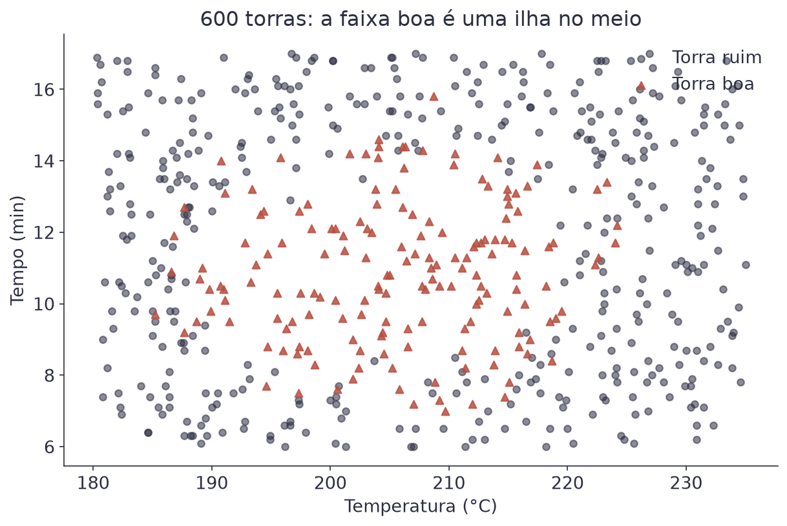
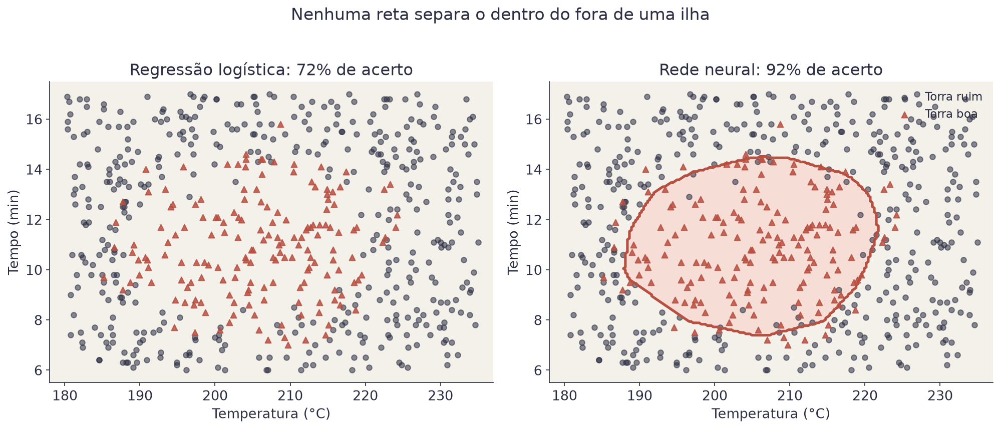
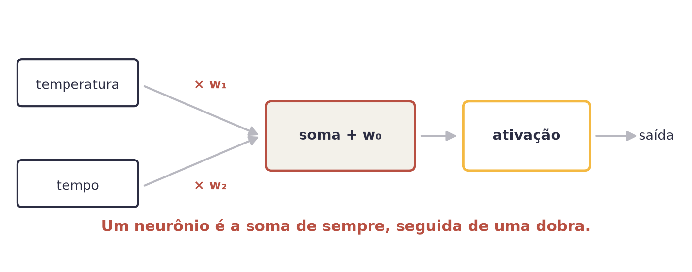
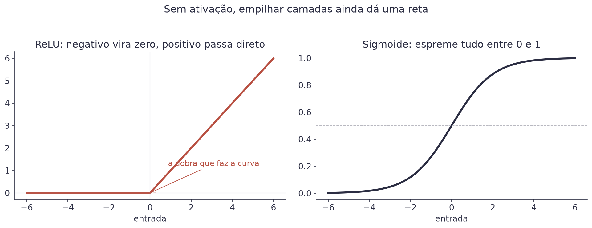
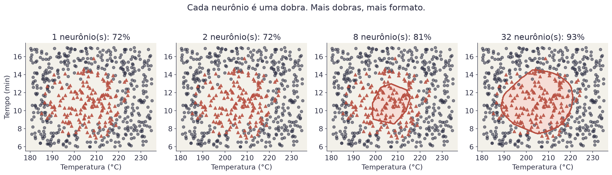
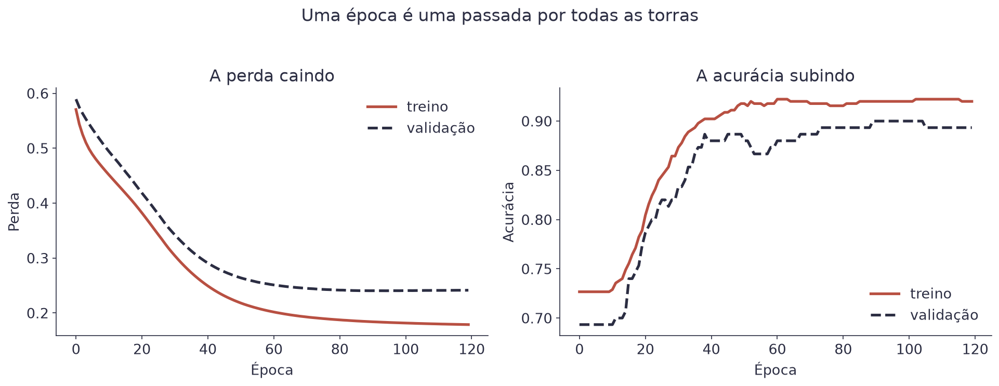
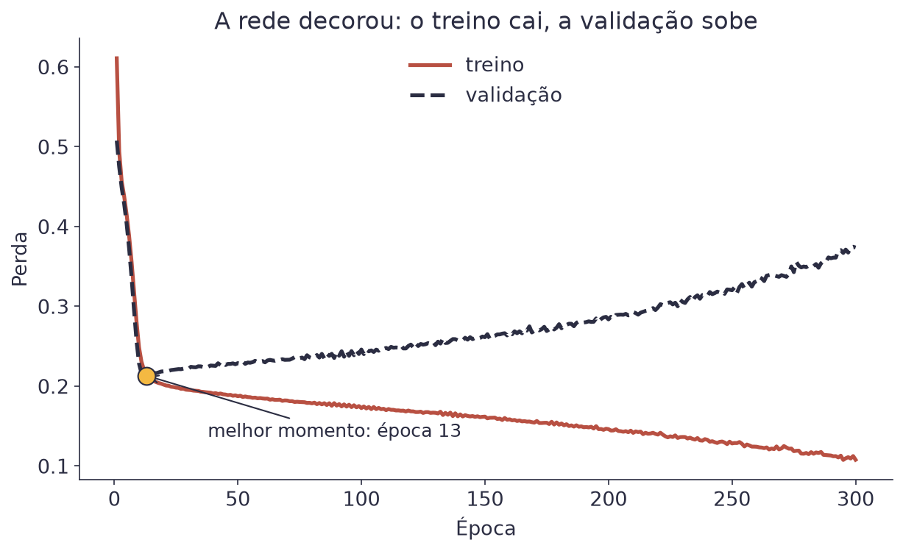
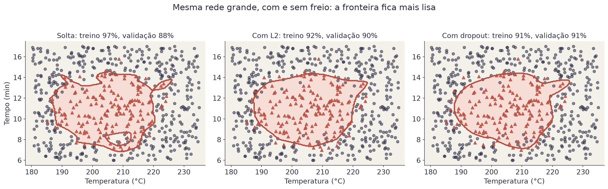
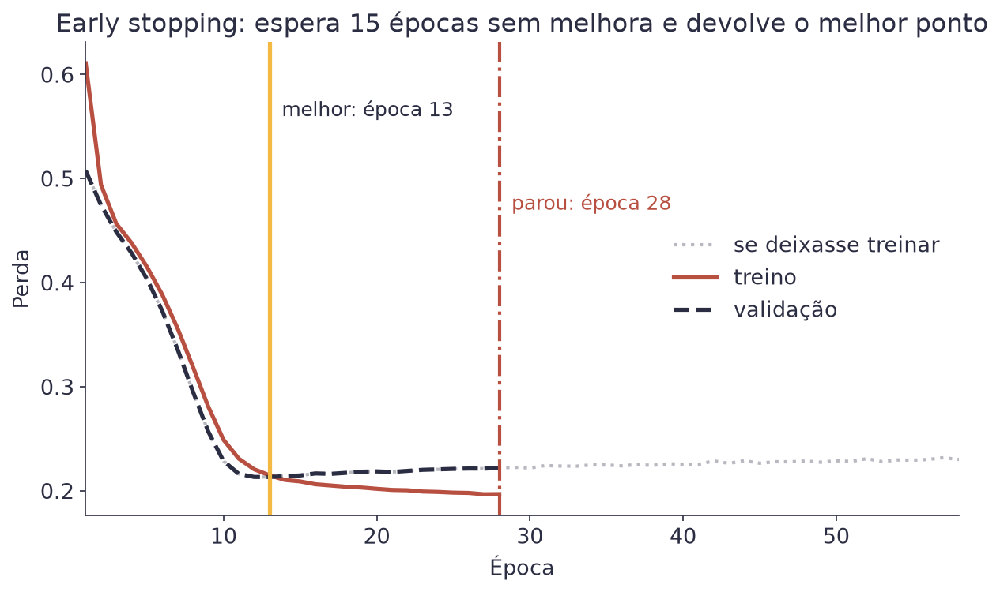
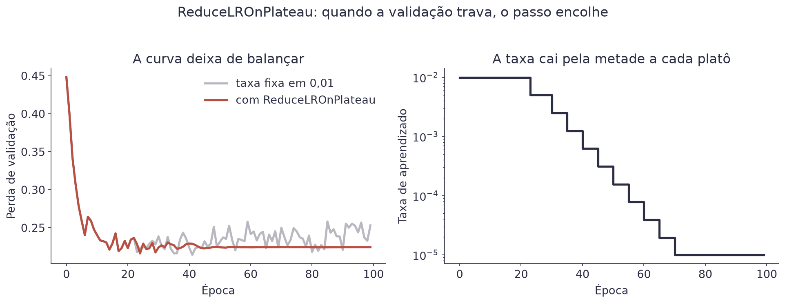

# Aula 7 — Fundamentos de Redes Neurais


**O que você leva desta aula**

Você vai entender o que é um neurônio (spoiler: é a soma da Aula 2 com uma
dobra em cima), por que empilhar neurônios resolve problemas que uma reta
não resolve, e como treinar uma rede em cinco linhas de Keras. Vai ver
também como segurar uma rede que decora, com L2 e dropout, e como deixar o
treino em piloto automático com callbacks.


## Para que serve

O Clube do Café torra os próprios grãos. Cada torra tem dois botões: a
temperatura do tambor e o tempo. Errar qualquer um dos dois estraga o lote.

Quente demais queima. Frio demais deixa o grão verde. Rápido demais não
desenvolve o açúcar. Devagar demais amarga. O ponto bom fica numa faixa no
meio, e é isso que o gráfico mostra:

<figure><figcaption>600 torras. As boas formam uma ilha, não uma metade.</figcaption></figure>

Olhe para essa figura e tente traçar uma reta que separe os triângulos dos
círculos. Não existe. É essa impossibilidade que abre o assunto de hoje.

## Por que a reta não basta

Vamos provar. Treine uma regressão logística nesses dados, do jeito da
Aula 3, e olhe o que ela decide.

<figure><figcaption>A logística desiste e chuta "ruim" para todo mundo. A rede fecha a ilha.</figcaption></figure>

A regressão logística acertou 71,8% das torras. Parece razoável até você
comparar com o modelo preguiçoso da Aula 3: como 71,8% das torras são
ruins, responder "ruim" para todo mundo dá exatamente os mesmos 71,8%.

Ela não aprendeu nada. E não é culpa dela: a fronteira que ela sabe
desenhar é uma reta, e nenhuma reta separa o dentro do fora de uma ilha.

A rede neural da direita, com duas camadas de 16 neurônios, chega a 91,8%.
A diferença não está no esforço nem nos dados. Está no formato da
fronteira que cada modelo consegue desenhar.

## O que é um neurônio

Aqui está a boa notícia: você já sabe o que é.

<figure><figcaption>Entrada vezes peso, soma, e uma dobra no fim.</figcaption></figure>

$$a = f(w_0 + w_1 x_1 + w_2 x_2)$$

| Símbolo | Significado |
|---|---|
| `x₁`, `x₂` | as entradas: temperatura e tempo |
| `w₁`, `w₂` | os pesos, iguais aos das aulas de regressão |
| `w₀` | o viés (*bias*), o mesmo termo independente de sempre |
| `f` | a função de ativação: a dobra |
| `a` | a saída do neurônio, que vira entrada do próximo |

Compare com a regressão logística da Aula 3: `P = σ(w₀ + w₁x₁ + w₂x₂)`. É a
mesma conta. **Um neurônio com ativação sigmoide é uma regressão
logística.** Uma rede neural é um monte deles, empilhados.

Exemplo com números: se `w₀ = −3`, `w₁ = 0,02`, `w₂ = 0,1`, uma torra de
205 °C e 11 minutos dá `−3 + 4,10 + 1,10 = 2,20` antes da ativação.

## A dobra: funções de ativação

Se a ativação não existisse, empilhar camadas não adiantaria nada. Somar
retas dá reta, e você voltaria ao problema do começo.

<figure><figcaption>A ReLU é a dobra mais usada hoje. A sigmoide você já conhece.</figcaption></figure>

$$\text{ReLU}(z) = \max(0, z)$$

| Símbolo | Significado |
|---|---|
| `z` | o resultado da soma, antes da ativação |
| `max(0, z)` | devolve `z` se ele é positivo, e 0 se é negativo |

Exemplo: `ReLU(2,20) = 2,20`. `ReLU(−1,4) = 0`.

Não parece grande coisa, mas é o suficiente. Cada neurônio com ReLU
introduz uma dobra na fronteira. Com dobras suficientes, a fronteira
contorna qualquer formato. Repare no salto entre 2 e 8 neurônios: é ali
que a fronteira deixa de ser uma reta.

<figure><figcaption>Com 1 ou 2 neurônios, nada muda. Com 8 aparece uma ilha pequena demais; com 32, o contorno certo.</figcaption></figure>

Onde usar cada uma, na prática:

| Onde | Ativação | Por quê |
|---|---|---|
| Camadas do meio | ReLU | rápida, e é a dobra que cria o formato |
| Saída, para sim ou não | sigmoide | devolve probabilidade entre 0 e 1 |
| Saída, para um número | nenhuma | o valor sai como está |

## A rede inteira, em cinco linhas

```python
modelo = keras.Sequential([
    keras.layers.Input(shape=(2,)),
    keras.layers.Dense(16, activation="relu"),
    keras.layers.Dense(16, activation="relu"),
    keras.layers.Dense(1, activation="sigmoid"),
])
```

Lendo de cima para baixo: entram 2 números, viram 16, viram 16 de novo, e
saem como 1 probabilidade. `Dense` quer dizer que **todo** neurônio da
camada recebe **todas** as saídas da camada anterior.

Essa rede tem 337 pesos. Você pode contar: 2×16+16 na primeira camada,
16×16+16 na segunda, 16×1+1 na saída. Cada um deles é um número que o
treino vai ajustar, exatamente como ajustava os dois pesos da Aula 1.

## Como ela aprende (é a Aula 1 de novo)

Nada de novo aqui, e vale dizer isso em voz alta:

| Peça | Na Aula 1 | Agora |
|---|---|---|
| O que ajusta | 2 pesos | 337 pesos |
| Função de perda | MSE | log loss (a da Aula 3) |
| Como ajusta | gradiente descendente | gradiente descendente |
| A regra | `w ← w − α · inclinação` | a mesma, para cada peso |

A perda usada para sim ou não é a **entropia cruzada binária**, que a Aula
3 já usava com outro nome:

$$\text{perda} = -\frac{1}{n}\sum_{i=1}^{n}\left[y_i \log(\hat{y}_i) + (1 - y_i)\log(1 - \hat{y}_i)\right]$$

| Símbolo | Significado |
|---|---|
| `yᵢ` | o rótulo real da torra `i`: 1 para boa, 0 para ruim |
| `ŷᵢ` | a probabilidade que a rede deu |
| `log` | o logaritmo, que castiga com força quem erra com confiança |

Exemplo: se a rede diz 0,9 para uma torra boa, a parcela dela é
`−log(0,9) = 0,105`. Se ela diz 0,1 para a mesma torra boa, a parcela vira
`−log(0,1) = 2,303`. Vinte e duas vezes pior.

A única novidade técnica é o nome do cálculo que distribui a culpa entre as
camadas: **retropropagação** (*backpropagation*). Ela responde "o quanto
cada um dos 337 pesos contribuiu para o erro" aplicando a regra da cadeia
de trás para frente. O Keras faz isso sozinho, e neste curso você não vai
implementá-la à mão.

## Época, lote e a curva de treino

Três palavras que aparecem em toda saída de treino:

| Palavra | O que é |
|---|---|
| Lote (*batch*) | quantos exemplos entram por vez antes de ajustar os pesos |
| Época (*epoch*) | uma passada completa por todos os exemplos |
| Passo | um ajuste dos pesos, feito uma vez por lote |

Com 600 torras e lote de 32, uma época tem 19 passos. Em 120 épocas, são
2.280 ajustes.

<figure><figcaption>A curva de treino é o painel de instrumentos: você olha para ela antes de olhar qualquer outra coisa.</figcaption></figure>

Repare que existem duas linhas em cada gráfico. A de treino usa as torras
que a rede viu; a de validação usa 25% que ela nunca viu. Enquanto as duas
caem juntas, está tudo bem. Quando a de validação para de cair e a de treino
continua, a rede começou a decorar. A próxima seção mostra como evitar isso.


**Erro do dia**

Treinar sem normalizar as entradas. Aqui a temperatura vai a 235 e o tempo
a 17: uma escala é catorze vezes a outra. A rede até aprende, mas devagar e
mal, porque o gradiente fica dominado pela variável de número maior. A
correção é uma linha, antes do treino: subtraia a média e divida pelo
desvio padrão de cada coluna. Faça isso **sempre** em rede neural.


## Quando a rede decora

Uma rede com liberdade demais faz o que o modelo simples nunca faria:
decora. Para ver isso, dê a ela três camadas de 128 neurônios, mais de 33
mil pesos, e só 420 torras para aprender. Separe outras 180 como
validação e treine por 300 épocas.

<figure><figcaption>O treino cai sem parar. A validação tem o melhor momento na época 13 e piora dali em diante.</figcaption></figure>

A perda de validação foi mínima na época 13, com 0,213. Na época 300 ela
estava em 0,374. A acurácia no treino chegou a 96,7%, e na validação ficou
em 87,8%. A rede parou de aprender o formato da ilha e passou a decorar o
ruído de cada torra.

A defesa se chama **regularização** (*regularization*): qualquer técnica
que torne decorar mais caro. Duas delas mexem na própria rede, o L2 e o
dropout. A terceira mexe no treino, e vem na próxima seção.

### L2: pesos pequenos

Você já conhece esse freio da Aula 2, onde ele aparecia como Ridge. Uma
rede que decora costuma ter pesos enormes, porque precisa de curvas
bruscas para encostar em cada ponto. O L2 soma à perda um castigo para cada
peso grande.

$$\text{perda total} = \text{perda} + \lambda \sum_{j} w_j^2$$

| Símbolo | Significado |
|---|---|
| `λ` | a força do castigo. Zero desliga o L2 |
| `wⱼ` | cada peso da rede. A soma passa por todos eles |

Na Aula 2 essa força se chamava `α`. Aqui ela é `λ` (lambda), para não
confundir com a taxa de aprendizado, que também é `α`.

Exemplo com `λ = 0,01`: dois pesos de 3 e −2 custam `0,01 × (9 + 4) = 0,13`.
Dois pesos de 0,5 custam `0,01 × (0,25 + 0,25) = 0,005`. Pesos pequenos
saem baratos, e a rede aprende a usá-los.

No Keras, o L2 é um argumento da camada:

```python
keras.layers.Dense(128, activation="relu",
                   kernel_regularizer=keras.regularizers.l2(0.001))
```

Com `λ = 0,001`, a perda de validação na época 300 caiu de 0,374 para
0,250.

### Dropout: neurônios sorteados

Imagine um time em que, a cada treino, alguns jogadores sorteados ficam no
banco. Ninguém pode depender de um único colega, e todos aprendem a
jogar bem com qualquer formação. O **dropout** faz isso com os neurônios.

A cada passo de treino, ele desliga ao acaso uma fração dos neurônios da
camada. Com `Dropout(0.3)`, 30% ficam em zero naquele passo, e outros 30%
no seguinte. É uma camada nova, que entra depois de cada `Dense`:

```python
modelo = keras.Sequential([
    keras.layers.Input(shape=(2,)),
    keras.layers.Dense(128, activation="relu"),
    keras.layers.Dropout(0.3),
    keras.layers.Dense(128, activation="relu"),
    keras.layers.Dropout(0.3),
    keras.layers.Dense(1, activation="sigmoid"),
])
```

O Keras só sorteia durante o treino. Na hora de prever, todos os neurônios
ficam ligados. Com dropout de 0,3, a perda de validação na época 300 foi de
0,257, e a acurácia de validação subiu de 87,8% para 91,1%.

<figure><figcaption>Mesma rede, mesmos dados. A solta desenha um buraco dentro da ilha. Com freio, a fronteira fica lisa.</figcaption></figure>

Dois pontos de partida para ajustar:

| Técnica | Ponto de partida | Aumente se |
|---|---|---|
| L2 | `λ` entre 0,0001 e 0,01 | a rede ainda decora |
| Dropout | taxa entre 0,2 e 0,5 | a rede ainda decora |

Se a rede passar a errar até no treino, você freou demais. Diminua o
valor. Duas defesas fora da rede também funcionam: uma rede menor, como a
da seção de capacidade, e mais dados, que é a mais forte e nem sempre está
ao seu alcance.

## Callbacks: o piloto automático do treino

Até aqui o treino foi cego: 300 épocas, aconteça o que acontecer. Um
**callback** é um objeto que o Keras chama ao fim de cada época. Ele olha as
métricas e decide algo, como parar o treino. Você entrega os callbacks ao
`fit`, numa lista:

```python
modelo.fit(entradas, alvo, epochs=300, validation_data=(entradas_val, alvo_val),
           callbacks=[callback_1, callback_2])
```

### EarlyStopping: parar quando não melhora mais

É a terceira defesa contra a decoreba. O `EarlyStopping` (parada antecipada)
acompanha a perda de validação. Se ela passa `patience` épocas sem bater o
recorde, o treino para.

<figure><figcaption>O melhor momento foi a época 13. Quinze épocas depois, sem recorde, o treino parou.</figcaption></figure>

```python
parar_cedo = keras.callbacks.EarlyStopping(
    monitor="val_loss", patience=15, restore_best_weights=True)
```

| Argumento | O que faz |
|---|---|
| `monitor` | a métrica que ele vigia. `"val_loss"` é a escolha de sempre |
| `patience` | quantas épocas sem recorde ele espera antes de parar |
| `restore_best_weights` | devolve os pesos da melhor época, e não os da última |

Sem o último argumento, você fica com os pesos de 15 épocas depois do
melhor ponto, um pouco piores. Esquecer dele é o erro mais comum com este
callback.

Neste exemplo o treino parou na época 28, de 300 possíveis, com perda de
validação de 0,213 e acurácia de 91,1%. Economizou 90% do tempo, e ficou
melhor que a rede solta.

Há um cuidado. Como você escolhe o ponto de parada olhando a validação, a
acurácia de validação fica um pouco otimista. Para um número final
honesto, guarde um terceiro pedaço dos dados, o teste, que ninguém olhou.

### ReduceLROnPlateau: encolher o passo quando trava

Lembra da regra da Aula 1, `w ← w − α · inclinação`? O `α` é a **taxa de
aprendizado** (*learning rate*), o tamanho do passo. Passo grande anda
rápido no começo. No fim, ele pula por cima do vale sem conseguir descer
até o fundo.

O `ReduceLROnPlateau` vigia a perda de validação. Quando ela trava por
`patience` épocas, ele encolhe o passo:

$$\alpha_{\text{novo}} = \alpha \times \text{fator}$$

| Símbolo | Significado |
|---|---|
| `α` | a taxa de aprendizado atual |
| `fator` | quanto ela encolhe a cada platô. Com 0,5, cai pela metade |

Exemplo com `α = 0,01` e fator 0,5: a taxa vai a 0,005 no primeiro platô,
a 0,0025 no segundo, e assim por diante, até o piso `min_lr`.

```python
reduzir_passo = keras.callbacks.ReduceLROnPlateau(
    monitor="val_loss", factor=0.5, patience=5, min_lr=0.00001)
```

<figure><figcaption>Com a taxa fixa em 0,01, a validação balança. Com a redução, ela assenta.</figcaption></figure>

O teste usou uma taxa propositalmente alta, 0,01, dez vezes a padrão do
Adam. A perda de validação final foi de 0,253 com a taxa fixa e de 0,224
com a redução. Com a taxa padrão, o ganho é menor: o callback é um seguro
contra passo grande demais.

### ModelCheckpoint: guardar o melhor modelo

O `EarlyStopping` devolve os melhores pesos na memória. Se o Colab
desconectar, eles somem. O `ModelCheckpoint` grava o modelo em arquivo
cada vez que a perda de validação bate um recorde:

```python
guardar_melhor = keras.callbacks.ModelCheckpoint(
    "melhor_rede.keras", monitor="val_loss", save_best_only=True)
```

Depois, em qualquer notebook, você carrega o modelo e usa sem treinar de
novo:

```python
modelo = keras.models.load_model("melhor_rede.keras")
```

### Os três juntos

A regra que faz os callbacks combinarem: o `ReduceLROnPlateau` espera
**menos** que o `EarlyStopping`. Primeiro a rede tenta andar com passos
menores. Só depois o treino desiste.

```python
reduzir_passo = keras.callbacks.ReduceLROnPlateau(
    monitor="val_loss", factor=0.5, patience=8, min_lr=0.00001)
parar_cedo = keras.callbacks.EarlyStopping(
    monitor="val_loss", patience=25, restore_best_weights=True)
guardar_melhor = keras.callbacks.ModelCheckpoint(
    "melhor_rede.keras", monitor="val_loss", save_best_only=True)

modelo.fit(entradas_treino, alvo_treino, epochs=300,
           validation_data=(entradas_val, alvo_val),
           callbacks=[reduzir_passo, parar_cedo, guardar_melhor])
```

Com dropout na rede e esses três callbacks, o treino parou na época 68, e
o melhor modelo ficou com perda de validação de 0,208.

Outros callbacks que valem um minuto de leitura:

| Callback | O que faz |
|---|---|
| `LearningRateScheduler` | muda a taxa de aprendizado por uma receita sua, época a época |
| `CSVLogger` | grava as métricas de cada época num arquivo CSV |
| `TensorBoard` | grava um painel interativo do treino |
| `TerminateOnNaN` | para o treino se a perda virar `nan` |

## Quando a rede não é a resposta

A rede venceu por 20 pontos aqui, mas isso não é regra.

| Situação | O que costuma ganhar |
|---|---|
| Fronteira reta, poucas variáveis | regressão logística, que é mais simples de explicar |
| Tabelas grandes, muitas colunas | árvores e florestas, que quase sempre batem redes |
| Imagem, áudio, texto | redes, com folga |
| Poucos dados (centenas de linhas) | modelos simples: rede grande decora |

A rede tem uma desvantagem que importa: ela não te dá um coeficiente para
interpretar. Na Aula 2 você lia "cada m² soma R$ 25". Aqui não existe frase
equivalente. Você ganhou formato e perdeu explicação.

## Materiais

- **Notebook desta aula, no Google Colab:** [](https://colab.research.google.com/github/klein-natan/nanodegree-AI-Atitus/blob/main/notebooks/aula-07-redes-neurais.ipynb)
- Slides desta aula: entregues em sala.
- Dataset: [`torra_cafe.csv`](https://github.com/klein-natan/nanodegree-AI-Atitus/blob/main/data/torra_cafe.csv)

## Para ir além

- [Guia do Keras Sequential](https://keras.io/guides/sequential_model/): a documentação oficial, com exemplos curtos.
- [Playground de redes neurais](https://playground.tensorflow.org/): desenhe fronteiras no navegador, mexendo em camadas e ativações com o mouse.
- [But what is a neural network? (3Blue1Brown)](https://www.youtube.com/watch?v=aircAruvnKk): o vídeo que mais gente usou para entender o neurônio pela primeira vez. Em inglês, com legendas.
- [Glossário](../glossario.md): para revisar qualquer termo novo desta aula.
